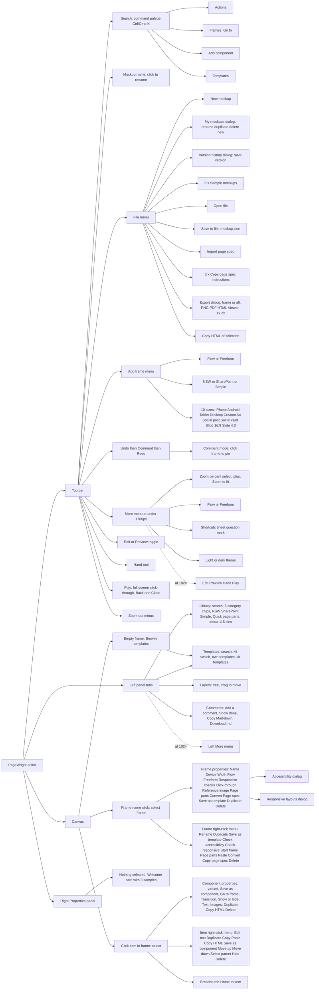
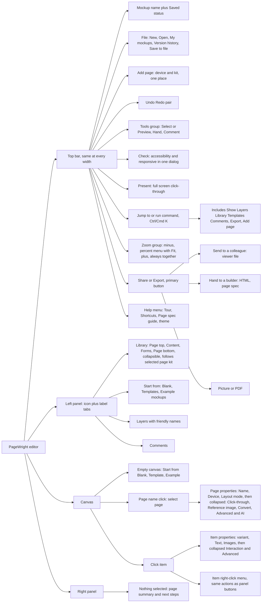

# PageWright design and usability review

Date: 27 October 2026. Build reviewed: `main` at commit 49f4abe (Pages build on port 4173 and the single file from disk). Method: eleven independent reviewers (nine lenses plus two task-walkthrough passes), each starting fresh from the same brief and driving the running app with Playwright; every finding was then merged and the high-impact ones re-run by me. Nothing in the app was changed.

## Executive summary

**Verdict: a strong, fast foundation that is not yet release-ready for its primary user.** Building a page works in under a minute, undo and drag feedback are good, hostile files are handled safely, exports are correct and nothing leaves the device. But the editor cannot be used without a mouse (S1), there are quiet ways to lose work, the top bar hides and moves important controls as the window changes, and the app talks to a newcomer in developer language ("frame", "Flow/Freeform", "page spec") without a clear first step. These are fixable in small milestones; none needs a redesign of the document model.

Findings after merging and verification: **186** (2 S1, 40 S2, 121 S3, 23 S4), grouped into 16 cross-cutting themes. Two reviewer findings were dropped because I could not reproduce them (performance numbers taken while ten other browsers were running), and two were re-rated down. The two S1 entries are the same keyboard problem seen from two angles (theme T1).

### Scorecard (1 to 5)

| Lens | Score | Why |
|---|---|---|
| Navigation and information architecture | 3 | Solid structure (clear tabs, rich context menus, graceful overflow) but hand-off is buried, controls are duplicated or split at common laptop and tablet widths, and specialist items clutter menus and panels for the first-time user. |
| Interaction design | 3.5 | Core drag, edit, undo and pan all work and give good feedback; the weaknesses are a shifting toolbar, no edge auto-scroll, structural jargon in selection, and late refusal cues. |
| Visual design of the editor UI | 3 | Coherent, polished layout with working light/dark themes and good empty states, but contrast failures on the primary button and placeholders, a fragmented 10-17px type scale, emoji/glyph icons, a hard-coded second palette and a glass look that contradicts the stated flat brief. |
| Kit fidelity and clarity | 3.5 | NSW and SharePoint templates look convincing and the kit guards exist, but fidelity gaps (static components, no logo/mega-menu), Simple kit spacing and low-contrast accents, and weakly signposted cross-kit recovery hold it back. |
| Accessibility of the editor (WCAG 2.2 AA) | 2 | Strong focus rings, dialogs, reduced motion and language, but the core build loop (selecting an item, frames, Properties, menus, tabs) cannot be done by keyboard or screen reader, there are no landmarks, and primary buttons fail contrast. |
| Content and microcopy | 3 | Mostly plain, Australian-spelt and consequence-aware, but undermined by frame/screen/page drift, Flow/Freeform/page spec/kit jargon, repeated Shrink text to fit fields, and a false-success import report. |
| Onboarding and learnability | 3 | Quick to a first page and a good template gallery and tour mechanics, but no clear call to action, tips that point at nothing, hidden help, silent insertion rules and an empty state that is unreadable. |
| Responsiveness and performance | 3 | Fast load, small memory and a layout that never scrolls the page, but the toolbar and panels give up the work area below about 1300 px and at 200% zoom, touch has no pan, pinch or long-press, and many targets are small. (The reviewer's low frame rates were not reproduced on a quiet machine: see Findings not reproduced.) |
| Trust and safety | 3 | Strong hostile-file handling, non-destructive conversions, named confirmations with Cancel focused and one-step undo; held back by a 700 ms reload data-loss window with no beforeunload, silent last-writer-wins across tabs, no New-mockup safeguard, and the viewer file leaking review comments. |
| Task walkthroughs 1 to 7 | 3.5 | All 7 tasks are achievable in under a minute of scripted time and the drag, undo and template experience is strong, but the obvious route often fails or lands wrongly (insertion point, Simple kit disabled, SharePoint chrome hidden in a long panel, search synonyms). |
| Task walkthroughs 8 to 13 | 3 | Every task is completable and the exports are correct, but the prototype, SharePoint outputs and conversion detail are hard to discover, and keyboard-only editing of existing content is impossible. |

Overall: **3.0 / 5** (mean of the nine lenses). Accessibility is the weakest lens (2/5); interaction and kit fidelity are the strongest (3.5/5).

### Top 10 issues

1. **Content cannot be selected or operated from the keyboard** (S1). Canvas items and Layers rows are not focusable and Enter/Space select nothing, so a keyboard user can add things but never select, edit, move or delete anything already on the page.
2. **Work can be lost silently** (S2). A reload within about half a second of an edit drops it (autosave debounces and only flushes on visibilitychange; no beforeunload).
3. **Click-to-add puts things in the wrong place, and rows are hard to make** (S2). Click-to-add inserts after the current selection (or inside it).
4. **The top bar drops and moves key controls** (S2). At 1280x720 a lone "−" stays on the bar while the zoom level, "+" and Zoom to fit are in More; at 1440 Zoom to fit, Flow/Freeform, help and the theme toggle are hidden; at 1024 Edit/Preview, Play and Hand are hidden and the left tabs collapse to Library plus a second More; at 200% zoom only Search, File and More remain.
5. **Primary colours and Simple accents fail contrast** (S2). White on the primary blue measures 3.65:1 in dark (rgb 10,132,255) and about 4.0:1 in light, below 4.5:1, affecting Add frame, frame-name chips and dialog primaries.
6. **Export, share and convert are hard to find and understand** (S2). There is no Share or Export button: Export is File > Export (three clicks), and the shareable viewer file is the fourth radio in the dialog.
7. **The same things have different names** (S2). Frame, screen and page all name the same object (the tour says "Build a screen"; the toolbar says "Add frame").
8. **The first screen does not say what to do, and help disappears** (S2). The brightest control is "+ Add frame", which adds a second empty frame; samples are in the Properties panel; the empty-frame prompt is tiny; the tour card sits over the lower canvas, points at nothing and never advances on real actions; there is no Help menu or tour replay (only "?" inside More); Play on an empty mockup shows a blank page.
9. **Choosing another kit in the Library leads to a dead end** (S2). Selecting SharePoint or Simple in the Library while an NSW frame is selected disables 70 tiles under a message ("This is an NSW frame — switch the library to NSW, or convert the frame") that has no buttons; tooltips on disabled tiles still say "Add…", and dropping into the other kit gives no refusal cue until release..
10. **Narrow windows, zoom and touch** (S2). At 200% zoom the canvas is 96px wide and the bar is Search, File, More.

### Top 5 strengths to protect

1. **Safe with hostile and large input.** Malformed JSON, `__proto__` keys, script in names and text, SVG and a 30 MB file were rejected or sanitised with plain messages, and a whole session made zero third-party requests (no API key anywhere).
2. **Direct manipulation feels right.** Esc cancels a drag cleanly, tab-through text editing is one undo step, delete and delete-frame undo in one step, Space-drag and the H hand tool pan, and the freeform Position panel is precise.
3. **Templates and kits are convincing.** Template thumbnails match what you get, NSW markup renders cleanly across all 23 templates, SharePoint templates read as SharePoint Online, and every frame carries a kit badge.
4. **Exports are correct and portable.** The PNG is exactly the frame size (393x852, or 786x1704 at 2x), the PDF opens, the HTML and viewer file work offline from disk with no external requests, build notes read like the SharePoint UI and a page spec re-imports cleanly.
5. **Fast and light.** First paint 524 ms on Pages and 704 ms for the 2.4 MB single file offline, selection in 15 to 83 ms, a 10-frame import renders in 1.5 s and undoes in 81 ms, heap about 21 MB with a large document.

## Task walkthrough results

Times and counts come from scripted runs by a reviewer acting as a first-time user (they include failed first attempts, so treat them as relative, not as human times). "Best case" is the shortest route found afterwards.

| # | Task | Seconds | Interactions | Success | Best case | Main sticking point |
|---|---|---|---|---|---|---|
| 1 | First run: make anything | 15 | 5 | yes | 1 | None for the first step; the tour card covers the page and the hero went above the header after masthead was selected |
| 2 | NSW service landing page, desktop then phone | 22 | 20 | yes | 15 | Click-to-add insertion point and getting three cards side by side |
| 3 | SharePoint communication site home | 43 | 14 | yes | 12 | Theme, header, mega menu and footer are Frame-panel settings not found by search |
| 4 | Simple kit page | 9 | 10 | yes | 8 | Library Simple toggle disables everything on an NSW frame |
| 5 | Template, edit text/images, reorder two sections, delete one | 7 | 12 | yes | 8 | Canvas text editing at fit zoom; sections are all named Section |
| 6 | Mistake and recover | 17 | 22 | yes | 2 | None; undo/redo and drag-fix work (Ctrl+Z, Ctrl+Shift+Z, Ctrl+Y, buttons) |
| 7 | Find "the thing with the expandable rows" | 8 | 9 | partly | 2 | Search misses "expandable"; "expand", "faq", "collapse" work |
| 8 | Turn a three-frame mockup into a click-through prototype and preview it | 9 | 8 | yes | 7 | Nothing on the canvas or in Play says how to link frames; the Go to frame control only appears after selecting a button or card. |
| 9 | Save, close, reopen; My mockups; duplicate; open a saved file | 25 | 9 | yes | 7 | Which 'save' is real: top-bar 'Saved' (browser only) versus File > Save to file; the wording does not separate them. |
| 10 | Export PNG, HTML, SharePoint build notes, page spec, PDF, viewer file and check each | 22 | 22 | partly | 16 | Build notes and page spec are not in the Export dialog; found only by right-clicking the frame name (TASK-B-09). |
| 11 | Import a page spec (valid and invalid) and trace over a reference screenshot | 30 | 16 | yes | 12 | Reference image controls are at the bottom of Frame properties and need scrolling to find. |
| 12 | Convert a frame NSW to SharePoint and back; understand what changed | 8 | 6 | partly | 3 | The summary gives counts and one 'Not converted' item, not what each part became. |
| 13 | Keyboard only: build a small page (add frame, components, edit text, move, undo, menus, palette) | 9 | 120 | partly | 60 | No way to select an existing component by keyboard (TASK-B-16). |

Task 13 (keyboard only) is the clearest failure: nothing already on the page can be selected, so only adding is possible (see theme T1).

## Cross-cutting themes

Findings from all lenses, merged. Each theme lists the finding ids it closes.

### T1. Content cannot be selected or operated from the keyboard (S1, effort L)

Findings: A11Y-01, TASK-B-16, A11Y-05, A11Y-02, A11Y-03, TASK-B-17, A11Y-18, A11Y-06, A11Y-11, A11Y-14

Canvas items and Layers rows are not focusable and Enter/Space select nothing, so a keyboard user can add things but never select, edit, move or delete anything already on the page. Frame names (rename, move, context menu, accessibility check) are plain divs. The left tabs lost their tablist parent in the overflow change and have no arrow keys; the File and Add frame menus say role=menu but arrow keys do nothing (focus stayed on "File" after two ArrowDowns); there is no skip link, landmark or h1 (about 150 Tab stops to reach Properties).

**Recommendation.** Make the Layers tree a real roving-tabindex tree (arrows, Enter to select, Delete, Alt+arrows to move), make frame names buttons, restore tablist/arrow keys, give menus proper menu keyboard behaviour, add a skip link and landmarks. As Figma does: Tab into the layers list and arrow through it.

### T2. Work can be lost silently (S2, effort M)

Findings: TRUST-01, TRUST-02, TRUST-05, TRUST-07, TRUST-10, TRUST-12, COPY-12, INT-13, TASK-A-18, TRUST-03, TRUST-04, TRUST-06, TRUST-11, TRUST-09

A reload within about half a second of an edit drops it (autosave debounces and only flushes on visibilitychange; no beforeunload). Two tabs on the same mockup overwrite each other and both read "Saved" (tab B's button was gone after tab A saved). File > New mockup replaces the page with no confirmation or toast and Undo is disabled. Deleting a frame with content, deleting a version, and opening a file give no confirmation or feedback. Storage warnings reuse one message and never clear. All are recoverable in some way (My mockups, Undo for delete frame) but none says so.

**Recommendation.** Flush on pagehide/beforeunload and show unsaved state; detect other tabs (BroadcastChannel or storage events) and warn or read-only the second; make New mockup undoable or confirm it; add an Undo toast to every destructive action, as Google Docs and Figma do; say where "Saved" means (this browser).

### T3. Click-to-add puts things in the wrong place, and rows are hard to make (S2, effort M)

Findings: ONB-01, TASK-A-01, TASK-A-02, TASK-A-16, INT-07, TASK-A-09, ONB-18

Click-to-add inserts after the current selection (or inside it). Reproduced: Add masthead + header, then Heading and three Cards, then Add footer gave masthead, section, header, footer. Three cards land stacked in one column (positions y=24, 509, 993) and getting a row needs the Grid selected through the breadcrumb and its "+" pressed. Empty columns are about 20px drop targets at fit zoom. The selection path exposes Section / Container / Grid / Column, and Esc takes five presses to reach the frame.

**Recommendation.** Add an explicit insertion model: a visible "Add to: [target]" indicator, page parts always go to top/bottom, content goes to the end of the nearest section, and a "Row of 3" layout option on repeated items. Hide Container/Grid layers behind an Advanced switch. As Webflow shows the insertion point before you click.

### T4. The top bar drops and moves key controls (S2, effort M)

Findings: NAV-03, NAV-04, NAV-05, INT-01, INT-03, VIS-03, ONB-12, PERF-03, PERF-04, PERF-10, VIS-04, COPY-03, TASK-B-19, INT-12, NAV-18

At 1280x720 a lone "−" stays on the bar while the zoom level, "+" and Zoom to fit are in More; at 1440 Zoom to fit, Flow/Freeform, help and the theme toggle are hidden; at 1024 Edit/Preview, Play and Hand are hidden and the left tabs collapse to Library plus a second More; at 200% zoom only Search, File and More remain. Hidden items are chosen by their position, not importance, and the More menu is unlabelled. The bar also shifts about 100px on every autosave (Add frame x moves 464 to 566 and back) because the status text changes width.

**Recommendation.** Give the bar fixed zones (document, history, mode, view) with a reserved-width status, move zoom to a stable corner of the canvas (as Figma does), group Help/Theme/Layout under a labelled menu, and make overflow priority explicit so Edit/Preview, Play and Share never hide.

### T5. Primary colours and Simple accents fail contrast (S2, effort S)

Findings: VIS-01, A11Y-04, A11Y-09, KIT-01, VIS-16, VIS-17

White on the primary blue measures 3.65:1 in dark (rgb 10,132,255) and about 4.0:1 in light, below 4.5:1, affecting Add frame, frame-name chips and dialog primaries. Search placeholders are about 3:1 (dark) and 2.4:1 (light). In the Simple kit, white button text on Green, Orange and Teal accents is 3.3, 3.56 and 3.74:1.

**Recommendation.** Darken the primary and chip colours to reach 4.5:1, lift placeholder and muted text tokens, and have the Simple kit choose dark text when white fails (it already picks ink by luminance; raise the threshold to a WCAG contrast test).

### T6. Export, share and convert are hard to find and understand (S2, effort M)

Findings: NAV-01, TASK-B-09, NAV-08, COPY-07, COPY-17, TASK-B-10, TASK-B-20, KIT-05, TASK-B-14, TASK-B-15, NAV-09, TASK-B-05, TASK-B-08

There is no Share or Export button: Export is File > Export (three clicks), and the shareable viewer file is the fourth radio in the dialog. Page spec and SharePoint build notes are not in the Export dialog at all (only the frame right-click menu). Convert to SharePoint is only in the right-click menu and is disabled on an empty frame with no reason. The convert summary gives counts, not what each part became, and the converted copy lands about 20px from the original so labels collide. The PDF uses phone-sized pages.

**Recommendation.** A top-bar "Share / Export" button opening one dialog that lists every output with its purpose (image, PDF, web page, viewer file, build notes, page spec); a Convert section in the Frame panel with a before/after list; paper-size option for PDF.

### T7. The same things have different names (S2, effort S)

Findings: COPY-01, COPY-02, COPY-11, NAV-16, NAV-02, TASK-B-04, NAV-06, COPY-14, COPY-16, COPY-18, COPY-20, COPY-21, NAV-15

Frame, screen and page all name the same object (the tour says "Build a screen"; the toolbar says "Add frame"). Preview, Play and click-through are three names for related ideas, and Preview opens the same full-screen overlay as Play. Flow and Freeform are unexplained (hover only). Section / Container / Grid / Column, "fold", "kit", "page spec" and "Claude chat" are developer language. Samples and templates are offered in four places under three names.

**Recommendation.** Adopt one glossary (proposed in the Content section: Page, Template, Sample, Preview/Present, Layout, Row, Column). Rename Flow/Freeform to "Structured / Free layout" with a one-line explanation shown where chosen.

### T8. The first screen does not say what to do, and help disappears (S2, effort M)

Findings: ONB-05, ONB-04, ONB-02, ONB-03, ONB-06, ONB-07, ONB-09, ONB-10, ONB-11, ONB-14, ONB-15, ONB-16, ONB-17, TASK-A-14, TASK-B-02, TASK-A-10, TASK-B-12

The brightest control is "+ Add frame", which adds a second empty frame; samples are in the Properties panel; the empty-frame prompt is tiny; the tour card sits over the lower canvas, points at nothing and never advances on real actions; there is no Help menu or tour replay (only "?" inside More); Play on an empty mockup shows a blank page. Using a template leaves the stray empty Home frame beside it.

**Recommendation.** A start screen (blank page, templates, samples, import) replacing the Welcome card, a Help menu with Replay tour/Shortcuts/Glossary, a tour anchored to the controls it names, and a hint when Play has nothing to play. Remove or reuse the empty starter frame when a template is chosen.

### T9. Choosing another kit in the Library leads to a dead end (S2, effort S)

Findings: NAV-07, KIT-04, TASK-A-04, INT-05

Selecting SharePoint or Simple in the Library while an NSW frame is selected disables 70 tiles under a message ("This is an NSW frame — switch the library to NSW, or convert the frame") that has no buttons; tooltips on disabled tiles still say "Add…", and dropping into the other kit gives no refusal cue until release.

**Recommendation.** Make the notice actionable ("Add a SharePoint frame" / "Convert this frame"), or let the Library follow the selected frame and offer kit choice only when adding a frame.

### T10. Narrow windows, zoom and touch (S2, effort L)

Findings: PERF-05, A11Y-07, A11Y-08, PERF-07, VIS-14, PERF-12, PERF-11, PERF-06, INT-11, PERF-08

At 200% zoom the canvas is 96px wide and the bar is Search, File, More. From 1280 to 1699 the panels keep about 630px, leaving a 600px canvas. On touch, tile drag works but one-finger pan, pinch zoom and long-press do nothing, and the on-canvas hint is mouse-only. Many controls are 20 to 32px tall. After a large import the fit zoom is 12 to 29%.

**Recommendation.** Collapsible side panels (Figma-style) with a keyboard shortcut, touch gestures (pan, pinch, long-press menu), minimum 32px targets (44px on touch), and a reflowing layout below 800px.

### T11. Properties panels are long and put the least useful things first (S3, effort M)

Findings: NAV-10, NAV-11, INT-09, TASK-A-15, KIT-10, TASK-A-06, COPY-04, ONB-13, TASK-A-17, COPY-05, KIT-06, KIT-09, TASK-A-07, TASK-B-13, COPY-22

Component panels start with go-to-frame, link address and "Save as component" before the text fields. "Shrink text to fit" repeats 22 times in the footer panel, whose fields are labelled "G 1LINK 1". SharePoint frame settings are 60+ controls in one scroll that keeps its scroll position into the next selection. Colour swatches are unlabelled; red "Turn on…" messages are permanent; column-width selects show "— 1".

**Recommendation.** Text first, then appearance, then behaviour; collapse specialist groups; one per-component "Shrink text" switch; human field labels; label swatches.

### T12. Search and discovery in the Library (S3, effort M)

Findings: TASK-A-11, TASK-A-05, NAV-12, NAV-14, NAV-19, ONB-17, VIS-11, A11Y-13, NAV-17

Library search finds nothing for "expandable" or "expandable rows" (it finds "expand", "faq", "collapse"); SharePoint theme, header and mega menu cannot be found by search at all; Ctrl+K "theme" offers only the editor theme; the Library is one very long scroll of 115+ tiles under chips that duplicate its headings.

**Recommendation.** Add synonyms to the catalogue, index frame settings in the palette, make the palette navigate (open panels, jump to settings), and show category headings as an index.

### T13. Prototype links are invisible (S3, effort S)

Findings: TASK-B-01, TASK-B-03, TASK-B-02, ONB-11

Click-through links show no marker on the canvas; Esc stops closing Play after you click inside the page (reproduced: the player stayed open); Play with no links shows a static page without a hint.

**Recommendation.** Show link badges on the canvas, close Play on Esc at all times, and add an empty-state hint.

### T14. Editor visual system (S3, effort L)

Findings: VIS-02, VIS-05, VIS-06, VIS-07, VIS-08, VIS-09, VIS-10, VIS-12, VIS-13, VIS-15, NAV-17, TASK-B-06, TASK-B-21, A11Y-12

Type is small and fragmented (measured: 17/16/15/14/13/12/11/10px, with 14 elements at 10px and 112 at 12px; no type tokens). Icons are text glyphs, an emoji and an icon font. The glass look conflicts with the stated flat aesthetic (owner decision) and makes menus see-through. Hard-coded colours and px values bypass tokens. Toasts cover the hint bar, vanish after 5 seconds and are not reliably announced.

**Recommendation.** A token pass (type scale, icon set, solid menu surfaces), then an owner decision on the glass look versus a flat theme option.

### T15. Canvas and frame handling (S3, effort M)

Findings: INT-02, INT-04, TASK-A-03, TASK-A-08, NAV-13, ONB-08, TASK-A-20, INT-06, INT-08, INT-10

There is no auto-scroll while dragging near the canvas edge (confirmed: no such code); a new frame is not scrolled into view; zoom jumps to the middle of the page; frame labels collide at low zoom; the selection tag covers the first line of the item; library thumbnails go blank briefly after edits; the zoom menu lists both 75% and 76%.

**Recommendation.** Edge auto-scroll, scroll-to-new-frame, zoom around the cursor, label truncation, move the selection tag above the item.

### T16. Kit polish (S3, effort M)

Findings: KIT-02, KIT-03, KIT-07, KIT-08, KIT-11, KIT-12, KIT-13, KIT-14

NSW templates have crowded spacing (headings 0 to 8px under blocks, link arrows touching text); the header shows "LOGO PLACEHOLDER"; bare components touch each other; Simple landing template has mixed alignment; some thumbnails render blank at first.

**Recommendation.** Spacing pass on templates; neutral logo placeholder; default vertical rhythm for bare components.

## Findings by lens

Verification: "reproduced by me" means I re-ran the steps in the running Pages build and saw the same result. The others were reproduced by the reviewer with a screenshot and spot-checked against it, but not independently re-run.

### Navigation and information architecture

Score 3/5. Solid structure (clear tabs, rich context menus, graceful overflow) but hand-off is buried, controls are duplicated or split at common laptop and tablet widths, and specialist items clutter menus and panels for the first-time user.

#### NAV-01 · S2 · Hand-off (export, share) is buried inside File, with no Share/Export button

- **Principle:** Nielsen: match with the real world; information scent; Fitts (primary goal has no prominent target)
- **Where / steps:** Top bar > File > Export… (3 clicks to start, 4 to finish). Palette query "share" returns "Copy page spec instructions" and unrelated "Utility list" components, not Export.
- **Evidence:** screens/NAV-01.png (Export dialog: the shareable "Viewer file (to share)" is the fourth radio under FORMAT). m-file-1280.png shows Export… as the 12th row of File. (screenshot: `screens/NAV-01.png`)
- **Impact:** The persona must "show colleagues and hand to a builder". The two outcome actions (a link or file to share, a file for the builder) are not on the surface. Users look for Share/Export top right (Figma Share, Canva Share, Framer Publish) and find only File, which they associate with saving.
- **Recommendation:** Add a primary-coloured "Share / Export" button at the right end of the bar that opens the existing Export dialog, with "Viewer file (to share)" as the first and default choice and plain verbs ("Send to a colleague", "Hand to a builder (HTML)", "Picture (PNG/PDF)"). Add "share" and "download" as palette aliases.
- **Effort:** S · **Verification:** reproduced by me in the running app

#### NAV-02 · S2 · Preview, Play and the sample toast give three overlapping ways to click through, with unclear names

- **Principle:** Nielsen: consistency and standards; match with the real world
- **Where / steps:** Top bar: Edit | Preview segmented control, plus separate "▶ Play". Open File > Sample: Licence renewal journey; the toast says "Switch to Preview to click through it" while Play is the full-screen click-through.
- **Evidence:** sample.png shows the toast; play.png shows Play as a full-screen player with Back/Close. Preview keeps the editor chrome; Play removes it. Palette lists "Preview", "Play the click-through", "Edit mode" as three actions. (screenshot: `screens/NAV-02.png`)
- **Impact:** Users cannot predict which to press to see their mockup working. Edit/Preview is a mode of the canvas, Play is a viewer; the toast steers to the less complete one. Figma and Framer have one Present/Preview verb.
- **Recommendation:** Keep one verb. Rename to Edit | Preview and make "Play" a button labelled "Present" (full screen), or fold it into Preview with a full-screen icon. Make the toast say "Press Play to click through it". Describe each in its tooltip in one plain line.
- **Effort:** S · **Verification:** reproduced by its reviewer with a screenshot; spot-checked against screenshots, not independently re-run

#### NAV-03 · S2 · At 1280 the zoom controls are split: a lone unlabelled "−" stays on the bar while level, "+", Fit are in More

- **Principle:** Nielsen: consistency and standards; recognition rather than recall; Gestalt proximity
- **Where / steps:** 1280x720: top bar shows "−" (Zoom out) beside Play; open More for the zoom % select, "+", "Zoom to fit". At 1440 the % appears; at 1536 Fit appears; At 1760+ everything is inline.
- **Evidence:** NAV-03.png (More popover) and base-1280.png. The "−" has no title or text, only a glyph, 32x32. (screenshot: `screens/NAV-03.png`)
- **Impact:** A zoom control that is half on the bar and half in a menu is a broken group; the user sees minus with no plus or value. Fit-to-screen, the most used zoom action, is two clicks away at the commonest laptop size.
- **Recommendation:** Collapse whole groups, never split them: either show "−  61%  +" as one unit or put all in More. Always keep Zoom to fit visible (or give the zoom % a popover with Fit/100%). Give icon buttons an aria-label and tooltip.
- **Effort:** M · **Verification:** reproduced by me in the running app

#### NAV-04 · S2 · At tablet width (1024) Edit/Preview, Play and Hand vanish into More, and the left tabs Templates, Layers, Comments collapse behind a second "More"

- **Principle:** Hick (hides choices, but hides the core ones); Nielsen: flexibility and efficiency; WCAG 1.4.10 reflow intent
- **Where / steps:** 1024x768 hasTouch: top bar shows only Search, File, Add frame, Undo, Comment, Redo, More. Left panel shows "Library | More ▾".
- **Evidence:** NAV-04.png; w1024-leftmore.png shows the toolbar More holding Edit, Preview, Hand, Play, zoom, Flow/Freeform, ?, theme. (screenshot: `screens/NAV-04.png`)
- **Impact:** Two different "More" menus on one screen (top bar and left panel) with different contents. Play, the headline demo feature, is two taps away on a tablet, which is where colleagues will review.
- **Recommendation:** Prioritise by task not by position: keep Preview/Play and the Layers tab visible (icons with labels on tooltips), collapse Hand, zoom detail and theme first. Use distinct labels for the two overflows (for example "Panels" and "Tools") or switch the left panel to icon-only tabs.
- **Effort:** M · **Verification:** reproduced by me in the running app

#### NAV-07 · S2 · Library kit switch can show tiles that cannot be used, with a red error

- **Principle:** Nielsen: error prevention; recognition rather than recall
- **Where / steps:** Library tab > click "SharePoint" on a fresh NSW frame. Red banner: "This is an NSW frame — switch the library to NSW, or convert the frame." The SharePoint tiles stay visible and the sticky "TEXT AND MEDIA" header overlaps the first tile row.
- **Evidence:** NAV-07.png (banner in red, header text over tiles). Clicking a tile in this state adds nothing. (screenshot: `screens/NAV-07.png`)
- **Impact:** The user is invited to pick a tile that is then refused. The switch lets you into a state that does nothing; the fix ("convert the frame") is not a button.
- **Recommendation:** Make the library filter follow the selected frame (disable or grey the other kits with a tooltip), or when the user picks another kit offer "Add a new SharePoint frame" as a button. Show tiles only when usable. Fix the sticky header overlap.
- **Effort:** M · **Verification:** reproduced by me in the running app

#### NAV-05 · S3 · Help (?) and light/dark theme are hidden under More until the window is about 1760px wide

- **Principle:** Nielsen: help and documentation; recognition rather than recall
- **Where / steps:** 1280x720 and 1440x900: only reachable via More > ?. Present on the bar only at 1760 and 1920 (measured by widths 1024 to 1920).
- **Evidence:** NAV-05.png (1280 bar has no ? or theme). m-keys-1280.png shows the shortcuts sheet that only the hidden ? or the typed "?" key opens. (screenshot: `screens/NAV-05.png`)
- **Impact:** First-time users on a laptop have no visible help entry; the shortcut sheet is the only help and requires knowing the key. Cmd/Ctrl+K palette is also only labelled "Search".
- **Recommendation:** Keep a "?" Help icon pinned at the far right at all widths and make it open a small menu: Tour, Shortcuts, Page spec guide, About. Move theme into that menu or settings.
- **Effort:** S · **Verification:** reproduced by me in the running app

#### NAV-06 · S3 · Kit and Flow/Freeform choices are repeated in 4 to 6 places with different meanings

- **Principle:** Nielsen: consistency and standards; Hick; progressive disclosure
- **Where / steps:** Add frame menu (Flow|Freeform, NSW|SharePoint|Simple); Library tab kit switch; Templates tab kit switch; toolbar Flow|Freeform (>=1760) or More; Frame properties Flow|Freeform; palette "Make this frame Freeform".
- **Evidence:** NAV-06.png (Add frame menu carries both toggles above the device list). base-1920.png shows the toolbar toggle; props-frame2.png shows it again in Frame properties. (screenshot: `screens/NAV-06.png`)
- **Impact:** Two of the toggles set defaults for new frames (toolbar, Add frame menu), two switch the library or template list, one changes the selected frame. Nothing on the toggle says which. A public servant picks "Freeform" from the bar and then finds the selected frame unchanged.
- **Recommendation:** One home per decision: the Add frame menu (defaults for new frames), Frame properties (this frame), and the library follows the selected frame automatically. Remove the global Flow/Freeform from the bar, or label it "New frames:". Hide Freeform behind an Advanced note for the first-time persona.
- **Effort:** M · **Verification:** reproduced by its reviewer with a screenshot; spot-checked against screenshots, not independently re-run

#### NAV-08 · S3 · File menu mixes document, samples, hand-off and Claude-specific items; three near-identical "Copy page spec instructions" rows wrap awkwardly

- **Principle:** Nielsen: aesthetic and minimalist design; match with real world; Hick
- **Where / steps:** Top bar > File: 14 rows: New, My mockups, Version history, 3x Sample, Open, Save to file, Import page spec, 3x Copy page spec instructions (NSW|SharePoint|Simple) "for a Claude chat", Export, Copy HTML of selection.
- **Evidence:** NAV-08.png: the SharePoint and Simple rows wrap their hint onto 3 lines and shift the hint column. (screenshot: `screens/NAV-08.png`)
- **Impact:** "Page spec", ".page.json" and "for a Claude chat" are specialist terms for the secondary persona sitting in the primary persona menu. Samples are content, not file operations. "Copy HTML of selection" depends on a selection and belongs on the item menu.
- **Recommendation:** Group: New/Open/Save; Samples submenu (or only in Templates); Export. Move the three copy-instructions rows into one "AI helper" submenu or a single "Copy instructions for Claude" with a kit chooser, and place the page-spec items under an "Advanced" section. Drop Copy HTML from File (it exists in the item menu).
- **Effort:** S · **Verification:** reproduced by its reviewer with a screenshot; spot-checked against screenshots, not independently re-run

#### NAV-09 · S3 · Accessibility and responsive checks, a key strength, are only reachable from Frame properties, the frame right-click menu or the palette

- **Principle:** Nielsen: visibility of system status; information scent
- **Where / steps:** Select a frame (click its name): Frame properties > RESPONSIVE > "Check responsive layouts…" and "Check accessibility…". Not on the top bar or File.
- **Evidence:** NAV-09.png: the two buttons sit about 600px down the panel, wrap onto two lines each and are cut at the bottom edge at 1280x720. a11y.png shows the dialog ("No problems found"). (screenshot: `screens/NAV-09.png`)
- **Impact:** Public sector mockups are judged on accessibility; the check is a selling point but needs a selected frame and scrolling. Users who never select a frame never discover it.
- **Recommendation:** Add a "Check" button (checkmark, tooltip "Check accessibility and responsive layouts") beside Preview/Play, and make the dialog tabs (Accessibility | Phone, tablet, desktop). Keep the Frame panel entry.
- **Effort:** S · **Verification:** reproduced by its reviewer with a screenshot; spot-checked against screenshots, not independently re-run

#### NAV-10 · S3 · Frame properties is one long scroll mixing basics with specialist tools

- **Principle:** Progressive disclosure; Hick; Nielsen: aesthetic and minimalist design
- **Where / steps:** Click a frame name, read the right panel: FRAME, NAME, DEVICE, WIDTH, Flow/Freeform, RESPONSIVE, CLICK-THROUGH, REFERENCE IMAGE, PAGE PARTS, CONVERT, PAGE SPEC, then Save as template / Duplicate / Delete. 12 sections, panel needs scrolling at 720px tall.
- **Evidence:** NAV-10.png (first 9 of them visible, rest below the fold). Page parts duplicates the Library "Quick page parts" buttons. (screenshot: `screens/NAV-10.png`)
- **Impact:** Name and width are what 90 percent of people need; Convert and Page spec appear with the same weight. Destructive Delete frame sits at the bottom of a long list.
- **Recommendation:** Show Name, Device, Mode first; collapse the rest into accordions ("Click-through", "Reference image", "Convert", "Page spec / AI") closed by default (Webflow and Figma collapse specialist panes). Remove duplicate Page parts here.
- **Effort:** M · **Verification:** reproduced by its reviewer with a screenshot; spot-checked against screenshots, not independently re-run

#### NAV-11 · S3 · Component properties put click-through links and "Save as component…" above the content fields; "Show or hide" checkboxes are ambiguous

- **Principle:** Nielsen: match with real world; information hierarchy; consistency
- **Where / steps:** Click the hero banner in the Licence renewal sample. Panel order: variant pills, Save as component…, OPTIONS (Go to frame, Transition), SHOW OR HIDE ("Button"), TEXT, IMAGES. Context menu also has "Hide" for the whole item.
- **Evidence:** NAV-11.png. TITLE field starts at y=600 at 1280x720; "Go to frame" is a frame-link control shown on every component. (screenshot: `screens/NAV-11.png`)
- **Impact:** The task the user came to do (change the words) is below the fold; a checkbox labelled just "Button" hides the hero button, but the context menu "Hide" hides the entire component under the same word.
- **Recommendation:** Order the panel: variant, Text, Images, then Options, then Link/Transition under "Interaction"; move Save as component into a "…" overflow. Label checkboxes "Show button". Rename the context menu item "Hide this section" or keep it only there.
- **Effort:** M · **Verification:** reproduced by its reviewer with a screenshot; spot-checked against screenshots, not independently re-run

#### NAV-12 · S3 · Command palette cannot navigate the app itself and has grammar slips

- **Principle:** Nielsen: flexibility and efficiency; consistency
- **Where / steps:** Ctrl/Cmd+K, type "layers": no results. No commands to open Library, Templates, Layers, Comments, or Add frame as a verb. Entries read "Add a iPhone frame", "Add a Android frame".
- **Evidence:** NAV-12.png (empty result for "layers"); m-search-1280.png lists categories Action, Frame, Add component, Template. (screenshot: `screens/NAV-12.png`)
- **Impact:** The palette is the escape hatch for the designer persona, but cannot switch panels, so it cannot replace the mouse. The "a iPhone" slip erodes trust.
- **Recommendation:** Add "Show Layers / Library / Templates / Comments" commands, "Add frame…" and "Export…" aliases, and fix the article ("Add an iPhone frame", or "Add frame: iPhone"). Show section headers in results (Figma/Framer do).
- **Effort:** S · **Verification:** reproduced by its reviewer with a screenshot; spot-checked against screenshots, not independently re-run

#### NAV-13 · S3 · Frame labels collide when frames are small: "Apply" is overlapped by the START chip of the previous frame

- **Principle:** Nielsen: aesthetic and minimalist design; Gestalt proximity
- **Where / steps:** Open File > Sample: Licence renewal journey. The sample opens zoomed out; "Home [NSW] [▶ START]" runs into the title "Apply" and its "NSW 1440px" badge.
- **Evidence:** NAV-13.png: text of "Apply" overprints the START chip and "Fold · 900px" flags (red, unlabelled) sit on the page edges. (screenshot: `screens/NAV-13.png`)
- **Impact:** Frame names are the main navigation on the canvas (click to select, right-click for the menu). When they overlap, the targets are hard to hit and the page looks broken in the first minute with a sample.
- **Recommendation:** Truncate chips and badges by priority (hide kit and width when the frame is narrower than the label; show them on hover), and drop the red Fold flag in default view or explain it with a tooltip ("Where most phones cut the page").
- **Effort:** S · **Verification:** reproduced by its reviewer with a screenshot; spot-checked against screenshots, not independently re-run

#### NAV-14 · S3 · Three different "search" boxes with different scopes, and the bar button labelled just "Search" opens a command palette

- **Principle:** Nielsen: match with real world; recognition rather than recall
- **Where / steps:** Top bar "Search" (tooltip "Search everything (Ctrl/⌘ K)"), Library "Search components", Templates "Search templates".
- **Evidence:** NAV-14.png (bar plus library search visible together). (screenshot: `screens/NAV-14.png`)
- **Impact:** "Search" suggests searching the mockup content or help. It actually runs commands, frames, components and templates. The user may type "export" and be surprised it performs an action.
- **Recommendation:** Label it "Search or run command" (or "Jump to…") with a ⌘K hint badge, or use a magnifier with placeholder. Make the library search the inline filter it is, but let the palette fall through to it.
- **Effort:** S · **Verification:** reproduced by its reviewer with a screenshot; spot-checked against screenshots, not independently re-run

#### NAV-15 · S3 · Samples and templates are offered in four places under three names

- **Principle:** Nielsen: consistency and standards; match with real world
- **Where / steps:** File > Sample: …; Properties empty state (Welcome card with three samples); frame empty state "Browse templates"; left "Templates" tab (which says "Click to add as a new frame, or drag onto a frame to replace its content").
- **Evidence:** NAV-15.png; tab-Templates.png; base-1280.png. (screenshot: `screens/NAV-15.png`)
- **Impact:** "Sample" (whole multi-frame mockup) and "Template" (single page) are real, different things but named by implementation. The Welcome card disappears as soon as anything is selected, so the main on-ramp for a new user lives in the least stable place.
- **Recommendation:** Put a "Start from" row in the empty canvas centre (Blank, Template, Sample), name samples "Example mockups", and keep one entry each in Templates tab and File > New. Remove "Sample:" rows from File or move them to the New submenu.
- **Effort:** M · **Verification:** reproduced by its reviewer with a screenshot; spot-checked against screenshots, not independently re-run

#### NAV-16 · S3 · Vocabulary leaks implementation: "Frame", "Flow/Freeform", "Section / Container / Grid / Column", "Fold"

- **Principle:** Nielsen: match between system and real world
- **Where / steps:** Add frame, Frame properties heading, Layers tree (Section > Container > Grid > Column), Library "Layout blocks" vs "Quick page parts", Freeform.
- **Evidence:** NAV-16.png (FRAME heading, "Flow|Freeform"); layers-sample.png (Section, Container, Grid, Column rows). (screenshot: `screens/NAV-16.png`)
- **Impact:** SharePoint people think "page, section, web part"; NSW people "page, component". "Frame" is Figma jargon; Section/Container/Grid/Column are NSW Design System terms that appear in the Layers list for Simple and SharePoint too.
- **Recommendation:** Use "Screen" or "Page" in the UI (Add page: Phone, Tablet, Desktop). Rename Flow/Freeform to "Stacked (recommended) / Free position". Show friendly layer names (Page section, Two columns) with the kit term as secondary text.
- **Effort:** M · **Verification:** reproduced by its reviewer with a screenshot; spot-checked against screenshots, not independently re-run

#### NAV-17 · S3 · Menus and popovers are semi-transparent, so page content shows through behind menu text

- **Principle:** WCAG 1.4.3 contrast (minimum); Nielsen: aesthetic and minimalist design
- **Where / steps:** Click Add frame: the frame text "Browse templates" and white frame body are visible behind the device rows. File menu shows the white frame body behind the right side of the rows (m-file-1280.png).
- **Evidence:** NAV-17.png and NAV-08.png: dark glass menu over the white frame; hint text such as "Free positions" renders over white at lower contrast. (screenshot: `screens/NAV-17.png`)
- **Impact:** Reading drop-down items is harder exactly where light content sits behind them; hints wrap awkwardly. Flag for owner: conflicts with CLAUDE.md "no glassmorphism" but the owner requested the DevDan look, so make the popover surfaces solid or more opaque and keep the glass for the shell.
- **Recommendation:** Raise popover/menu background to an opaque surface (menus are overlays, not decoration), keep blur on the shell panels. Re-check contrast on all hint text.
- **Effort:** S · **Verification:** reproduced by its reviewer with a screenshot; spot-checked against screenshots, not independently re-run

#### NAV-18 · S3 · Undo, Comment, Redo: a tool button is wedged between the history pair; Hand is an emoji with no text

- **Principle:** Nielsen: consistency; Gestalt similarity; Fitts
- **Where / steps:** Top bar order at 1280 and 1920: Add frame, Undo, Comment, Redo, Edit|Preview, ✋, Play.
- **Evidence:** NAV-18.png (bar crop). (screenshot: `screens/NAV-18.png`)
- **Impact:** Undo/Redo are a pair; splitting them with Comment breaks the group and makes Redo easy to hit when Comment is meant. The ✋ glyph renders as a coloured emoji unlike the other controls, with no label.
- **Recommendation:** Order: [history: Undo Redo] [tools: Edit/Preview, Hand, Comment] [Play]. Use the same icon set; add aria-labels and visible shortcut hint (H).
- **Effort:** S · **Verification:** reproduced by its reviewer with a screenshot; spot-checked against screenshots, not independently re-run

#### NAV-19 · S3 · The Library is a single 12,000px scroll of about 115 tiles with category chips that do not read as an index

- **Principle:** Hick's law; progressive disclosure; information scent
- **Where / steps:** Library tab, All chip: last tile at y=12,185 at 1280x720 (about 17 screens). Chips are Layout, Navigation, Content, Forms, Feedback, Media. SharePoint uses different chip names (All, Sections, Text and media, Navigation and links, Content, Data).
- **Evidence:** base-1280.png (first screen) and the element dump: tile y positions 519 to 12,185. (screenshot: `screens/NAV-19.png`)
- **Impact:** New users must scroll or search to find "Cards" or "Header"; the page-building order (header, hero, content, footer) is not reflected. Chip names differ per kit so muscle memory fails when switching.
- **Recommendation:** Group by task ("Page top", "Content", "Forms", "Page bottom") with collapsible headings and show 6 to 8 most-used first ("Header, Hero, Cards, Text, Button, Footer"). Use the same category names across kits where concepts match.
- **Effort:** M · **Verification:** reproduced by its reviewer with a screenshot; spot-checked against screenshots, not independently re-run

**Already excellent (protect):**

- Add frame menu puts device, kit and mode in one place with real sizes: One menu answers "what am I making and for what screen"; sizes are shown beside names (iPhone 393px), and non-phone formats (A4, Slide, Social post) are grouped below a divider.
- Right-click and context menus show shortcuts and use consistent verbs: Item menu lists Duplicate Ctrl+D, Copy Ctrl+C, Move up Alt+↑, Delete Del, supporting both personas; Paste greyed rather than hidden.
- Canvas breadcrumb and selection badge: "Home › Hero banner · Wide" plus the properties panel title (HERO BANNER · WIDE) always tell you what you are editing and how to select the parent.
- Export dialog is plain-language and explains each option: Each radio has a one-line description ("A real, clickable web page built with the NSW Design System"); 2x is pre-selected sensibly.
- Toolbar degrades gracefully into a More menu rather than clipping or wrapping: At 1280 and 1024 nothing is lost and no horizontal scroll appears; every control remains reachable.
- Command palette covers actions, frames, components and templates with shortcut hints: Good flexibility and efficiency for the designer persona and one search for everything.
- Layers panel shows the real structure with expand/collapse and truncated content previews: Matches Figma/Webflow navigator mental model and gives a recognisable alternative to canvas clicking.
- Empty states give next steps: "This frame is empty… Browse templates", Comments "Click Add a comment…", Properties "Click a frame name…" with sample buttons.
- Accessibility check dialog is plain and honest: "It can't replace testing with real people" sets expectations; a differentiator versus the benchmark tools.
- Play opens a clean full-screen player with only Back and Close: Calm, obvious exit; page is shown at real size.

### Interaction design

Score 3.5/5. Core drag, edit, undo and pan all work and give good feedback; the weaknesses are a shifting toolbar, no edge auto-scroll, structural jargon in selection, and late refusal cues.

#### INT-01 · S2 · Toolbar buttons jump about 100px on every autosave

- **Principle:** Fitts's law; Nielsen 4 consistency
- **Where / steps:** 1440x900, fresh mockup. Add a component (click a tile) and watch the top bar. Measured Add frame x: 464 resting, 566 while the status reads 'Saving...' (about 300ms), then back to 464.
- **Evidence:** screens/INT-01.png (status 'Saving...' with Search/File and Add frame shifted); measured x 566,566,464 over successive 150ms samples (screenshot: `screens/INT-01.png`)
- **Impact:** Every edit moves the primary button, Undo and the mode toggle. A click aimed at Undo or Edit/Preview just after an edit can land on a different control.
- **Recommendation:** Reserve fixed width for the status text (or move it out of the flow, e.g. a fixed-width slot or a tooltip dot). Figma and Canva keep the toolbar static.
- **Effort:** S · **Verification:** reproduced by me in the running app

#### INT-02 · S3 · No auto-scroll or pan when dragging near the canvas edge

- **Principle:** Direct manipulation; Nielsen 7 flexibility
- **Where / steps:** Add four Cards at 1280x720 so the frame is taller than the viewport. Drag a Heading tile to within 8px of the canvas bottom and hold 1.5s. Frame position unchanged.
- **Evidence:** screens/INT-02.png; frame bbox identical before and after the hold. Docs list this as a known limit. (screenshot: `screens/INT-02.png`)
- **Impact:** On long pages you cannot drop below the fold. The user must drop short, then drag again, or zoom out first.
- **Recommendation:** Auto-pan (about 8-20px/frame, ramping with proximity) inside a 48px edge band during any drag, as Figma and Webflow do. Also scroll the target frame in Layers.
- **Effort:** M · **Verification:** reproduced by me in the running app

#### INT-03 · S3 · At 1280px the zoom controls are split: Zoom out stays, the rest hide in More

- **Principle:** Nielsen 4 consistency; Hick's law
- **Where / steps:** Viewport 1280x720. Look at the top bar: a lone minus button sits beside Play. Open More: zoom %, plus, Zoom to fit, the Flow/Freeform default, the shortcuts help and the theme toggle.
- **Evidence:** screens/INT-03.png (screenshot: `screens/INT-03.png`)
- **Impact:** A very common laptop width has an orphaned minus button, and Zoom to fit (a key recovery action) needs two clicks. The Flow/Freeform default for new frames is hidden with no label saying what it does.
- **Recommendation:** Collapse the whole zoom group together (or keep percentage plus fit visible and drop minus/plus). Label the Flow/Freeform toggle in More 'New frames:'.
- **Effort:** S · **Verification:** reproduced by me in the running app

#### INT-04 · S3 · A newly added frame is not scrolled into view

- **Principle:** Nielsen 1 visibility of system status
- **Where / steps:** Add frame > SharePoint > Desktop on a fresh mockup. The 1440px frame appears at x=934 with most of it clipped by the canvas edge and the selection moves to it.
- **Evidence:** screens/INT-04.png (Desktop 2 mostly off-screen) (screenshot: `screens/INT-04.png`)
- **Impact:** The person thinks nothing happened, or sees a sliver. They must find Zoom to fit or pan.
- **Recommendation:** Pan or zoom to reveal the new frame (animate, as Figma does on paste or insert).
- **Effort:** S · **Verification:** reproduced by its reviewer with a screenshot; spot-checked against screenshots, not independently re-run

#### INT-05 · S3 · Dropping into a frame of the other kit gives no refusal cue until release

- **Principle:** Nielsen 1 and 5; direct manipulation (feedback while dragging)
- **Where / steps:** With a SharePoint frame selected, click NSW in the library switcher (tiles grey, red note appears). Drag the Heading tile over the SharePoint frame. The ghost reads 'Drag onto a frame'. Release: a toast appears and nothing is added.
- **Evidence:** screens/INT-04.png (ghost mid-drag), screens/INT-05.png (toast after release) (screenshot: `screens/INT-05.png`)
- **Impact:** The explanation is good but arrives after the failed gesture. Greyed tiles still pick up. The ghost does not use a not-allowed state, so users cannot tell why the drop failed until after.
- **Recommendation:** While over an incompatible frame show a no-drop ghost with the reason ('SharePoint frame: use SharePoint parts') and a not-allowed cursor. Offer 'Convert frame' in the toast.
- **Effort:** S · **Verification:** reproduced by its reviewer with a screenshot; spot-checked against screenshots, not independently re-run

#### INT-06 · S3 · The selection label covers the first line of the selected item

- **Principle:** Nielsen 8 minimalist design; direct manipulation
- **Where / steps:** Add Heading, Paragraph, then select the paragraph. The blue 'Paragraph - Body text' tag sits over the text's first line. Same on Cards.
- **Evidence:** screens/INT-06.png (screenshot: `screens/INT-06.png`)
- **Impact:** You cannot read or double-click the text you have just selected, and a text edit on the first line starts under the tag.
- **Recommendation:** Place the label above the item's top edge (flip inside only when at the frame top) or shrink it to a small drag-handle chip, as Figma and Webflow do.
- **Effort:** S · **Verification:** reproduced by its reviewer with a screenshot; spot-checked against screenshots, not independently re-run

#### INT-07 · S3 · Selection path exposes Section / Container / Grid / Column, and Esc needs five presses to reach the frame

- **Principle:** Nielsen 2 match with the real world; Hick's law
- **Where / steps:** Add a Card, click it. Breadcrumb reads Home > Section > Container > Grid > Column > Cards. Press Esc repeatedly: Column, Grid, Container, Section, Home, nothing (5 presses to the frame).
- **Evidence:** screens/INT-07.png; Esc sequence logged (screenshot: `screens/INT-07.png`)
- **Impact:** A non-designer sees structural jargon they never created. Esc to the frame is slow, and the auto-created wrappers are indistinguishable steps.
- **Recommendation:** Hide auto-created wrapper levels by default (show Frame > Card), with a 'Show structure' toggle for designers. Let clicking the frame name or Shift+Esc jump to the frame.
- **Effort:** M · **Verification:** reproduced by its reviewer with a screenshot; spot-checked against screenshots, not independently re-run

#### INT-08 · S3 · Library thumbnails go blank white after edits, then re-render

- **Principle:** Nielsen 1; recognition over recall
- **Where / steps:** Add Heading and Card by clicking tiles, then scroll the Library: Bulleted, Numbered, Buttons and Cards tiles show empty white boxes. They fill in a moment later (see Cards in the next state).
- **Evidence:** screens/INT-08.png (screenshot: `screens/INT-08.png`)
- **Impact:** Tiles the user is choosing between look identical for a while. A blank tile cannot be recognised.
- **Recommendation:** Keep the previous thumbnail until the new one is ready; cache by kit and variant so edits to the document never invalidate library previews.
- **Effort:** M · **Verification:** reproduced by its reviewer with a screenshot; spot-checked against screenshots, not independently re-run

#### INT-09 · S3 · Properties for a simple Card put link and structural options before its text

- **Principle:** Hick's law; progressive disclosure
- **Where / steps:** Select a Card. The panel shows 6 variant chips, Save as component, Go to frame, Link address, Heading level, 4 show/hide checkboxes and only then Text fields (the tag text field is below the fold at 900px).
- **Evidence:** screens/INT-09.png (screenshot: `screens/INT-09.png`)
- **Impact:** The things a public servant wants (change the title and summary) are furthest away; heading level and Go to frame are prominent.
- **Recommendation:** Order by frequency: variant, text, show/hide; put Link, Go to frame and Heading level behind an 'Advanced' disclosure. Webflow and Framer put content first.
- **Effort:** M · **Verification:** reproduced by its reviewer with a screenshot; spot-checked against screenshots, not independently re-run

#### INT-11 · S3 · Most-used controls are small targets

- **Principle:** Fitts's law; WCAG 2.5.8 (24px minimum met, 44px not)
- **Where / steps:** Measured at 1440x900: Edit/Preview 28px tall, kit switcher 28px, library category chips 26px, toolbar buttons 32px, zoom +/- 32x32, property variant chips about 26px. Library tiles are 139x117 (fine).
- **Evidence:** screens/INT-11.png; measurements via getBoundingClientRect (screenshot: `screens/INT-11.png`)
- **Impact:** Slower and error-prone for pointer users near the thresholds and on tablets. I did not test touch drag in this pass.
- **Recommendation:** Raise mode, kit and chip heights to 32-36px and give touch pointers 44px hit areas.
- **Effort:** S · **Verification:** reproduced by its reviewer with a screenshot; spot-checked against screenshots, not independently re-run

#### INT-10 · S4 · Zoom menu lists both 75% and 76%

- **Principle:** Nielsen 4 consistency
- **Where / steps:** Open the zoom dropdown at the default fit. Options: 10, 25, 50, 75, 76, 100, 150, 200, 300, 400. Fit gives odd values such as 76% and 49%.
- **Evidence:** screens/INT-10.png (zoom reads 76%) (screenshot: `screens/INT-10.png`)
- **Impact:** Two near-identical entries look like a bug.
- **Recommendation:** Show 'Fit (76%)' as its own entry and drop the injected value; offer 'Zoom to 100%' (Shift+1) and 'Fit' as named items.
- **Effort:** S · **Verification:** reproduced by its reviewer with a screenshot; spot-checked against screenshots, not independently re-run

#### INT-12 · S4 · Hand tool is an unlabelled emoji

- **Principle:** Nielsen 6 recognition; consistency
- **Where / steps:** Look at the toolbar: the hand tool is a yellow emoji, the only icon button without text. It turns blue when active.
- **Evidence:** screens/INT-12.png (screenshot: `screens/INT-12.png`)
- **Impact:** Emoji render differently per OS and clash with the otherwise text-only toolbar. Meaning is visible only on hover.
- **Recommendation:** Use a drawn icon in the editor's icon set with a tooltip 'Hand tool (H, or hold Space)'.
- **Effort:** S · **Verification:** reproduced by its reviewer with a screenshot; spot-checked against screenshots, not independently re-run

#### INT-13 · S4 · Delete has no visible confirmation or undo prompt

- **Principle:** Nielsen 3 user control; reversibility
- **Where / steps:** Select an item and press Delete; it vanishes with no toast. Undo works (one step) but only the Undo button hints at it.
- **Evidence:** screens/INT-13.png (no toast after Delete) (screenshot: `screens/INT-13.png`)
- **Impact:** Reversible, but a user who did it by accident may not know Undo is available.
- **Recommendation:** Show a short 'Deleted Card - Undo' toast like SharePoint and Canva.
- **Effort:** S · **Verification:** reproduced by me in the running app

**Already excellent (protect):**

- Drag feedback: The ghost names the component and says 'Release to drop'. Esc mid-drag cancels cleanly with nothing added. The freeform frame shows a 'Drop here' placeholder box.
- Inline text editing: Double-click selects the text, Tab walks through every text in the component, and one edit session is one undo step.
- Context menu: Complete and honest: every action shows its shortcut, unavailable ones are greyed (Move up), and 'Select parent Esc' teaches the shortcut.
- Cross-kit guard is explained, not silent: Browsing the other kit greys tiles and shows a red 'This is a SharePoint frame - switch the library...' note, then a toast on drop.
- Pan and zoom: Space-drag (60,50 px for a 60,50 drag), H hand tool, wheel pan, Ctrl+wheel zoom, and Ctrl+0 fit all work, including over the iframe.
- Freeform Position panel: X, Y, Width, align and Bring to front/Send to back sit together, with plain wording ('Pixels from the frame's top-left corner').

### Visual design of the editor UI

Score 3/5. Coherent, polished layout with working light/dark themes and good empty states, but contrast failures on the primary button and placeholders, a fragmented 10-17px type scale, emoji/glyph icons, a hard-coded second palette and a glass look that contradicts the stated flat brief.

#### VIS-01 · S2 · Primary button and placeholder text fail WCAG contrast

- **Principle:** WCAG 1.4.3 Contrast (Minimum)
- **Where / steps:** Top bar "+ Add frame" (both themes); "Search components"/"Search templates" placeholders. Load app at 1440x900 and inspect.
- **Evidence:** Computed: white on #0a84ff = 3.65:1 dark, 4.02:1 light (13px, need 4.5). Placeholder rgba(235,235,245,.38) over glass input = about 2.99:1 dark; rgba(60,60,67,.45) = about 2.37:1 light (--dd-ink-3, theme.css:14,76). Screens/VIS-01.png (screenshot: `screens/VIS-01.png`)
- **Impact:** The most important button and the first search box are harder to read for low-vision users and in bright rooms; placeholders carry the only label of the search fields.
- **Recommendation:** Darken the accent for filled buttons (about #0066d6 dark / #0062cc light gives over 4.5), or use dark text on it. Raise --dd-ink-3 to at least 4.5:1 for placeholders (about .60 alpha dark, .66 light) and add a visible label or aria-label.
- **Effort:** S · **Verification:** reproduced by me in the running app

#### VIS-02 · S2 · Type scale is too small and too fragmented for the primary user

- **Principle:** Visual hierarchy; WCAG 1.4.4 resize/readability; Nielsen aesthetic and minimalist design
- **Where / steps:** Whole editor. Script collected computed font-size of all visible text nodes outside frames at 1440x900.
- **Evidence:** Sizes in use: 10px (14 nodes: Partial/Static badges, NSW frame tag), 11px (7: category labels, frame width), 12px (112), 13px (95), 14, 15, 16 (3), 17 (1). app.css has 51 px font-size declarations (19x12px, 18x11px, 4x10px) and no type tokens in theme.css (only --ed-font-size:13px). Body text of the whole editor is 12-13px, Figma UI3 uses 11-12px but with dense pro users; Canva and SharePoint use 14px+. Screens/VIS-02.png (screenshot: `screens/VIS-02.png`)
- **Impact:** Eight near-identical sizes (10,11,12,13,14,15,16,17) blur hierarchy; 10-11px labels are borderline unreadable for a busy public servant on a projector or a 1280 laptop.
- **Recommendation:** Define a 4-step type scale as tokens (--ed-text-xs 11, sm 12, md 13/14, lg 16) and replace the 51 literal sizes. Raise the floor to 12px, and lift body to 14px at 1440 and above. Remove 10px badges or turn them into icons with tooltips.
- **Effort:** M · **Verification:** reproduced by me in the running app

#### VIS-03 · S2 · Top bar silently drops zoom controls at 1280x720 and the canvas shrinks to 600px

- **Principle:** Consistency; Fitts; Nielsen visibility of system status
- **Where / steps:** 1280x720: toolbar. Compare 1440 where -, 76%, + and Zoom to fit are visible.
- **Evidence:** At 1280 only a single "-" remains beside Play; the 76%, "+" and "Zoom to fit" move into More. Panels are fixed at 320px each so the canvas is 600px wide, and the library shows about 1.5 rows of layout blocks. Screens/VIS-03.png (screenshot: `screens/VIS-03.png`)
- **Impact:** A half-hidden zoom group (one minus without its plus) looks broken. The common 1280 laptop gets less working area than the tools it is benchmarked against (Figma lets you collapse both panels).
- **Recommendation:** Collapse the zoom group as one unit (single "76%" menu) rather than leaving the lone minus. Make side panels 280px or collapsible below 1400px (Tab or a panel toggle).
- **Effort:** M · **Verification:** reproduced by its reviewer with a screenshot; spot-checked against screenshots, not independently re-run

#### VIS-04 · S3 · More menu mixes controls of different kinds and the theme toggle has no label

- **Principle:** Gestalt similarity/proximity; Nielsen recognition rather than recall
- **Where / steps:** Click More at 1440x900.
- **Evidence:** Popover contains a Zoom to fit button, a Flow/Freeform segmented control, a round "?" button and a lone round sun glyph button (U+2600), unlabelled and with no grouping or captions. Screens/VIS-04.png (screenshot: `screens/VIS-04.png`)
- **Impact:** Layout mode (a document-level choice) and theme (a personal preference) sit beside each other with the same visual weight; the sun/moon shows the mode you will switch TO, which is ambiguous, and users must guess what it does.
- **Recommendation:** Group with small captions (View, Layout, Appearance). Replace the round glyph with a labelled row "Theme: Dark / Light" or a segmented control. Move Help to a persistent "?" in the bar.
- **Effort:** S · **Verification:** reproduced by its reviewer with a screenshot; spot-checked against screenshots, not independently re-run

#### VIS-05 · S3 · Toolbar icons are text glyphs, an emoji and an icon font used inconsistently

- **Principle:** Consistency and standards; iconography (style, weight, size)
- **Where / steps:** Toolbar.tsx:188 (hand), :202 (play), :390 (theme), Layers.tsx:21-25,190,241, Modal.tsx:73. Compare to toolbar in the screenshot.
- **Evidence:** Hand tool is the colour emoji U+270B, rendered yellow/orange and not following theme colour (VIS-05.png light, VIS-01 dark); Play is "▶ Play" text glyph; theme is U+2600/U+263E; Layers uses geometric glyphs ▭ ▯ ▦ ▥ ◆ and ● / ◌ for visibility; zoom uses "-" and "+" text. An "Editor Icons" font exists (app.css:953) but only for the icon picker. Hand has no text label unlike every neighbour. (screenshot: `screens/VIS-05.png`)
- **Impact:** Emoji colour clashes with the calm palette, differs per OS (Windows/Android render differently) and glyphs sit on different baselines/weights; users cannot tell the hand means Pan.
- **Recommendation:** Adopt one outline SVG icon set (Lucide or Phosphor, 16px, 1.5px stroke) for the whole editor, as Figma/Framer do. Give icon-only buttons tooltips and aria-labels.
- **Effort:** M · **Verification:** reproduced by its reviewer with a screenshot; spot-checked against screenshots, not independently re-run

#### VIS-06 · S3 · Layers panel icons and eye toggle are ambiguous glyphs

- **Principle:** Consistency; recognition rather than recall; WCAG 1.4.11 non-text contrast
- **Where / steps:** Select Licence renewal sample, open the Layers tab.
- **Evidence:** All components use the same diamond; Section/Container/Grid/Column use ▭ ▯ ▦ ▥ glyphs; visibility is a small "●" (visible) or "◌" (hidden) circle with a blue focus ring but no eye icon and no label. Rows truncate to "Masthead · Dark An official websit…". Screens/VIS-07.png (screenshot: `screens/VIS-06.png`)
- **Impact:** Components cannot be told apart by icon (a Masthead looks like a Footer), the dot toggle is not recognisably a visibility control. Figma uses distinct type icons plus an eye.
- **Recommendation:** Per-type icons for components (use the catalogue category) and an eye/eye-off SVG with a tooltip; put the variant in a lighter, smaller second column.
- **Effort:** M · **Verification:** reproduced by its reviewer with a screenshot; spot-checked against screenshots, not independently re-run

#### VIS-07 · S3 · Selected state differs in strength between panels and canvas

- **Principle:** Visual hierarchy; Nielsen visibility of status
- **Where / steps:** Select a component in frame 1; compare canvas, Layers, Properties.
- **Evidence:** Selected node on canvas gets a solid #1f5fd1 label bar plus outline, Layers row only a faint blue tint with border (layers-dark.png), the frame chip "Home" is a saturated blue pill and the breadcrumb is blue text on glass. Three different blues are in play (#1f5fd1, #0a84ff, #64b5ff). (screenshot: `screens/VIS-07.png`)
- **Impact:** The same selection is expressed three different ways with different blues, so the link between layer, canvas and properties is weaker than in Figma, where one selection blue is used everywhere.
- **Recommendation:** Use one --ed-select token for outline, label, layer row and breadcrumb; raise the Layers selected row to a solid accent-soft with 2px left bar.
- **Effort:** S · **Verification:** reproduced by its reviewer with a screenshot; spot-checked against screenshots, not independently re-run

#### VIS-08 · S3 · Keyboard focus ring is inconsistent and hidden by the glass look on some controls

- **Principle:** WCAG 2.4.7 Focus Visible; consistency
- **Where / steps:** Press Tab 3 times from page load on Layers tab.
- **Evidence:** Focus ring on the Layers eye toggle is a 2px blue circle (focus-dark.png); toolbar buttons and tabs show different treatments (underline for tabs, outlines for buttons). app.css has only 5 transition/focus-visible rules for 2287 lines. (screenshot: `screens/VIS-08.png`)
- **Impact:** Ring appearance varies by component class, so users cannot predict where focus is; on translucent glass the thin blue ring has low separation.
- **Recommendation:** One shared :focus-visible rule using --ed-focus, 2px outline plus 2px offset, with a light inner halo for glass surfaces.
- **Effort:** S · **Verification:** reproduced by its reviewer with a screenshot; spot-checked against screenshots, not independently re-run

#### VIS-09 · S3 · Panel heading and section captions use monospace all-caps with wide tracking

- **Principle:** Typographic consistency; calm aesthetic
- **Where / steps:** Right panel title "PROPERTIES" and every sub-heading (OPTIONS, GO TO FRAME, TRANSITION, TEXT, TITLE) at 1440x900.
- **Evidence:** devdan.css:188-208,298 apply --ed-mono (SF Mono/JetBrains Mono) to eyebrow labels, 9 text nodes in a mono face versus 225 in sans. Panels read as shouty code consoles, and three levels of caption (section, field group, field) look nearly identical at 11-12px caps. Screens/VIS-09.png (screenshot: `screens/VIS-09.png`)
- **Impact:** Flat hierarchy: Options, Go to frame, Transition share the same style so nothing groups; the developer-console tone is at odds with a public servant audience and with warm/calm.
- **Recommendation:** Use sentence-case 12px semibold for section titles, regular muted 12px for field labels, and keep caps/mono for IDs only. Add 24px between sections and 8px within.
- **Effort:** S · **Verification:** reproduced by its reviewer with a screenshot; spot-checked against screenshots, not independently re-run

#### VIS-10 · S3 · Canvas dot grid produces moire noise at low zoom

- **Principle:** Aesthetic and minimalist design
- **Where / steps:** Open a sample (3 frames fit to 14% zoom).
- **Evidence:** Dotted grid pattern becomes a visible shimmering mesh around the frames and behind the breadcrumb at 14% (VIS-10.png and light variant). Sample opens at 14% so this is the first impression of a sample. (screenshot: `screens/VIS-10.png`)
- **Impact:** Visual noise next to the artefact being judged; sample frames at 14% are also unreadably small.
- **Recommendation:** Fade the dot grid out below about 50% zoom or scale the pitch with zoom; open samples at a readable zoom focused on frame 1.
- **Effort:** S · **Verification:** reproduced by its reviewer with a screenshot; spot-checked against screenshots, not independently re-run

#### VIS-11 · S3 · Library category chips duplicate the section headings; hierarchy is flat

- **Principle:** Gestalt proximity; Hick; visual hierarchy
- **Where / steps:** Library tab at 1440x900.
- **Evidence:** Left panel stacks tabs, search, 6 category chips (2 rows), kit segmented control, a hint line, a LAYOUT caption, Quick page parts, two full-width buttons and Layout blocks before any real NSW component is visible (VIS-11.png). Chip rows wrap onto two lines; the kit switcher (NSW/SharePoint/Simple) is a major decision but visually quieter than the chips. (screenshot: `screens/VIS-11.png`)
- **Impact:** About 520px of 800 of vertical space is controls; the first screen of the library shows only 4 layout tiles, which are abstract wireframes, not components.
- **Recommendation:** Put kit switcher at the top, single-line scrolling chips or a dropdown, and show the most-used components first. Shorten the hint ("Click to add to Home" could be a tooltip).
- **Effort:** M · **Verification:** reproduced by its reviewer with a screenshot; spot-checked against screenshots, not independently re-run

#### VIS-13 · S3 · Hard-coded colours and px values bypass the tokens

- **Principle:** Consistency; maintainability of tokens
- **Where / steps:** grep -nE "#[0-9a-fA-F]{3,8}\b" src/styles/app.css (39 hex or rgb matches) and devdan.css (14); font-size px count app.css 51, devdan.css 4
- **Evidence:** Worst: app.css:54 #194fae and :1466 #962817 (old warm-theme button hovers, still live), :1412 #e1b8ae banner border, :1938 #6b7280 resolved pin, :2268 fallback #d7153a, ten literal #fff backgrounds (258,300,483,1565,1646,1729,1825,2218,2223), rgb(31 95 209 / .05-.18) selection tints at :560,603,637,1686 (a blue unrelated to --ed-accent #0a84ff), rgb(255 254 251 / .9) at :330 and :941, rgba(43 40 35/.45) backdrop at :1274 (warm brown leftovers), rgb(10 132 255 / .16) at :1846. 101 padding/margin/gap declarations use px versus 100 via --ed-space tokens. Only SettingsPanel.tsx:108 has a literal in app/*.tsx (a default value). (screenshot: `screens/VIS-13.png`)
- **Impact:** Two palettes live in one stylesheet (warm/#1f5fd1 original and DevDan #0a84ff), so states drift (hover blue vs accent blue) and a theme change misses them.
- **Recommendation:** Add --ed-select, --ed-select-soft, --ed-scrim and --ed-white tokens; replace the literals above; add a stylelint rule (color-no-hex) and a type-scale/space token lint.
- **Effort:** M · **Verification:** reproduced by its reviewer with a screenshot; spot-checked against screenshots, not independently re-run

#### VIS-15 · S3 · Toast overlaps the canvas hint bar and has a weak dismiss target

- **Principle:** Nielsen visibility of status; Fitts
- **Where / steps:** Open a sample from the welcome card; toast appears bottom centre.
- **Evidence:** The toast "Opened the sample... Switch to Preview" sits on top of the "Space + drag to pan" hint, cutting it to "Space + d" (selected-dark.png). Dismiss is a bare "×" glyph (Modal.tsx:73 uses same).
- **Impact:** Two overlapping messages look like a bug; close target is about 16px.
- **Recommendation:** Stack the hint above/below the toast or hide the hint while a toast shows; 28px close button with aria-label.
- **Effort:** S · **Verification:** reproduced by its reviewer with a screenshot; spot-checked against screenshots, not independently re-run

#### VIS-16 · S3 · Disabled and secondary actions are barely distinguishable

- **Principle:** Nielsen visibility of status; WCAG 1.4.11
- **Where / steps:** Top bar Undo/Redo in empty document.
- **Evidence:** Undo and Redo are disabled with low-alpha text (contrast about 2:1 in dark, VIS-01.png), nearly the same weight as the active Comment/Search buttons; the active Edit/Preview segment differs only by a faint fill (6.69:1 text but tiny fill difference).
- **Impact:** Users cannot tell active from disabled quickly, and Edit versus Preview mode (a critical state) is a subtle fill change.
- **Recommendation:** Disabled: 40% opacity with no border; selected segment: solid accent or inverse fill; show a coloured Preview banner while in Preview mode.
- **Effort:** S · **Verification:** reproduced by its reviewer with a screenshot; spot-checked against screenshots, not independently re-run

#### VIS-12 · S4 · Glass look conflicts with the repo aesthetic (owner decision)

- **Principle:** Nielsen aesthetic and minimalist design; stated design brief
- **Where / steps:** Both themes. Dark: aurora with blur(40px) saturate(1.8) toolbar, 24px blur panel tiles, 16/24px radii, inset highlight and 0 8px 32px shadow (theme.css:30). 13 backdrop-filter uses across app.css/devdan.css.
- **Evidence:** CLAUDE.md says warm, flat, neutral, no glassmorphism or heavy shadows; theme.css header says it is now the DevDan Startup glass. Measured: border radii 10px x120, 16px x26, 24px x3, 999px x10; dark theme is blue-violet not warm; library__category headers each carry backdrop-filter blur(24px) (14 elements). Screens/VIS-12.png (light looks much calmer). (screenshot: `screens/VIS-12.png`)
- **Impact:** Decision for the owner. Usability cost: translucent panels over aurora make contrast depend on what is behind them (secondary text contrast varies, popups had to be made near opaque), and the repeated backdrop blur is a GPU cost on low-end laptops.
- **Recommendation:** Owner to choose. If DevDan stays: keep glass on the top bar and floating panels only, make working surfaces (properties fields, library tiles, layers) solid, turn the aurora strength down while editing (--dd-aurora-strength token exists), and update CLAUDE.md so the two statements agree. Offer a calm "Flat" theme as a third option.
- **Effort:** M · **Verification:** reproduced by its reviewer with a screenshot; spot-checked against screenshots, not independently re-run

#### VIS-14 · S4 · 1920x1080: panels stay 320px and the layout does not use the room

- **Principle:** Visual hierarchy; Figma UI3 comparison
- **Where / steps:** Load at 1920x1080.
- **Evidence:** Canvas grows but side panels stay 320px and text stays 12-13px, so the UI looks smaller and sparser (VIS-14.png); the hint bar and frame chips remain tiny relative to the canvas. Figma UI3 scales panel width 240-400 and allows user resize. (screenshot: `screens/VIS-14.png`)
- **Impact:** Large monitors waste space; meeting-room projection at 1080p feels small.
- **Recommendation:** Allow panel resize (drag edge) and a UI-scale option; default panels to 340px at 1600+.
- **Effort:** M · **Verification:** reproduced by its reviewer with a screenshot; spot-checked against screenshots, not independently re-run

#### VIS-17 · S4 · Status and warning colours rely on red/blue labels with small text on mockup

- **Principle:** Colour meaning; WCAG 1.4.1
- **Where / steps:** Sample at 1440: "Fold · 900px" labels, "START" chip, "NSW" tag.
- **Evidence:** The fold marker is saturated red solid with white 11px text on the frame edge (selected-dark.png), the same red family as the danger token; START is a mono 10px chip. Red is used for a neutral guide rather than error.
- **Impact:** Red reads as an error or a defect; competing semantic use of colour.
- **Recommendation:** Use a neutral or dashed accent for fold guides, reserve --ed-danger for destructive/errors.
- **Effort:** S · **Verification:** reproduced by its reviewer with a screenshot; spot-checked against screenshots, not independently re-run

**Already excellent (protect):**

- Both themes hold together: Light and dark share the same layout, tokens swap cleanly and light is noticeably calmer; text contrast of body and tabs is 4.7-6.9:1 everywhere apart from the items flagged.
- Clear three-zone layout with a floating pill toolbar: Library left, canvas centre, Properties right, equal gutters and consistent 16px panel radii; matches Figma/Framer mental model.
- Helpful empty states: Empty frame says what to do and offers Browse templates; empty Properties offers three one-click sample journeys, good for first-time users.
- Token system exists and is mostly used: --ed-space-1..5 used by about half of spacing declarations; radii, colours and focus colours are variables; one set of values flips themes.
- Properties panel is well structured for forms: Pill variant chips, labelled fields, checkboxes and sections separated by hairlines read clearly and use consistent field heights.
- Layer tree readability: Indentation, chevrons and selection highlight make hierarchy easy to scan even for a long page.

### Kit fidelity and clarity

Score 3.5/5. NSW and SharePoint templates look convincing and the kit guards exist, but fidelity gaps (static components, no logo/mega-menu), Simple kit spacing and low-contrast accents, and weakly signposted cross-kit recovery hold it back.

#### KIT-01 · S2 · Simple accent colours Green, Orange and Teal give white button text below 4.5:1

- **Principle:** WCAG 1.4.3 Contrast (Minimum); Consistency
- **Where / steps:** Simple frame (Landing page template) > frame Properties > Colour or Simple kit colours > Green / Orange / Teal. Buttons, step numbers and the closing accent band.
- **Evidence:** screens/KIT-15.png (all six accents), screens/KIT-08.png. Sampled fills: Green #16A34A = 3.3:1 against white, Orange #EA580C = 3.56:1, Teal #0D9488 = 3.74:1 (Red 4.83, Violet 5.7 pass). Button labels are about 12px bold.
- **Impact:** A mockup that is meant to be credible fails accessibility the moment a user picks a popular accent; checks in the app's own accessibility tool will flag it, and the user has no hint beforehand.
- **Recommendation:** Darken those three accents (for example green-700 #15803D, orange-700 #C2410C, teal-700 #0F766E all exceed 4.5:1) or switch the on-accent text to dark. Show a warning under a swatch if contrast is below 4.5.
- **Effort:** S · **Verification:** reproduced by me in the running app

#### KIT-04 · S2 · Cross-kit guard explains the problem but offers no button to fix it

- **Principle:** Nielsen 9 Help users recover; Visibility of system status
- **Where / steps:** Library > pick SharePoint while an NSW frame (the default Home) is selected. Banner 'This is an NSW frame - switch the library to NSW, or convert the frame.' All tiles are dimmed.
- **Evidence:** screens/KIT-04.png. The banner has no action buttons and individual tiles show no reason; tile tooltip still says 'Add Text - Paragraph'. Red text 13px on a red tint reads as an error rather than a hint. (screenshot: `screens/KIT-04.png`)
- **Impact:** A first-time user who clicks a dimmed tile gets nothing and has to guess where 'convert' is.
- **Recommendation:** Put two buttons in the banner: 'Show NSW library' and 'Convert this frame to SharePoint...'. Change tile tooltips to 'Not available in an NSW frame'. Use a neutral/amber style, not error red.
- **Effort:** S · **Verification:** reproduced by me in the running app

#### KIT-05 · S2 · Convert to SharePoint exists only in the right-click menu and is disabled on an empty frame with no reason

- **Principle:** Nielsen 6 Recognition over recall; Nielsen 1 Status; Fitts
- **Where / steps:** Right-click the frame name 'Home' (empty NSW frame). 'Convert to SharePoint' is greyed between Paste and Copy as page spec.
- **Evidence:** screens/KIT-05.png. The banner in KIT-04 tells people to 'convert the frame' but the only entry point is this hidden menu item; the Frame properties panel has no Convert control. (screenshot: `screens/KIT-05.png`)
- **Impact:** Core cross-kit task is undiscoverable. On an empty frame the command is disabled without explaining that the user can instead simply change the kit or add a new frame.
- **Recommendation:** Add a 'Kit' row in Frame properties (NSW | SharePoint | Simple) with a Convert button and a preview of what will be lost; when disabled, show 'Nothing to convert yet - frame is empty' tooltip. Empty frames should allow switching kit directly.
- **Effort:** M · **Verification:** reproduced by me in the running app

#### KIT-02 · S3 · NSW templates: headings and blocks crowd the content above them

- **Principle:** Fidelity to source system; Aesthetic and minimalist design
- **Where / steps:** Templates > NSW > Application: work dashboard (desktop 1440). See 'Group tasks' under the 'Give back' button, 'Recent documents' under 'Take it', 'Favourites' under 'Show more'.
- **Evidence:** screens/KIT-02.png: section headings sit 0 to 8px below the previous block while the real NSW pattern puts 32 to 48px (nsw-section padding) between groups. Also result titles show the arrow icon touching the link text ('Search result 1->') in KIT-03.png. (screenshot: `screens/KIT-02.png`)
- **Impact:** The densest template looks like a rough prototype instead of an NSW page; colleagues will judge the kit by it.
- **Recommendation:** Wrap each group in its own nsw-section or add a spacing wrapper using official NSW utility classes (nsw-m-top-*) in the template DSL; add the standard gap between the link text and the arrow icon.
- **Effort:** M · **Verification:** reproduced by its reviewer with a screenshot; spot-checked against screenshots, not independently re-run

#### KIT-03 · S3 · NSW header uses a dashed 'LOGO PLACEHOLDER' and no sub-menus; frames read as wireframes, not NSW sites

- **Principle:** Fidelity to source system; Recognition
- **Where / steps:** Any NSW template, e.g. Homepage: featured list. Masthead and main navigation.
- **Evidence:** screens/KIT-03.png: dashed logo box, 6 flat nav links, hero uses grey mountain image. docs/NSW-DESIGN-SYSTEM.md lists the waratah as absent and main-nav sub-menus 'not included'. (screenshot: `screens/KIT-03.png`)
- **Impact:** Public servants showing a mockup to executives expect the waratah and a mega menu; the placeholder signals 'unfinished' in every screenshot and export.
- **Recommendation:** Ship a neutral waratah-like text-free lockup option or at least a 'Use NSW Government logo' toggle (licence permitting), and support one level of sub-menu in Preview. Make the placeholder label optional so exports are clean.
- **Effort:** M · **Verification:** reproduced by its reviewer with a screenshot; spot-checked against screenshots, not independently re-run

#### KIT-06 · S3 · Simple section 'Look' panel: background swatches unlabelled and help text describes the wrong control

- **Principle:** Nielsen 2 Match with real world; Recognition
- **Where / steps:** Simple frame > click a section > Properties > LOOK.
- **Evidence:** screens/KIT-06.png: intro line says 'Let the content use the whole width instead of staying in a centred column' but sits above the four colour swatches (white, soft grey, dark, accent); only the selected swatch's name ('Soft grey') appears below. Swatches 52x32px with no visible label. (screenshot: `screens/KIT-06.png`)
- **Impact:** Users cannot tell which swatch is 'Soft' or 'Dark' without hover-and-click; the help copy belongs to the Edge to edge checkbox beneath.
- **Recommendation:** Move the help text beside 'Edge to edge'; show names on hover and as small captions under all four swatches (as SharePoint's own Background picker names None/Neutral/Soft/Strong).
- **Effort:** S · **Verification:** reproduced by its reviewer with a screenshot; spot-checked against screenshots, not independently re-run

#### KIT-07 · S3 · Simple Landing page template: mixed alignment and tight spacing

- **Principle:** Consistency; Gestalt alignment
- **Where / steps:** Templates > Simple > Landing page (1440).
- **Evidence:** screens/KIT-07.png: hero and 'Ready when you are' heading are centred, but the CTA button under that heading is left-aligned at the column edge; the three feature rows are left-aligned; 'Sign up/Set up/Go' step titles sit about 4px below the numbered circles and the 'How it works' heading about 8px above them. (screenshot: `screens/KIT-07.png`)
- **Impact:** The Simple kit is sold as neat and neutral; the flagship template looks unfinished, so users copy its mistakes.
- **Recommendation:** Centre the button with its heading (or left-align both), use one spacing scale between heading, icon and text (16px), and apply the same rhythm to Steps and Features components.
- **Effort:** S · **Verification:** reproduced by its reviewer with a screenshot; spot-checked against screenshots, not independently re-run

#### KIT-08 · S3 · Bare Simple components dropped into a frame touch each other

- **Principle:** Consistency; Aesthetic
- **Where / steps:** Simple frame (iPhone) > click all library tiles in order (80 tiles incl. variants). Stats card against the callout, features against accordion, profile rows against steps.
- **Evidence:** screens/ KIT-16.png (library) and full/simple-all-1.png: stacked components have 0 to 4px between them, but 16 to 24px between a heading and a card in other places. (screenshot: `screens/KIT-08.png`)
- **Impact:** A user building a page by clicking tiles gets uneven vertical rhythm and has to fix it block by block.
- **Recommendation:** Give top-level components a default outer margin in the Simple kit (like Notion/Framer stacks) or auto-wrap them in a section with a 'Normal' spacing setting.
- **Effort:** M · **Verification:** reproduced by its reviewer with a screenshot; spot-checked against screenshots, not independently re-run

#### KIT-09 · S3 · Simple frame Properties: two identical colour pickers and a permanent red 'Turn on...' message

- **Principle:** Nielsen 4 Consistency; Error prevention; Hick
- **Where / steps:** Simple frame name > Properties > COLOUR and SIMPLE KIT COLOURS (ALL SIMPLE FRAMES).
- **Evidence:** screens/KIT-09.png: two rows of 7 swatches that look identical; the first is inert until a checkbox is ticked and shows red text 'Turn on "Use a different accent on this frame" first.' as soon as the frame is selected. Swatch names only on selected item. (screenshot: `screens/KIT-09.png`)
- **Impact:** Users click the first row, nothing happens, and the red message reads as an error they caused.
- **Recommendation:** Hide per-frame swatches until the checkbox is ticked; make the kit-wide row the single default control with a label 'Accent colour'; use neutral help text.
- **Effort:** S · **Verification:** reproduced by its reviewer with a screenshot; spot-checked against screenshots, not independently re-run

#### KIT-10 · S3 · SharePoint frame panel repeats red 'only available...' / 'footer is hidden' messages; 60+ controls in one scroll

- **Principle:** Hick's law; Nielsen 8 Minimalist; recognition
- **Where / steps:** SharePoint > Team site: Home page template > select frame > Properties.
- **Evidence:** screens/KIT-10.png (2300px tall panel). Footer area shows 'Footers are only available on communication sites.' then four more red 'The footer is hidden.' lines under disabled controls. Header background swatches (None/Neutral/Soft/Strong) are unlabelled except the selected one. (screenshot: `screens/KIT-10.png`)
- **Impact:** Rules from docs/SHAREPOINT-OOB.md are enforced, which is good, but the way they are shown looks like five errors on a clean page.
- **Recommendation:** Collapse a disabled group to one muted line with the rule ('Team sites have no footer. Switch to Communication site to add one'), and group Site / Header / Navigation / Footer / Page title as collapsible accordions, as SharePoint's Change the look pane does.
- **Effort:** M · **Verification:** reproduced by its reviewer with a screenshot; spot-checked against screenshots, not independently re-run

#### KIT-11 · S3 · Bare NSW components in a frame are crowded; Preview works for accordion and tabs but popover and dialog are only static

- **Principle:** Fidelity; Visibility of system status
- **Where / steps:** NSW desktop frame > add Accordion, Tabs, Main navigation, Dialog, Popover, Show more, Card carousel, Date picker > Preview.
- **Evidence:** screens/KIT-11.png. In Preview, details toggled (true) and tab 2 became aria-selected (true). The Dialog is rendered inline with no backdrop or trigger, 'Open popover' button sits tight against 'Show more'; date field has no calendar. Known static list in docs/NSW-DESIGN-SYSTEM.md is honoured by 'Static' badge on tiles. (screenshot: `screens/KIT-11.png`)
- **Impact:** Core interactive parts do work (strength) but dialog, carousel and date picker cannot demonstrate behaviour in click-through reviews.
- **Recommendation:** Add a 'Open dialog' trigger link/Play action that overlays the real dialog with backdrop; wire carousel arrows. Add default spacing between bare components.
- **Effort:** M · **Verification:** reproduced by its reviewer with a screenshot; spot-checked against screenshots, not independently re-run

#### KIT-13 · S3 · Template tile thumbnails for Simple and some NSW tiles render blank for the first moments

- **Principle:** Visibility of system status; Recognition
- **Where / steps:** Templates tab > Simple (and scroll NSW list quickly). Second NSW tile 'Homepage: hero banner' showed a white box at 1440x900 on first load; Simple tiles white at 800ms.
- **Evidence:** screens/KIT-14.png (blank second NSW thumbnail), screens/KIT-14b.png (Simple tiles blank after switching kit). (screenshot: `screens/KIT-13.png`)
- **Impact:** People choose templates by picture; blank cards look broken.
- **Recommendation:** Show a skeleton shimmer and pre-render the visible tiles at once on kit switch; cache thumbnails per kit.
- **Effort:** S · **Verification:** reproduced by its reviewer with a screenshot; spot-checked against screenshots, not independently re-run

#### KIT-12 · S4 · Kitchen sink: sticky parts (quick exit, alert, back to top, cookie consent) are shown in flow, so the template is misleading

- **Principle:** Fidelity to source system; match with real world
- **Where / steps:** Templates > NSW > Kitchen sink: sticky elements.
- **Evidence:** screens/KIT-12.png: quick exit bar at the top, back to top as a button in the middle of the page, cookie banner above the footer; the info callout explains this in text. (screenshot: `screens/KIT-12.png`)
- **Impact:** Users may export a page that has sticky elements in the wrong places. Honest labelling mitigates it.
- **Recommendation:** Add a 'Pin to screen' option that fixes these parts to the frame viewport in the canvas and in Preview so the page behaves as designed.
- **Effort:** M · **Verification:** reproduced by its reviewer with a screenshot; spot-checked against screenshots, not independently re-run

#### KIT-14 · S4 · SharePoint kit reads convincingly but Hero Layers and flexible sections are approximations

- **Principle:** Fidelity to source system
- **Where / steps:** Templates > SharePoint > Communication site: Topic / Intranet home page.
- **Evidence:** screens/KIT-13.png: suite bar, site logo tile, horizontal nav with chevrons, Hero tiles, News, Events, Quick links, People, document cards all look like modern SharePoint. docs/SHAREPOINT-OOB.md build notes list Layers hero as stacked bands and flexible section without free placement. (screenshot: `screens/KIT-14.png`)
- **Impact:** Little: a stakeholder will recognise it. The risk is only for designers expecting exact SharePoint hero layers.
- **Recommendation:** Keep the 'Static' and approximation labels visible in Properties, not only in docs. Consider real Segoe UI when the viewer has it installed (font-family stack local first) so text widths match tenants.
- **Effort:** S · **Verification:** reproduced by its reviewer with a screenshot; spot-checked against screenshots, not independently re-run

**Already excellent (protect):**

- SharePoint templates look like SharePoint Online: Suite bar, site title block, compact header, cascading nav chevrons, hero tiles, Fluent icons and Teal/Blue theming are accurate enough that colleagues recognise it immediately.
- NSW templates use real NSW markup and render cleanly: Masthead, hero banner, cards, link lists, brand-light sections, footer render with Public Sans and Material icons, no broken layouts across the 23 templates inspected (heights 1040-2942px at 1440).
- Kit is always labelled: Every frame has a NSW / SHARE / SIMPLE badge beside its name, Frame properties starts with the kit name and one-line description, Library and Templates both have a three-way kit switcher.
- Cross-kit guard prevents mixing: Wrong-kit tiles are disabled and a banner names the cause; SharePoint rules (no footer on team sites) are enforced in the panel.
- Accordion and tabs really work in Preview: Official NSW script runs in frames; details toggles and tab selection changes verified by script.
- Simple kit accents apply consistently: All six accents recolour navbar, buttons, icons, numbered steps and the accent band without leftover blue.

### Accessibility of the editor (WCAG 2.2 AA)

Score 2/5. Strong focus rings, dialogs, reduced motion and language, but the core build loop (selecting an item, frames, Properties, menus, tabs) cannot be done by keyboard or screen reader, there are no landmarks, and primary buttons fail contrast.

#### A11Y-01 · S1 · Items on the canvas and in Layers cannot be selected with the keyboard

- **Principle:** WCAG 2.1.1 Keyboard (A); 4.1.2 Name, Role, Value
- **Where / steps:** Left panel > Layers; canvas frames. Add a section + hero, open Layers, press Tab: only the frame twisty and each row's eye (hide) button take focus. Tree rows are role=treeitem with no tabindex and no key handler (ArrowDown/Up/Enter/Space do nothing). Tab into a frame lands on the mockup's own links, and Enter/Space on them selects nothing.
- **Evidence:** screens/A11Y-01.png; Measured with Playwright Tab/arrow sequence (see a11y/t5.js, t7.js): after Tab to the frame iframe and Enter/Space the Properties panel still says FRAME. Rows have tabIndex -1. Selection (and therefore Properties, Delete, Duplicate, Alt+Arrow, text edit via Enter/F2) only starts from a pointer click. (screenshot: `screens/A11Y-01.png`)
- **Impact:** Keyboard-only and screen reader users cannot pick any component or section, so cannot edit, move or delete anything. Core task blocked.
- **Recommendation:** Make the Layers tree a real tree: roving tabindex, Up/Down to move, Right/Left to expand/collapse, Enter/Space to select, Home/End. Selecting a row selects the node on the canvas. Optionally add Tab/Shift+Tab or arrow navigation between siblings on the canvas when a frame has focus. Benchmark: Figma layers panel and SharePoint page editor both support arrow-key selection.
- **Effort:** M · **Verification:** reproduced by me in the running app

#### A11Y-02 · S2 · File, Add frame and context menus are role=menu but File/Add frame have no arrow-key or focus management

- **Principle:** WCAG 2.1.1 Keyboard; 4.1.2 Name, Role, Value; WAI-ARIA menu button pattern
- **Where / steps:** Toolbar > File (or Add frame): press Enter. Focus stays on the trigger; ArrowDown does nothing; Tab walks through items and leaves the menu open when focus moves on. Esc closes it. (The right-click context menu does support arrows.)
- **Evidence:** screens/A11Y-02.png; Playwright: after click, document.activeElement is still the File button; ArrowDown leaves it there. Items are role=menuitem buttons (Menu.tsx). (screenshot: `screens/A11Y-02.png`)
- **Impact:** Screen readers announce "menu" and users expect arrow keys, Home/End and type-ahead; instead they get an unlabelled tab sequence of 17 items. Sighted keyboard users also get no visible current item.
- **Recommendation:** On open, move focus to the first item; Up/Down/Home/End navigate; Tab or Esc closes and returns focus to the trigger; or drop role=menu/menuitem and present a plain disclosure list of buttons.
- **Effort:** S · **Verification:** reproduced by me in the running app

#### A11Y-03 · S2 · Library/Templates/Layers/Comments tabs have role=tab but no tablist parent, and no arrow-key navigation

- **Principle:** WCAG 4.1.2 Name, Role, Value; 1.3.1; axe aria-required-parent (critical, 4 nodes on every screen)
- **Where / steps:** Left panel header. Inspect accessibility tree: tab elements sit in a plain div.overflow.tabs. Focus Layers tab and press ArrowRight: focus does not move to the next tab (each tab is a separate Tab stop).
- **Evidence:** screens/A11Y-03.png; axe aria-required-parent, critical, 4 nodes, present in all 39 axe runs (axe/empty-dark.json). ariaSnapshot lists tab nodes outside any tablist. (screenshot: `screens/A11Y-03.png`)
- **Impact:** Screen readers do not announce "tab 2 of 4" or the tab group, and the role pattern promises arrow keys that do not work.
- **Recommendation:** Wrap in role=tablist with aria-label "Panels"; roving tabindex with Left/Right/Home/End; keep aria-controls/aria-labelledby (already present). Same fix for the Overflow "More" tab.
- **Effort:** S · **Verification:** reproduced by me in the running app
- **Reviewer note:** Partly a regression from the More-menu overflow work (the tab strip is now an overflow row without role=tablist); the lack of arrow-key support predates it.

#### A11Y-04 · S2 · Primary blue buttons and frame-name chips fail text contrast (white on #0a84ff 3.64:1 dark; white on #007aff 4.01:1 light)

- **Principle:** WCAG 1.4.3 Contrast (Minimum) AA, 4.5:1 for 13px/12px normal-weight text
- **Where / steps:** Toolbar "Add frame", the frame name chip ("Home") above each frame, the on-canvas selection label chip, dialog primary buttons (Export, Version history Save, My mockups), Comments "Add a comment".
- **Evidence:** screens/A11Y-04.png; axe color-contrast violation on every screen: foreground #ffffff, background #0a84ff, 13px normal = 3.64:1 (dark theme); 4.01:1 in light theme (axe/*-light.json). (screenshot: `screens/A11Y-04.png`)
- **Impact:** The most important button in the toolbar and the selection labels are harder to read for low-vision users and in sunlight.
- **Recommendation:** Darken the fill (e.g. #0066d6 gives about 5.4:1 with white) or use 600-weight text 14px+ only if it still reaches 4.5:1; apply the token once in theme.css.
- **Effort:** S · **Verification:** reproduced by me in the running app

#### A11Y-05 · S2 · Frame actions (rename, duplicate, check accessibility, delete) are only reachable by mouse via the frame name

- **Principle:** WCAG 2.1.1 Keyboard; 2.5.7 Dragging Movements (frame move)
- **Where / steps:** Frame name label above a frame: a span with title "Drag to move. Double-click to rename.", no tabindex/role. Shift+F10 and the ContextMenu key do nothing. Frame panel buttons in Properties duplicate most actions, but Properties cannot be reached until a frame is selected, which needs a click.
- **Evidence:** screens/A11Y-05.png; Playwright: .frame__name is SPAN, tabindex null; Shift+F10 opens no [role=menu]. Context menu itself (once open) has arrows and Esc. (screenshot: `screens/A11Y-05.png`)
- **Impact:** Keyboard users cannot select, rename, move or delete a frame, and the Check accessibility/responsive dialogs are only reachable from a selected frame.
- **Recommendation:** Make the frame name a focusable button (Enter selects, F2 renames, Shift+F10/menu key opens the actions menu, Alt+arrows move the frame). Keep drag as an extra.
- **Effort:** M · **Verification:** reproduced by me in the running app

#### A11Y-06 · S2 · No skip link or landmarks; tabbing to the Properties panel passes 150+ library tiles and then every focusable link inside each mockup

- **Principle:** WCAG 2.4.1 Bypass Blocks (A); 2.4.3 Focus Order (A); 1.3.1
- **Where / steps:** With the Library tab open, press Tab from the top: 12 toolbar stops, 4 tabs, search, 7 chips, 3 kit buttons, then about 130 tile buttons (each 139x117) before the canvas. From Layers, Tab goes into the iframe and stops on each link/button inside the mockup (menu, logo, search, Get started...) before reaching the Properties panel.
- **Evidence:** screens/A11Y-06.png; Playwright Tab trace (t3.js, t6.js). axe: landmark-one-main and page-has-heading-one (moderate) on every non-dialog screen; region (6 nodes): tabs, tabpanel, canvas not in any landmark. (screenshot: `screens/A11Y-06.png`)
- **Impact:** Keyboard and switch users must press Tab roughly 150 times to reach Properties or the canvas; screen reader users have no landmark to jump to.
- **Recommendation:** Add a skip-links row (Skip to canvas, Skip to Properties), wrap panels in <main>/<nav>/<aside> with labels, give the page one h1 (visually hidden "PageWright editor"), make the tile grid one composite widget (arrow keys, single tab stop) and take mockup content out of the tab order in Edit mode (inert or tabindex -1).
- **Effort:** M · **Verification:** reproduced by me in the running app

#### A11Y-07 · S3 · Layout does not reflow at 320 CSS px: three fixed panes and a 532px-wide page scroll horizontally, canvas squashed to 2px

- **Principle:** WCAG 1.4.10 Reflow (AA)
- **Where / steps:** Open at viewport 320x568 (or 400% zoom at 1280 wide = 320x180). Document scrollWidth 532 vs clientWidth 320; .viewport width 2px; toolbar 520px wide.
- **Evidence:** screens/A11Y-07.png; Measured: documentElement.scrollWidth=532, clientWidth=320 at 320x568 and 320x256 (DPR 4). Two-dimensional canvas editors have a partial exception, but the panels and toolbar could still stack. (screenshot: `screens/A11Y-07.png`)
- **Impact:** Low-vision users at 400% zoom cannot reach the canvas at all.
- **Recommendation:** Below about 900px collapse Library and Properties into slide-over drawers (Figma/Canva mobile do this) so the canvas keeps full width; keep the toolbar overflow menu.
- **Effort:** L · **Verification:** reproduced by its reviewer with a screenshot; spot-checked against screenshots, not independently re-run

#### A11Y-08 · S3 · At 200% zoom (1280 wide) the canvas is only 96px wide and the frame is unusable

- **Principle:** WCAG 1.4.4 Resize Text (AA); 1.4.10 Reflow
- **Where / steps:** Viewport 640x360, deviceScaleFactor 2 (equals 200% at 1280). Library 232px + Properties 264px leave the viewport 96x260; a 393px frame is shown at about 20% and truncated ("N" kit chip cut off).
- **Evidence:** screens/A11Y-08.png; Measured: .viewport 96x260 at 640x360. Text itself scales and does not clip (text spacing test: no clipped buttons/chips). (screenshot: `screens/A11Y-08.png`)
- **Impact:** Users who need 200% zoom can read panels but cannot work on the page they are building.
- **Recommendation:** Let panels collapse (a toggle for each side) and remember it; auto-collapse Properties below 800 css px; fit-zoom the canvas on collapse.
- **Effort:** M · **Verification:** reproduced by its reviewer with a screenshot; spot-checked against screenshots, not independently re-run

#### A11Y-09 · S3 · Muted text over the translucent panels measures 4.0 to 4.3:1 (dark theme); 10px NSW kit chip 4.26:1 (light)

- **Principle:** WCAG 1.4.3 Contrast (Minimum)
- **Where / steps:** Dark theme, Properties hints ("Double-click text on the canvas..." 12px), Saved indicator (12px), Preview segment, inactive Templates tab/Layout chip (13px, rgba(235,235,245,.64)). Backgrounds vary with the aurora glow behind the glass, so ratio depends on position.
- **Evidence:** screens/A11Y-09.png; Pixel-sampled with text hidden: prop-hint 4.03, Preview 4.08, Saved 4.28, tab/chip 3.1-3.5 at the lit areas (axe reports 90 contrast nodes as "incomplete" because of the gradient, so axe cannot verify these). Light theme: frame__kit 10px at 4.26. See contrast-dark.json / contrast-light.json (chip/tab values partly sampling artefacts; hints/status are reliable). (screenshot: `screens/A11Y-09.png`)
- **Impact:** Hint text and state labels are borderline for low-vision users, and unverifiable by automated tools because of the gradient background.
- **Recommendation:** Raise muted text alpha to at least .78 or use a solid #b7b7c2; give panels a more opaque base so contrast is predictable; enforce minimum 12px (kit chip is 10px).
- **Effort:** S · **Verification:** reproduced by its reviewer with a screenshot; spot-checked against screenshots, not independently re-run

#### A11Y-10 · S3 · Dialogs expose a second banner landmark (their header) and the background is not inert

- **Principle:** WCAG 1.3.1; 4.1.2; axe landmark-no-duplicate-banner and landmark-unique (moderate)
- **Where / steps:** Open Export, My mockups, Version history, Import page spec, Shortcuts, Accessibility, Responsive dialogs and run axe: the toolbar is flagged as one of two banners. Modal sets aria-modal but leaves the page behind it in the accessibility tree.
- **Evidence:** screens/A11Y-10.png; axe/export-dark.json etc.: landmark-no-duplicate-banner(1), landmark-unique(1); shortcuts sheet also scrollable-region-focusable (.sheet__body has no focusable content). (screenshot: `screens/A11Y-10.png`)
- **Impact:** Screen reader users in browse mode can still read and reach content behind the dialog; shortcuts sheet body cannot be scrolled by keyboard.
- **Recommendation:** Make the app root inert (or aria-hidden) while a dialog is open; use div not header inside the dialog; add tabindex=0 to the scrollable shortcuts body.
- **Effort:** S · **Verification:** reproduced by its reviewer with a screenshot; spot-checked against screenshots, not independently re-run

#### A11Y-11 · S3 · Add frame menu puts toggle buttons (Flow/Freeform, kit) inside role=menu

- **Principle:** WCAG 4.1.2; axe aria-required-children (critical in menu-addframe runs)
- **Where / steps:** Toolbar > Add frame. The Layout and Style kit groups are button[aria-pressed] groups inside the menu element, which only allows menuitem*.
- **Evidence:** screens/A11Y-11.png; axe/menu-addframe-dark.json and light: aria-required-children, 1 node (.menu__list). (screenshot: `screens/A11Y-11.png`)
- **Impact:** Assistive tech may skip or mis-announce the layout/kit choices that change what the device items do.
- **Recommendation:** Use menuitemradio for the two groups (with arrows), or move them out of the menu into a small dialog/popover.
- **Effort:** S · **Verification:** reproduced by its reviewer with a screenshot; spot-checked against screenshots, not independently re-run

#### A11Y-12 · S3 · Toast notices are inserted with their text and vanish after 5 seconds with no way to pause

- **Principle:** WCAG 4.1.3 Status Messages (AA); 2.2.1 Timing Adjustable (A)
- **Where / steps:** Select an item and press Copy HTML. A new div.toast role=status is mounted already containing "HTML copied. Paste it into your code." and removed after 5s. (The Saved indicator is a persistent role=status and works.)
- **Evidence:** screens/A11Y-12.png; Playwright: toast present at 300ms, gone at 5.8s. Live region created together with its content is unreliably announced by NVDA/JAWS. (screenshot: `screens/A11Y-12.png`)
- **Impact:** Screen reader users may never hear confirmations or errors (e.g. clipboard, import problems); slow readers lose the message.
- **Recommendation:** Render a persistent empty role=status region and update its text; pause the timer on hover and focus; keep errors until dismissed.
- **Effort:** S · **Verification:** reproduced by its reviewer with a screenshot; spot-checked against screenshots, not independently re-run

#### A11Y-13 · S3 · Library tiles are named "Default", "Dark", "Light", "Simple" with context only in the title tooltip

- **Principle:** WCAG 2.4.6 Headings and Labels; 2.5.3 Label in Name; 1.3.1
- **Where / steps:** Library tab. Around 30 buttons are named "Default" and 12 "Dark/Light"; the full name ("Add Hero banner - Dark") lives in title, which is announced as a description inconsistently. A screen reader button list or voice control ("click Default") is ambiguous.
- **Evidence:** screens/A11Y-13.png; ariaSnapshot: button "Default" appears 30+ times under h3 headings; tile title="Add “Hero banner – Dark”". (screenshot: `screens/A11Y-13.png`)
- **Impact:** Voice-control and screen-reader users cannot tell tiles apart without stepping through headings.
- **Recommendation:** Set aria-label to "Hero banner, Dark" (or aria-labelledby heading + label). Add role=group with aria-labelledby for each component group.
- **Effort:** S · **Verification:** reproduced by its reviewer with a screenshot; spot-checked against screenshots, not independently re-run

#### A11Y-14 · S3 · Layers eye buttons change their label and also set aria-pressed (double state)

- **Principle:** WCAG 4.1.2 Name, Role, Value
- **Where / steps:** Layers tab: each row button is aria-label "Hide X"/"Show X" and aria-pressed true/false, which reads "Show X, pressed" when hidden. Also the glyph is a solid dot "●" for both states.
- **Evidence:** screens/A11Y-14.png; Layers.tsx and ariaSnapshot: button "Hide Hero banner · Light" with aria-pressed flipping with the label. (screenshot: `screens/A11Y-14.png`)
- **Impact:** Confusing announcement ("Hide Header, not pressed" then "Show Header, pressed"). Sighted users also get no icon change.
- **Recommendation:** Use a fixed label "Visible: Header" with aria-pressed, or a changing label without aria-pressed; use an eye / eye-off icon.
- **Effort:** S · **Verification:** reproduced by its reviewer with a screenshot; spot-checked against screenshots, not independently re-run

#### A11Y-15 · S3 · Built-in accessibility checker: misses an empty form label and a placeholder image without alt, reports "No problems found"

- **Principle:** WCAG 1.1.1 Non-text Content; 1.3.1 / 3.3.2 Labels or Instructions; Nielsen 9 (help users recognise errors)
- **Where / steps:** Add Media > Image (placeholder) and Check accessibility: "No problems found." Add Forms > Text input, clear Label in Properties, check: no issue. After uploading an image without alt, the checker does flag it. Correctly caught: skipped heading (h1 to h3), empty-named button, uploaded image without alt. Disabled button and dark-section colours were correctly not flagged (NSW adjusts colours).
- **Evidence:** screens/A11Y-15.png; Playwright runs t11/t17/t20/t22: results quoted in screens/_chk_*.png. Placeholder picture with empty alt and empty label both yield "No problems found." (screenshot: `screens/A11Y-15.png`)
- **Impact:** False reassurance: a mockup with an unlabelled field passes, then the builder inherits the gap.
- **Recommendation:** Flag placeholder images with empty alt and inputs whose label text is empty; word the clean result as "No problems found by these checks" and list what is not covered (focus order, link purpose, language).
- **Effort:** S · **Verification:** reproduced by its reviewer with a screenshot; spot-checked against screenshots, not independently re-run

#### A11Y-17 · S3 · Sticky category heading in the library overlaps the tiles scrolling under it

- **Principle:** WCAG 1.4.3 / 1.4.12 (legibility of overlapping text); 1.4.13
- **Where / steps:** Library tab, scroll down: the sticky "CONTENT" / "FEEDBACK" label is drawn over the top of tile names ("Heading 1", "Tooltip") so both are unreadable at the boundary.
- **Evidence:** screens/A11Y-17.png; Screenshots _darkbtn.png and _upl.png: "CONTENT" printed over "Heading 1". (screenshot: `screens/A11Y-17.png`)
- **Impact:** Text collides while scrolling; looks broken.
- **Recommendation:** Give the sticky heading an opaque (or blurred) background and z-index above tiles.
- **Effort:** S · **Verification:** reproduced by its reviewer with a screenshot; spot-checked against screenshots, not independently re-run

#### A11Y-18 · S3 · Dragging alternatives are partial: moving into another container or frame has no keyboard route

- **Principle:** WCAG 2.5.7 Dragging Movements (AA)
- **Where / steps:** Click-to-add and Alt+Up/Down reorder within the same parent are fine alternatives, but both start from a mouse selection (see A11Y-01). Moving an item into another container/frame, resizing a freeform frame side handles, panning (Space+drag) and Layers re-parenting are drag-only; Cut/paste (Ctrl+C/V) works between frames if an item is selected.
- **Evidence:** screens/A11Y-18.png; Shortcut sheet list (shortcutList.ts) reviewed; Layers rows only have pointer handlers. (screenshot: `screens/A11Y-18.png`)
- **Impact:** Users who cannot drag cannot restructure a page.
- **Recommendation:** Add "Move to..." in the item context menu / Properties (choose container or frame) and numeric size fields for freeform frames; resolve A11Y-01 first.
- **Effort:** M · **Verification:** reproduced by its reviewer with a screenshot; spot-checked against screenshots, not independently re-run

#### A11Y-16 · S4 · Accessibility checker advice is correct but not actionable: no WCAG reference, no fix-in-place, dialog closes on jump

- **Principle:** Nielsen 9 and 10; WCAG 3.3.3 Error Suggestion (guidance)
- **Where / steps:** Frame > Check accessibility. Each item has a plain sentence and a button naming the component; clicking it selects the component and closes the dialog, so the next problem is lost.
- **Evidence:** screens/A11Y-16.png; Observed: 2 items (skipped heading, button with no name); the Heading 3 item says "Don’t skip heading levels" with no way to change the level. (screenshot: `screens/A11Y-16.png`)
- **Impact:** Public servants must remember each issue after the dialog closes and cannot learn the standard.
- **Recommendation:** Keep the dialog as a side panel, add the success criterion (e.g. "1.3.1"), a one-click fix (change level, focus the Label field) and a re-check button; show count in the Frame panel.
- **Effort:** M · **Verification:** reproduced by its reviewer with a screenshot; spot-checked against screenshots, not independently re-run

**Already excellent (protect):**

- Visible, consistent focus indicator: Every control tested (toolbar, tabs, chips, tiles, layers) shows a 2px #0a84ff outline plus 5px halo; satisfies 2.4.7 and 2.4.11.
- Modal dialogs are well built: role=dialog aria-modal, labelled by title, focus moves in, Tab/Shift+Tab trap, Esc closes and focus returns to the trigger (verified: focus back on "Check accessibility…").
- Page language, title and status: <html lang="en-AU">, title "PageWright", Saved indicator is a persistent role=status.
- Reduced motion honoured: A global prefers-reduced-motion rule stops the library shimmer and transitions: 0 running animations under reduce.
- Target sizes meet 2.5.8: All toolbar/panel buttons are at least 26x28 (most 32px high, tiles 139x117); only checkbox inputs are 16px but sit in clickable labels.
- Click-to-add tiles are a built-in dragging alternative: Every component can be added without dragging, and the Layers tree and context menu use proper roles (tree/treeitem, aria-selected, aria-expanded).
- Text spacing and zoomed text do not clip: With WCAG 1.4.12 spacing applied (line-height 1.5, letter 0.12em, word 0.16em) no button, chip or tab label overflowed.
- Right-click context menu has arrow-key support and the in-app checker exists: Context menu items are role=menuitem with arrow navigation and Esc; an accessibility checker is part of the product, which exceeds Figma/Canva defaults.
- Light and dark themes both available: Theme toggle persists and both themes pass axe with the same rule set (no extra theme-only failures except 4.01 vs 3.64 on primary).

### Content and microcopy

Score 3/5. Mostly plain, Australian-spelt and consequence-aware, but undermined by frame/screen/page drift, Flow/Freeform/page spec/kit jargon, repeated Shrink text to fit fields, and a false-success import report.

#### COPY-01 · S2 · Same thing is called frame, screen and page across the app

- **Principle:** Nielsen 2 (match with real world), 4 (consistency); NSW content style: use one term
- **Where / steps:** First-run tour step 1 "Build a screen" and step 4 "fit your screens"; toolbar "Add frame"; empty state "This frame is empty"; Properties "See this page at phone, tablet and desktop widths"; Import "Each page becomes a new frame"; Export "Frame “Content: form”"
- **Evidence:** Tour steps 1 and 4 (screens/COPY-01.png); strings.txt (screenshot: `screens/COPY-01.png`)
- **Impact:** A newcomer cannot tell whether screen, page and frame are one object or three, and "frame" is design-tool jargon.
- **Recommendation:** Choose one term. Recommend "page" for the thing people design (device is a property), or "screen" if app-like. Tour: "Build a page" / "fit your pages". Toolbar: "Add page". Empty state: "This page is empty". Update all ~40 occurrences.
- **Effort:** M · **Verification:** reproduced by me in the running app

#### COPY-02 · S2 · "Flow" and "Freeform" layout modes are unexplained jargon, and the explanation is only in a hover title

- **Principle:** Nielsen 2, 10 (help); no jargon without explanation
- **Where / steps:** Add frame menu top toggle; More menu (no heading); Frame Properties
- **Evidence:** Open Add frame: toggle shows "Flow | Freeform" with no label; explanation only in title tooltips (screens/COPY-02.png) (screenshot: `screens/COPY-02.png`)
- **Impact:** Public servants will not know what Flow means, and touch users never see titles; the choice is made before they know its effect.
- **Recommendation:** Label it and describe visibly: "Layout: Stacked sections (like a real web page) | Free placement (drag anywhere)". Default silently to the first and move the choice to Properties.
- **Effort:** S · **Verification:** reproduced by its reviewer with a screenshot; spot-checked against screenshots, not independently re-run

#### COPY-04 · S2 · Every text field repeats "Shrink text to fit", and field labels show raw ids ("G 1LINK 1")

- **Principle:** Nielsen 8 (minimalist), 4; GOV.UK: do not repeat yourself
- **Where / steps:** Select the Footer component (Content: form template) > Properties > Text
- **Evidence:** Footer panel contains 25+ "Shrink text to fit" checkboxes and labels such as "G 1LINK 1", "LEGAL 3" (screens/COPY-04.png) (screenshot: `screens/COPY-04.png`)
- **Impact:** The panel is a wall of identical controls; the useful label is lost and the option is meaningless to most users.
- **Recommendation:** Remove per-field checkboxes; offer one "Shrink long text to fit" under Advanced, or only on a text-fitting problem. Labels: "Group 1", "Group 1, link 1", "Legal link 1". Also drop the duplicated heading ("TEXT" appears twice) .
- **Effort:** M · **Verification:** reproduced by me in the running app

#### COPY-07 · S2 · Dialog copy leaks implementation language: "page spec", JSON, "Claude chat"

- **Principle:** Nielsen 2; plain English; no jargon
- **Where / steps:** File menu items, Frame Properties "Page spec", Import dialog
- **Evidence:** "Copy page spec instructions (NSW) for a Claude chat", "Paste the JSON of a page spec", placeholder `{ "format": "mockup-page-spec" ...}` (screens/COPY-13.png) (screenshot: `screens/COPY-07.png`)
- **Impact:** A public servant sees developer text; three near-identical menu entries (NSW, SharePoint, Simple) multiply it.
- **Recommendation:** Rename to "Import a page from AI…" with one entry; copy: "Paste the page description you got from your AI assistant." Move kit choice inside the dialog. Explain "page spec" once as "page description".
- **Effort:** M · **Verification:** reproduced by its reviewer with a screenshot; spot-checked against screenshots, not independently re-run

#### COPY-11 · S2 · Preview, Play and "click-through" are three names for related ideas

- **Principle:** Nielsen 4, 2
- **Where / steps:** Toolbar (Edit | Preview, ▶ Play), tooltip "Play the click-through full screen", Properties "Click-through", shortcuts sheet "Close the click-through"
- **Evidence:** Toolbar tooltip and Frame Properties copy (screenshot: `screens/COPY-11.png`)
- **Impact:** Users cannot predict which button shows the interactive version; "click-through" is jargon.
- **Recommendation:** Use "Preview" for in-canvas and "Present" (or "Play full screen") for full screen; call the feature "Prototype links". "Play starts here" -> "Presenting starts on this page."
- **Effort:** S · **Verification:** reproduced by its reviewer with a screenshot; spot-checked against screenshots, not independently re-run

#### COPY-12 · S2 · Destructive actions lack confirmation copy that names the thing and the consequence

- **Principle:** Nielsen 5 (error prevention), 9; GOV.UK: confirm destructive actions
- **Where / steps:** Select frame > Delete frame; My mockups > Delete
- **Evidence:** Delete frame removes the frame with no dialog and no visible "Deleted" toast (screens/COPY-17.png); button title says "Undo brings it back." only on hover. My mockups > Delete has no consequence text (screenshot: `screens/COPY-12.png`)
- **Impact:** Accidental loss is possible and users do not learn Undo exists.
- **Recommendation:** Toast after delete: "Deleted page “Home”. Undo". For deleting a saved mockup: "Delete “Untitled mockup”? It will be removed from this browser and can’t be brought back. [Delete mockup] [Keep it]".
- **Effort:** S · **Verification:** reproduced by me in the running app

#### COPY-13 · S2 · Accessibility check says "No problems found." on an empty frame

- **Principle:** Nielsen 1, 5; WCAG-related trust; GOV.UK: do not overpromise
- **Where / steps:** Frame Properties > Check accessibility… on an empty frame
- **Evidence:** Dialog "Accessibility: Home": "No problems found." (screens/COPY-10.png) (screenshot: `screens/COPY-13.png`)
- **Impact:** A false all-clear; the lead-in line is good but the result is misleading.
- **Recommendation:** Empty page: "There is nothing to check yet. Add components first." Otherwise "No problems found in the checks we run (X checks). Test with real people too."
- **Effort:** S · **Verification:** reproduced by me in the running app

#### COPY-03 · S3 · The More menu has an unlabelled layout toggle, a bare "?" and a sun glyph

- **Principle:** Nielsen 6 (recognition), WCAG 3.3.2 labels
- **Where / steps:** Top bar > More
- **Evidence:** Menu shows "Flow Freeform", "?" and a sun icon with no visible words; labels exist only as title/aria-label ("Default layout", "Keyboard shortcuts (?)", "Switch to light theme") (screens/COPY-03.png) (screenshot: `screens/COPY-03.png`)
- **Impact:** Settings are guessable only by hovering; "Default layout" is indistinguishable from the per-frame layout.
- **Recommendation:** Visible rows: "Default layout for new pages: Stacked | Free", "Keyboard shortcuts  ?", "Theme: Dark | Light". Rename button "More" to "Settings" or "View".
- **Effort:** S · **Verification:** reproduced by its reviewer with a screenshot; spot-checked against screenshots, not independently re-run

#### COPY-05 · S3 · Column width selects show truncated "— 1" and cryptic Phone/Small/Medium/Large/Wide

- **Principle:** Nielsen 2; WCAG 1.4.4
- **Where / steps:** Select a column > Properties > Column width
- **Evidence:** Selects display "— 1" for unset values and the hint says only "Out of 12, per screen size." (screens/COPY-05.png) (screenshot: `screens/COPY-05.png`)
- **Impact:** "— 1" is unreadable; users cannot tell what 12 means or what "Small" is in pixels.
- **Recommendation:** Option text "Same as smaller", and hint: "Width in a 12-part grid. Leave blank to use the next size down." Label breakpoints with devices: "Phone", "Tablet", "Laptop", "Desktop" and widths in the tooltip.
- **Effort:** M · **Verification:** reproduced by its reviewer with a screenshot; spot-checked against screenshots, not independently re-run

#### COPY-06 · S3 · A failed import is reported as a success: "Page imported ... Imported 0 components."

- **Principle:** Nielsen 9 (error messages), 1 (status); GOV.UK error messages
- **Where / steps:** File > Import page spec; paste a spec whose section type is unknown, then Import
- **Evidence:** Dialog titled "Page imported", body "Imported 0 components." and detail "Something on the page wasn’t a component or a section, so it was left out." An empty frame "Imported page 1" was created (screens/COPY-06.png) (screenshot: `screens/COPY-06.png`)
- **Impact:** Users think it worked, get an empty page, and the reason names no component and gives no next step.
- **Recommendation:** Title "Nothing was imported" when 0 components. Body: "None of the 1 items matched a known component (nonsense-widget). Check the names against the instructions, then try again." Do not create an empty frame.
- **Effort:** M · **Verification:** reproduced by me in the running app
- **Reviewer note:** Re-rated from S2. A page spec with an empty or unusable page still shows the success title "Page imported" with "Imported 0 components" and adds frames; the dialog does list the placeholder count, so it is misleading rather than silent.

#### COPY-08 · S3 · Frame context menu: "iphone" lowercase and "Duplicate as…" gives a device but not an outcome

- **Principle:** Nielsen 4; NSW style: proper nouns capitalised
- **Where / steps:** Right-click a frame name
- **Evidence:** Items "Duplicate as iphone (393px)", "Duplicate as tablet (820px)" (screens/COPY-08.png) (screenshot: `screens/COPY-08.png`)
- **Impact:** Unpolished; "iphone" is a brand misspelt; inconsistent with "iPhone" in Add frame menu.
- **Recommendation:** "Duplicate as iPhone (393px)", "Duplicate as tablet (820px)". Better: "Copy to a phone-sized page".
- **Effort:** S · **Verification:** reproduced by its reviewer with a screenshot; spot-checked against screenshots, not independently re-run

#### COPY-09 · S3 · Palette phrasing: "Add a iPhone frame", "Add a Android frame", and Mac-only shortcut glyphs on all platforms

- **Principle:** Nielsen 4; Australian/standard English grammar; Nielsen 7
- **Where / steps:** Ctrl/Cmd+K palette
- **Evidence:** Rows "Add a iPhone frame", "Add a Android frame", "Add a Custom frame"; shortcuts shown as "⌘Z", "⇧⌘Z" on Linux/Windows while tooltips say "Ctrl/⌘ Z" (screens/COPY-07.png) (screenshot: `screens/COPY-09.png`)
- **Impact:** Grammar errors in the first screen of the palette; Windows users must translate symbols.
- **Recommendation:** "Add an iPhone page", "Add an Android page", "Add a custom-width page". Show Ctrl+Z on Windows/Linux, ⌘Z on Mac.
- **Effort:** S · **Verification:** reproduced by its reviewer with a screenshot; spot-checked against screenshots, not independently re-run

#### COPY-10 · S3 · Palette actions are inconsistently worded and do not name the outcome

- **Principle:** Nielsen 4; actions named by outcome (verb + object)
- **Where / steps:** Palette top list
- **Evidence:** "Preview", "Edit mode", "Play the click-through", "Add a comment", "Switch to the light theme" (vs tooltip "Switch to light theme") (screenshot: `screens/COPY-10.png`)
- **Impact:** Mixed noun/verb phrasing, theme string differs from the button, and "Preview" vs "Play" vs "click-through" are three words for related things.
- **Recommendation:** "Switch to Preview mode", "Switch to Edit mode", "Play the prototype", "Add a comment", identical theme string in both places.
- **Effort:** S · **Verification:** reproduced by its reviewer with a screenshot; spot-checked against screenshots, not independently re-run

#### COPY-14 · S3 · Jargon in templates and library: "Kitchen sink", "Fold · 900px", "Static", "Partial", "Easy Read"-style names, "furniture"

- **Principle:** Nielsen 2; plain English
- **Where / steps:** Templates tab category "Kitchen sink"; frame label "Fold · 900px"; library badges "Static" / "Partial"; Frame Properties "Start a page with the standard NSW furniture."
- **Evidence:** Screens/COPY-12.png and strings.txt; badges explained only in title text (screenshot: `screens/COPY-14.png`)
- **Impact:** Terms like fold, furniture and Static/Partial are meaningless without hover, and badges look like warnings.
- **Recommendation:** "Kitchen sink" -> "Test pages"; "Fold · 900px" -> "Visible without scrolling (900px)"; "Static"/"Partial" -> an info icon with visible "Preview only" / "Limited"; "furniture" -> "masthead, header and footer".
- **Effort:** S · **Verification:** reproduced by its reviewer with a screenshot; spot-checked against screenshots, not independently re-run

#### COPY-15 · S3 · Template names use a "Category: name" colon pattern and drag-replace copy hides a destructive effect

- **Principle:** Nielsen 4, 5
- **Where / steps:** Templates tab
- **Evidence:** Names such as "Maps: location primary with sub filters"; header text "drag onto a frame to replace its content." (screens/COPY-12.png) (screenshot: `screens/COPY-15.png`)
- **Impact:** Long names truncate, and "replace its content" is in small grey text before an easy-to-miss drop.
- **Recommendation:** Name by outcome: "Map with location search and filters". Add drop prompt "Replace everything on Home?" or keep Undo toast text.
- **Effort:** S · **Verification:** reproduced by its reviewer with a screenshot; spot-checked against screenshots, not independently re-run

#### COPY-16 · S3 · Layer names are redundant and use glyph icons: "Heading · Heading 1", "Buttons · Brand Dark"

- **Principle:** Nielsen 8; WCAG 1.1.1
- **Where / steps:** Layers tab and canvas breadcrumb
- **Evidence:** Breadcrumb "Heading · Heading 1"; Layers aria text "Hide Forms · Text input"; "Empty frame" row label (screens/COPY-09.png) (screenshot: `screens/COPY-16.png`)
- **Impact:** Noisy and repeated; users want to see the text (e.g. "Apply for a permit") they typed.
- **Recommendation:** Use the content as the layer name ("Heading: Apply for a permit"). Drop the repeated variant.
- **Effort:** M · **Verification:** reproduced by its reviewer with a screenshot; spot-checked against screenshots, not independently re-run

#### COPY-17 · S3 · Export dialog uses "retina", "Viewer file (to share)" and unclear scope wording

- **Principle:** Nielsen 2; plain English
- **Where / steps:** File > Export…
- **Evidence:** "2× (sharper, for retina screens and slides)", "Viewer file (to share)", "The frame you have selected, or the first one." (screens/COPY-14.png) (screenshot: `screens/COPY-17.png`)
- **Impact:** Ambiguity about what will download; "retina" is brand jargon.
- **Recommendation:** "2× (sharper, best for slides)". "Shareable viewer (one file, read-only)". Scope: "The selected page" / "All pages (2)". Say what format the file will have (zip).
- **Effort:** S · **Verification:** reproduced by its reviewer with a screenshot; spot-checked against screenshots, not independently re-run

#### COPY-18 · S3 · My mockups card: "Open now · 2 frames" and "mockup" vs "project" vs "file" mix

- **Principle:** Nielsen 4
- **Where / steps:** File menu: "New mockup", "Save to file .mockup.json", "Open file…", dialog "My mockups"
- **Evidence:** Screens/COPY-13.png, _d_mymockups.png
- **Impact:** "Save to file" vs "Save version" vs "Saved" (status) confuses where work lives; extension is shown as a hint.
- **Recommendation:** Use "mockup" consistently; menu: "Download a copy (.mockup.json)", "Open a downloaded copy…". Say "Saved in this browser only" in the status tooltip, not just in the dialog footer.
- **Effort:** S · **Verification:** reproduced by its reviewer with a screenshot; spot-checked against screenshots, not independently re-run

#### COPY-20 · S3 · SharePoint library: grammar "Add a one column" and "web part" vs "component"

- **Principle:** Nielsen 4; grammar
- **Where / steps:** Switch kit to SharePoint; Library tooltips
- **Evidence:** Titles "Add a one column", "Add a two columns"; copy "Web parts sit side by side" while the rest of the app says "component" (screens/COPY-11.png)
- **Impact:** Mis-generated tooltip grammar and an unreconciled second term.
- **Recommendation:** "Add one column", "Add two columns". Keep "web part" only inside the SharePoint kit and show a glossary tooltip "web part (component)".
- **Effort:** S · **Verification:** reproduced by its reviewer with a screenshot; spot-checked against screenshots, not independently re-run

#### COPY-21 · S3 · Tour is helpful but uses "frame", "screens", "Space and drag" and inconsistent buttons ("Start building" vs "Close")

- **Principle:** Nielsen 10; consistency
- **Where / steps:** First-run tour, last step
- **Evidence:** Step 4: "Hold Space and drag to pan, and use the zoom control to fit your screens." Buttons "Close" and "Start building" (strings.txt)
- **Impact:** Two closing buttons with different outcomes; "Skip tour" vs "Close".
- **Recommendation:** Single final button "Start building"; step 4: "Hold Space and drag to move around. Use Zoom to fit to see all your pages."
- **Effort:** S · **Verification:** reproduced by its reviewer with a screenshot; spot-checked against screenshots, not independently re-run

#### COPY-23 · S3 · Status text "Saved" is ambiguous and local-only storage is not stated

- **Principle:** Nielsen 1 (status), 9
- **Where / steps:** Top bar next to the title
- **Evidence:** Shows "Saving…" then "Saved"; footer in My mockups says "Saved in this browser."
- **Impact:** Users may assume cloud save and lose work if they clear site data.
- **Recommendation:** "Saved in this browser" (tooltip "Download a copy to keep it safe").
- **Effort:** S · **Verification:** reproduced by its reviewer with a screenshot; spot-checked against screenshots, not independently re-run

#### COPY-24 · S3 · Shortcut sheet entries describe keys with vague wording and invented key labels

- **Principle:** Nielsen 6; Nielsen 10
- **Where / steps:** Press ?
- **Evidence:** Keys such as "Click a tile", "Freeform frame", "Comments tab" in key pills; "Click a link: Follow a “go to frame” link" (screens/COPY-15.png)
- **Impact:** Non-keys in key styling confuse; "go to frame" is internal wording.
- **Recommendation:** Group "Mouse" separately from "Keys"; "Link to another page".
- **Effort:** S · **Verification:** reproduced by its reviewer with a screenshot; spot-checked against screenshots, not independently re-run

#### COPY-19 · S4 · Version history copy is dense and uses "kept in this browser (the newest 30)"

- **Principle:** Nielsen 10; GOV.UK short sentences
- **Where / steps:** File > Version history…
- **Evidence:** "A version is a named copy of this mockup that you can come back to. Versions are kept in this browser (the newest 30), not in the mockup file." (strings.txt)
- **Impact:** Two ideas in one sentence; the key warning (not in the file) is buried.
- **Recommendation:** "Save a named copy you can return to later. Copies stay in this browser only (up to 30). They are not in the downloaded file."
- **Effort:** S · **Verification:** reproduced by its reviewer with a screenshot; spot-checked against screenshots, not independently re-run

#### COPY-22 · S4 · Title/aria-label copy repeats the same hint and uses odd phrasing in Properties

- **Principle:** Nielsen 8
- **Where / steps:** Properties panel for any text component
- **Evidence:** "Double-click text on the canvas to edit it in place, or edit it here." shown on every selection above fields labelled TEXT
- **Impact:** Instructional hint repeated for every component, plus duplicated "TEXT" headings.
- **Recommendation:** Show once (first selections) then fade; heading "Wording".
- **Effort:** S · **Verification:** reproduced by its reviewer with a screenshot; spot-checked against screenshots, not independently re-run

**Already excellent (protect):**

- Plain, calm sentences in most hints and empty states: "This frame is empty. Drag a component here from the library, or start from a template." says what and what next.
- Undo-aware toasts: "Added “Content: form” as a new frame. Undo removes it." names the thing and the way back.
- Reference-image and Convert hints explain consequences: "The original is never changed." and "Only shown while editing" reassure.
- Invalid JSON error is specific and actionable: "That isn’t valid JSON. Check for a missing comma or bracket."
- Australian spelling used consistently: colour, Licence renewal journey, Acknowledgement of Country; no US spellings found in the harvest.
- Export option descriptions state the result: Each format has a one-line outcome sentence.

### Onboarding and learnability

Score 3/5. Quick to a first page and a good template gallery and tour mechanics, but no clear call to action, tips that point at nothing, hidden help, silent insertion rules and an empty state that is unreadable.

#### ONB-01 · S2 · Click-to-add inserts after the selection, so a first page builds out of order

- **Principle:** Nielsen: match between system and real world; user control and freedom; error prevention
- **Where / steps:** Clean profile, 1440x900. Skip tour. Click "Add masthead + header" (masthead becomes selected), click Heading 1, click Cards > Default three times, click "Add footer".
- **Evidence:** screens/ONB-01.png: result has the dark masthead strip, then Heading 1, then three cards, then the "Site name" header block under the cards, then the footer. The header ended up in the middle of the page. (screenshot: `screens/ONB-01.png`)
- **Impact:** Newcomer follows the obvious order (masthead, heading, cards, footer) and gets a broken page with no explanation. The only hint is the shortcuts sheet line "Click a tile: Add it next to the selection", which a first-timer never reads. The Library caption just says "Click to add to Home".
- **Recommendation:** Make the rule visible and safer: change the caption to "Adds after the selected item, or at the end if nothing is selected". After a quick-part button, select the last inserted piece (or clear selection) so the next click appends. Show a brief insertion marker or toast ("Added after Masthead"). Canva/Webflow append at the end of the page by default.
- **Effort:** M · **Verification:** reproduced by me in the running app

#### ONB-04 · S2 · No way to replay the tour or open help once dismissed; help is only a bare "?" icon inside More

- **Principle:** Nielsen: help and documentation; visibility of system status
- **Where / steps:** Click More at 1440x900 (or at 1280x720). Look for Help, Tour or Guide.
- **Evidence:** screens/ONB-04.png: More holds Flow/Freeform, a circular "?" and a theme icon. No label, no tooltip text in the toolbar, no tour replay, no link to a guide. The "?" is the only route to the shortcuts sheet besides pressing ?. (screenshot: `screens/ONB-04.png`)
- **Impact:** Someone who skipped the tour (everyone, in a rush) has no visible Help. The mode switch Flow/Freeform is unexplained and sits in the same hidden row.
- **Recommendation:** Add a visible "Help" menu (or "?" at the top level, labelled) with: Take the tour, Keyboard shortcuts, Quick guide, Report a problem. Add one-line descriptions to Flow vs Freeform. SharePoint and Canva keep a persistent Help.
- **Effort:** S · **Verification:** reproduced by its reviewer with a screenshot; spot-checked against screenshots, not independently re-run

#### ONB-05 · S2 · The blank first screen has no single obvious call to action; three competing entry points

- **Principle:** Hick's law; the five-second test; Nielsen: aesthetic and minimalist design
- **Where / steps:** Fresh profile 1440x900 with tour skipped. Look at the screen for five seconds.
- **Evidence:** screens/ONB-05.png (1280) and screens/after-tour.png: eye goes first to the bright blue "+ Add frame" in the toolbar (an advanced action: add another device), then to the dense Library (around 200 tiles). The in-frame prompt "This frame is empty" is 6 to 8px type at the default zoom; "Browse templates" is a small outlined pill. The Welcome card with samples is in the far right Properties panel, below the fold of attention. (screenshot: `screens/ONB-05.png`)
- **Impact:** Task: "make a page". The biggest button invites the user to add a second empty frame instead. Five-second takeaway is "a design tool full of parts", not "start here".
- **Recommendation:** Make the empty frame the hero: larger, readable text and two buttons, "Start from a template" and "Add masthead + header", plus "Or drag a component". Demote "+ Add frame" to secondary until a frame has content. Canva and Framer open on a template picker.
- **Effort:** M · **Verification:** reproduced by its reviewer with a screenshot; spot-checked against screenshots, not independently re-run

#### ONB-02 · S3 · First-run tour sits over the bottom of the canvas, away from what it describes, and hides the hint bar

- **Principle:** Nielsen: recognition over recall; Gestalt proximity
- **Where / steps:** Clean profile at 1440x900 and 1280x720: read tip 1 ("Find a component in the library on the left").
- **Evidence:** screens/ONB-02.png: tip card is 440px wide at x=500 (1440) / x=420 (1280), bottom centre, y=707 to 876. It covers the lower part of the empty frame and the "Space + drag to pan" hint pill. It points left at the Library but has no arrow or highlight. Tips 2 to 4 refer to Properties, Layers and zoom and likewise point at nothing. (screenshot: `screens/ONB-02.png`)
- **Impact:** Tips are abstract text rather than guided. The user must map "library on the left" and "panel on the right" themselves. A tour that covers part of the working surface also feels like it is in the way.
- **Recommendation:** Anchor each tip to its target (spotlight ring or arrow on the Library tile grid, then a canvas item, then the Layers tab, then the toolbar). Tip 1 should sit beside the Library; keep it clear of the frame. Figma and Webflow use anchored coach marks with a pulse on the target.
- **Effort:** M · **Verification:** reproduced by its reviewer with a screenshot; spot-checked against screenshots, not independently re-run

#### ONB-06 · S3 · Welcome card and samples live in the Properties panel and offer no explanation of what each sample is

- **Principle:** Nielsen: recognition over recall; information scent
- **Where / steps:** Fresh profile: look at the right panel with nothing selected.
- **Evidence:** screens/ONB-06.png: card "Welcome to PageWright" with three buttons: Licence renewal journey, Events and news, Mobile service. No thumbnail, no description, no device or frame count. The card disappears once a frame has content (second-run.png), so a user cannot get back to it except through File. (screenshot: `screens/ONB-06.png`)
- **Impact:** Samples are the fastest route to a satisfying result but read as plain buttons. A newcomer cannot tell which one resembles a page they need. The Welcome card also pushes the Properties panel to carry onboarding.
- **Recommendation:** Move samples to a gallery with thumbnails (same style as the Templates tab, which previews well) and show it on the empty canvas. Keep a "Samples" entry in the Templates tab so it is findable later.
- **Effort:** M · **Verification:** reproduced by its reviewer with a screenshot; spot-checked against screenshots, not independently re-run

#### ONB-07 · S3 · Template previews are strong, but the Templates tab looks like a different feature from "Browse templates" and from the samples

- **Principle:** Consistency and standards; Nielsen: recognition over recall
- **Where / steps:** Click Templates tab. Compare with the Welcome-card samples and the File > Sample items.
- **Evidence:** screens/ONB-07.png: 24 NSW templates with accurate thumbnails and one-line descriptions, grouped by Homepage, Content, Search, Maps and so on. Three further "samples" are held elsewhere (Properties and File menu) with no thumbnails. Using a template adds a new frame at desktop width next to the empty phone frame (screens/ONB-07.png) rather than filling the empty one. (screenshot: `screens/ONB-07.png`)
- **Impact:** Two overlapping concepts (samples and templates) with different UIs. After using a template the user is left with a stray empty "Home" phone frame beside the new page and has to find the delete action.
- **Recommendation:** Merge samples into the template gallery. When the only frame is empty, fill it (and match its device) instead of adding another. Tell the user what happened ("Added Homepage: featured list as a new frame").
- **Effort:** M · **Verification:** reproduced by its reviewer with a screenshot; spot-checked against screenshots, not independently re-run

#### ONB-08 · S3 · Frame name labels collide when a template frame is added next to the empty frame

- **Principle:** Nielsen: aesthetic and minimalist design; visibility
- **Where / steps:** Templates > Homepage: featured list on a clean profile at 1280x720, then reload or Zoom to fit.
- **Evidence:** screens/ONB-08.png: "Home" with its NSW badge overlaps "Homepage: featured list" so the text reads "HomeHomepage: featured list"; the NSW badge sits behind the second name. (screenshot: `screens/ONB-08.png`)
- **Impact:** First thing a newcomer sees after trying a template looks broken. It also hides which frame is which.
- **Recommendation:** Truncate frame labels to the frame width with ellipsis, or give frames a larger minimum gap so labels never meet. Figma truncates names to the frame width.
- **Effort:** S · **Verification:** reproduced by its reviewer with a screenshot; spot-checked against screenshots, not independently re-run

#### ONB-09 · S3 · Second run: reload restores the last mockup silently and the Welcome card vanishes with no note

- **Principle:** Nielsen: visibility of system status
- **Where / steps:** Add a template, reload the page at 1280x720.
- **Evidence:** screens/ONB-09.png: the page opens straight on the previous mockup, "Untitled mockup", with the only status being a small "Saved" next to the name. No "Welcome back" or "Opened your last mockup" message, and "Untitled mockup" is never nudged to be renamed. My mockups lists the same file as "Open now". (screenshot: `screens/ONB-09.png`)
- **Impact:** Restoring work is correct and valuable. But a user who expected a fresh start, or a colleague opening on the same browser, cannot tell whether they are looking at old work or new. Combined with the welcome card disappearing there is no route to a clean start.
- **Recommendation:** Show a one-time toast "Opened your last mockup, Untitled mockup. New mockup" with an action. Give a new mockup a prompt to name it (title field focused and highlighted).
- **Effort:** S · **Verification:** reproduced by its reviewer with a screenshot; spot-checked against screenshots, not independently re-run

#### ONB-10 · S3 · Empty-frame prompt is tiny and unreadable at normal zoom

- **Principle:** WCAG 1.4.4 resize text / readability; Nielsen: visibility
- **Where / steps:** Fresh profile, 1280x720: the empty "Home" frame at 56% zoom.
- **Evidence:** screens/ONB-10.png: the "This frame is empty" message renders at roughly 6 to 7px on screen (body text scaled with the frame). "Drag a component here from the library, or start from a template." is barely legible. At 1440 (76%) it is roughly 8px. (screenshot: `screens/ONB-10.png`)
- **Impact:** The one in-canvas instruction is the least readable text on screen. The text lives in the frame and scales with zoom.
- **Recommendation:** Render the empty state in editor chrome (not inside the scaled frame) at a fixed 14 to 16px, or counter-scale it. Add icons for drag and click.
- **Effort:** S · **Verification:** reproduced by its reviewer with a screenshot; spot-checked against screenshots, not independently re-run

#### ONB-11 · S3 · Play and Preview on an empty mockup show a blank white page with no message

- **Principle:** Nielsen: visibility of system status; error prevention
- **Where / steps:** Fresh profile: click Play (or Preview).
- **Evidence:** screens/ONB-11.png: Play opens a full-screen overlay showing only a blank white column; Back is disabled; no text such as "Nothing to play yet. Add components first". (screenshot: `screens/ONB-11.png`)
- **Impact:** A first-time user who clicks Play out of curiosity concludes it is broken.
- **Recommendation:** Disable Play with a tooltip "Add something to play" or show an empty-state message in the viewer. Explain Preview vs Edit with a one-line tooltip on first use.
- **Effort:** S · **Verification:** reproduced by its reviewer with a screenshot; spot-checked against screenshots, not independently re-run

#### ONB-12 · S3 · At 1280x720 the zoom controls are split: a lone "-" stays in the toolbar and the rest hides in More

- **Principle:** Consistency and standards; Fitts's law; Nielsen: recognition over recall
- **Where / steps:** Clean profile at 1280x720. Compare with 1440x900.
- **Evidence:** screens/ONB-12.png: toolbar shows Play, "-", More. The zoom level, "+" and Zoom to fit are only inside More (DOM positions x=928 to 1052). At 1440 all are shown in the bar. (screenshot: `screens/ONB-12.png`)
- **Impact:** A cluster that is partly visible is more confusing than all or nothing: the user sees "-" with no matching "+" or readout. 1280x720 is a common laptop size.
- **Recommendation:** Move the whole zoom group into More, or show a single compact zoom pill (percentage with a menu). Keep Zoom to fit reachable in one click.
- **Effort:** S · **Verification:** reproduced by me in the running app

#### ONB-13 · S3 · Properties for a footer exposes cryptic field labels ("G 1LINK 1") and a very long form to a newcomer

- **Principle:** Progressive disclosure; Nielsen: match between system and real world
- **Where / steps:** Add footer, then select it.
- **Evidence:** screens/ONB-13.png: Properties lists Group 1, Footer link 1, Footer link 2 and so on, each with a "Shrink text to fit" checkbox, and labels like "G 1LINK 1" and "G 2LINK 1" in monospace caps. (screenshot: `screens/ONB-13.png`)
- **Impact:** The first deep Properties panel a newcomer meets is long and repetitive, with labels that read as code.
- **Recommendation:** Use plain labels ("Group 1, link 1"), collapse repeated groups, and hide "Shrink text to fit" under an Advanced toggle.
- **Effort:** S · **Verification:** reproduced by its reviewer with a screenshot; spot-checked against screenshots, not independently re-run

#### ONB-14 · S3 · Shortcuts sheet: key chips overflow their column and there is no search or grouping by task

- **Principle:** Nielsen: aesthetic and minimalist design; recognition over recall
- **Where / steps:** Press ? at 1440x900. Scroll to "Alt while dragging".
- **Evidence:** screens/ONB-14.png: the "Alt while dragging" chip runs into its description ("On a freeform frame, ignore grid..."), the text touching the chip. Sheet has about 30 rows in 5 groups, no search, and no distinction between essentials and expert items. (screenshot: `screens/ONB-14.png`)
- **Impact:** Occasional users want five keys, not thirty. Some entries need the Freeform concept which has not been introduced.
- **Recommendation:** Open with a "Start here" group of five (Click to add, Double-click to edit, Ctrl+Z, Delete, Space-drag) and put Freeform and nudging under "Advanced". Fix chip wrapping. Add a filter field.
- **Effort:** S · **Verification:** reproduced by its reviewer with a screenshot; spot-checked against screenshots, not independently re-run

#### ONB-17 · S3 · Library of about 200 tiles under 7 category chips and 3 kit tabs overwhelms a first-time user

- **Principle:** Hick's law; progressive disclosure
- **Where / steps:** Fresh profile at 1440x900: scroll the Library under "All".
- **Evidence:** screens/screens/first-1440.png: category chips (All, Layout, Navigation, Content, Forms, Feedback, Media), NSW / SharePoint / Simple tabs, then Quick page parts, Layout blocks (Section, Container, 1 to 4 columns). Starting with raw layout blocks teaches the model, but a public servant wants a heading and a card. (screenshot: `screens/ONB-17.png`)
- **Impact:** Time-to-first-value suffers: the first tiles shown are Section, Container and 1 to 4 columns, which are abstract. The kit switcher (NSW vs SharePoint vs Simple) also appears before the user knows what a kit is.
- **Recommendation:** Open on a "Common" group (Heading, Paragraph, Button, Card, Image) above the layout blocks, and label the kit switch ("Style: NSW"). Keep the full catalogue behind "All".
- **Effort:** M · **Verification:** reproduced by its reviewer with a screenshot; spot-checked against screenshots, not independently re-run

#### ONB-03 · S4 · Tour is non-modal and stays open while the user acts, so tips never advance on real actions

- **Principle:** Time-to-first-value; progressive disclosure
- **Where / steps:** Fresh profile: with tip 1 showing, click "Add masthead + header" in the library. The click goes through; the tour stays on "Tip 1 of 4".
- **Evidence:** Observed: the click was accepted and .tour count stayed 1. Tour has Next, Back, Skip, Escape to close, and does not return after Skip or Start building (verified by reload: .tour count 0). (screenshot: `screens/ONB-03.png`)
- **Impact:** Non-blocking is good, but the tour does not notice that the user just did tip 1. The first action is made while the card still says "Drag it onto the frame". There is no confirmation that the user succeeded.
- **Recommendation:** Advance (or tick) tip 1 when the first component is added, tip 2 when something is selected, and so on, as in a Webflow checklist. Keep Skip and the never-again behaviour. Add a "Replay tour" item in the help or More menu.
- **Effort:** M · **Verification:** reproduced by its reviewer with a screenshot; spot-checked against screenshots, not independently re-run

#### ONB-15 · S4 · Layers, Comments and My mockups empty states are present but only partly instructive

- **Principle:** Nielsen: help and documentation
- **Where / steps:** Open Layers, Comments (clean profile) and File > My mockups.
- **Evidence:** screens/ONB-15.png Layers shows "Home 393px / Empty frame" with no guidance. screens/ONB-15.png Comments explains "Click Add a comment, then click a spot on a frame..." clearly and says it is editing only. screens/ONB-15.png My mockups shows the open mockup with "No preview yet" and the footer "Saved in this browser". (screenshot: `screens/ONB-15.png`)
- **Impact:** Comments is the model empty state. Layers is just a label. My mockups never explains that files live only in this browser and what to do for a backup (Save to file).
- **Recommendation:** Give Layers a one-line hint ("Your page structure appears here once you add components"). In My mockups explain that storage is per browser and link to Save to file. Show thumbnails when available.
- **Effort:** S · **Verification:** reproduced by its reviewer with a screenshot; spot-checked against screenshots, not independently re-run

#### ONB-16 · S4 · Properties panel gives double-click-to-edit guidance, but only after selecting; the library gives no cue for drag vs click

- **Principle:** Affordance; Nielsen: recognition over recall
- **Where / steps:** Select a masthead; read the Properties panel. Hover a library tile.
- **Evidence:** screens/ONB-16.png / heading-added.png: tiles have a tooltip "Add “Cards – Default”" (good) and the panel says "Double-click text on the canvas to edit it in place". Tiles show no drag handle or "Drag or click" label; the Library caption says only "Click to add to Home". (screenshot: `screens/ONB-16.png`)
- **Impact:** Click works, drag is invisible until the tour or shortcuts sheet mentions it. First-timers rarely try dragging a tile that looks like a button.
- **Recommendation:** Change the caption to "Click to add, or drag onto the page", add a grab cursor and a ghost preview on hover, and a one-time hint when the first item is added about double-click to edit.
- **Effort:** S · **Verification:** reproduced by its reviewer with a screenshot; spot-checked against screenshots, not independently re-run

#### ONB-18 · S4 · Time to a satisfying page is short once learnt, but needs 8 or more actions and a scroll hunt

- **Principle:** Time-to-first-value
- **Where / steps:** Timed scripted run on a clean profile: skip tour, Add masthead + header, scroll, Heading 1, scroll, Cards x3, Add footer, Zoom to fit.
- **Evidence:** screens/ONB-18.png: 8 clicks plus 2 library scrolls produce a page in under 30 seconds of machine time, but the Library scroll length (the Heading group sits about 900px down, Cards further) means a human needs search or guessing. Zoom to fit then shows a 393px page at 26%, unreadable. (screenshot: `screens/ONB-18.png`)
- **Impact:** Fast for those who know, but the result is hard to judge: at fit zoom the page is too small to feel satisfying.
- **Recommendation:** Offer "Add 3 cards" style blocks, make Search the first resort ("Search components" is good), and make Zoom to fit favour readable width for tall single frames (fit width, scroll vertically).
- **Effort:** M · **Verification:** reproduced by its reviewer with a screenshot; spot-checked against screenshots, not independently re-run

**Already excellent (protect):**

- Sample and template previews are realistic: Template thumbnails are real renders of NSW pages with names and one-line descriptions, comparable to Framer and Webflow template galleries.
- The tour is short, dismissible and never returns: Four tips, Skip, Back, Escape, and no reappearance after dismissal; non-modal so people can act. Protect these behaviours.
- Comments empty state is a model: Says what to click, where, and that notes are not exported.
- Click-to-add and quick page parts get a first page started in few clicks: One-click "Add masthead + header" and "Add footer" are exactly the shortcut a public servant needs.
- Tile tooltips and breadcrumb selection path: Tiles say "Add Cards – Default" and the canvas shows a breadcrumb (Home > Section > Container > Grid > Column > Heading), which teaches the structure.
- Autosave and restore on reload with "Saved" status: Work is never lost and the status is always visible.

### Responsiveness and performance

Score 3/5. Fast load, small memory and a layout that never scrolls the page, but the toolbar and panels give up the work area below about 1300 px and at 200% zoom, touch has no pan, pinch or long-press, and many targets are small. (The reviewer's low frame rates were not reproduced on a quiet machine: see Findings not reproduced.)

#### PERF-04 · S2 · At 200% browser zoom (640 CSS px) the canvas is 190 px wide and Add frame, Undo and Play are inside More

- **Principle:** WCAG 1.4.4 resize text / 1.4.10 reflow (AA); responsive design
- **Where / steps:** Viewport 640x360, deviceScaleFactor 2 (emulates 200% zoom at 1280 wide). Top bar shows only Search, File, More. Left panel 230 px, right panel 264 px leave a 190 px canvas; library tabs collapse to Library | More.
- **Evidence:** Measured: library 230, properties 264, canvas about 190 px of 640. Page does not scroll horizontally (scrollWidth 640) so layout does not break, but the work area is unusable for dragging. Screenshot: /tmp/claude-0/-home-user-MockUps/d90828c6-0e2c-5974-8f29-8eec1643e736/scratchpad/raw/perf/screens/PERF-04.png (screenshot: `screens/PERF-04.png`)
- **Impact:** Low-vision users who rely on browser zoom cannot build a page; they cannot see the canvas while a panel is open and must hunt in More for primary actions.
- **Recommendation:** Below about 900 px, show one panel at a time as a drawer (Library or Properties toggled by a button) and give the canvas the full width, as Canva does on tablet. Keep Add frame and Undo in the bar.
- **Effort:** L · **Verification:** reproduced by me in the running app

#### PERF-05 · S2 · Touch: no one-finger pan, no pinch zoom and no long-press menu on the canvas (hint text is mouse-only)

- **Principle:** Responsive design / input-modality support; Nielsen 2 match with the real world
- **Where / steps:** Playwright, 1024x768, hasTouch true, CDP Input.dispatchTouchEvent (synthetic touches). 1) Touch-drag from library tile to frame works (drop pill "Callout - Default Release to drop", component inserted). 2) One-finger swipe on empty canvas: frame moved 0 px. 3) Two-finger pinch 40 to 140 px spread: frame width 240.3 to 240.3 (no zoom). 4) 900 ms touch-hold on a component: no context menu (role=menu count 0). Bottom hint still reads "Space + drag to pan - Ctrl/Cmd + scroll to zoom".
- **Evidence:** See numbers in where. Tap-to-select and tile-drag do work; panels fit at 1024 (library 230, properties 264, canvas 480). Screenshot: /tmp/claude-0/-home-user-MockUps/d90828c6-0e2c-5974-8f29-8eec1643e736/scratchpad/raw/perf/screens/PERF-05.png (screenshot: `screens/PERF-05.png`)
- **Impact:** On an iPad or touch laptop a user can place components but cannot navigate a longer page or reach item actions (duplicate, delete) except via the Properties panel.
- **Recommendation:** Add Pointer Events handling: one finger on empty canvas pans (touch-action none already set), two-finger pinch zooms around the midpoint, long-press (500 ms) opens the same context menu. Swap the hint copy by pointer type (matchMedia(pointer: coarse)).
- **Effort:** M · **Verification:** reproduced by its reviewer with a screenshot; spot-checked against screenshots, not independently re-run

#### PERF-03 · S3 · At 1280 wide the zoom readout, Zoom in, Zoom to fit, Flow/Freeform, shortcuts and theme are hidden, but Zoom out stays visible

- **Principle:** Consistency and standards (Nielsen 4); Fitts; recognition over recall
- **Where / steps:** Open at 1280x720, import any page. Top bar shows Zoom out only (a lone minus). Click More: zoom % select, +, Zoom to fit, Flow/Freeform, ?, theme toggle. At 1440 the zoom group is inline; at 1920 everything is inline.
- **Evidence:** Measured visible set: 1280 = 13 controls inline; 1440 adds zoom in, fit, % ; 1920 adds Flow/Freeform, ?, theme. At 1280 after import the zoom was 12 %, but nothing in the bar shows it. Screenshot: /tmp/claude-0/-home-user-MockUps/d90828c6-0e2c-5974-8f29-8eec1643e736/scratchpad/raw/perf/screens/PERF-03.png (screenshot: `screens/PERF-03.png`)
- **Impact:** The most common laptop width loses the zoom value (system status) and splits a three-control zoom group into one visible and two hidden controls. Users who see a lone minus cannot find plus.
- **Recommendation:** Collapse the whole zoom group as one unit (readout + minus + plus + fit), or collapse by priority: keep the zoom % readout (it is the status indicator) and move Comment, Undo/Redo labels to icon-only first. Also use icon-only buttons (Figma style) rather than hiding functions.
- **Effort:** S · **Verification:** reproduced by me in the running app

#### PERF-06 · S3 · Interactive controls are 20 to 32 px tall; 27 of 138 visible controls on a fresh load are under 44 px and some are 20 px

- **Principle:** Touch target size (WCAG 2.5.8 AA minimum 24x24; 2.5.5 AAA and Apple HIG 44 pt); Fitts
- **Where / steps:** 1024x768 empty app: iterate visible button/select/input/tab. Top bar buttons 32 px high, category chips 26 px, kit switch 28 px, library "More" tab 71x20 px, in-frame "Browse templates" 85x20.
- **Evidence:** Smallest control height 20 px; typical primary buttons 32 px (Undo 60x32, Add frame 108x32). Chips (All, Layout...) 26 px. Screenshot: /tmp/claude-0/-home-user-MockUps/d90828c6-0e2c-5974-8f29-8eec1643e736/scratchpad/raw/perf/screens/PERF-06.png (screenshot: `screens/PERF-06.png`)
- **Impact:** Fine with a mouse but error-prone on tablets, and the 20 px items fall under the WCAG 2.2 AA 24 px minimum target.
- **Recommendation:** Use a coarse-pointer media query to enlarge hit areas to 44 px (padding, not visual size) for toolbar buttons, chips and tabs; raise the 20 px items to at least 24 px.
- **Effort:** S · **Verification:** reproduced by its reviewer with a screenshot; spot-checked against screenshots, not independently re-run

#### PERF-07 · S3 · From 1280 to 1699 px the side panels stay at about 630 px combined, leaving a 600 px canvas (47% of the width)

- **Principle:** Responsive design; Fitts; benchmark: Figma collapsible panels (Tab hides UI)
- **Where / steps:** 1280x720: library 318 + properties 312 of 1280, canvas 598 px. At 1440: canvas 770. At 2560 panels grow to 433/410. Panel widths change only above 1700 px.
- **Evidence:** Measured aside widths: 1280 318/312; 1440 318/312; 1920 324/312; 2560 433/410. Canvas width at 1280 shows a 393 px phone frame at 56% scale. Screenshot: /tmp/claude-0/-home-user-MockUps/d90828c6-0e2c-5974-8f29-8eec1643e736/scratchpad/raw/perf/screens/PERF-07.png (screenshot: `screens/PERF-07.png`)
- **Impact:** On a 13-inch laptop the user edits a half-sized page with two big panels around it; desktop-width pages (1200+) are shown at about 40% and are unreadable.
- **Recommendation:** Let each panel collapse to a rail (Figma: Ctrl+backslash hides UI), remember the choice, and auto-collapse Properties when nothing is selected. Make panel widths fluid (clamp(260px, 22vw, 340px)).
- **Effort:** M · **Verification:** reproduced by its reviewer with a screenshot; spot-checked against screenshots, not independently re-run

#### PERF-08 · S3 · After import the canvas fits every frame, so a page sits at 12 to 29% and frame labels collide ("Built", "NSW", "START", "393px" overprint)

- **Principle:** Visibility of system status; legibility; benchmark: Figma zoom to selection
- **Where / steps:** Import any page spec at 1280, 1440 or 2560. Zoom reads 12 %, 16 %, 29 %. The labels for the new frame and the empty Home frame overlap, and a second floating "Built" pill appears above them.
- **Evidence:** Zoom after import: 12 % at 1280x720, 16 % at 1440x900, 29 % at 2560x1440. Labels overlap at all three (see screenshots). Screenshot: /tmp/claude-0/-home-user-MockUps/d90828c6-0e2c-5974-8f29-8eec1643e736/scratchpad/raw/perf/screens/PERF-08.png (screenshot: `screens/PERF-08.png`)
- **Impact:** The result of the user action is unreadable and looks broken at first sight; the user must zoom manually to see what was imported.
- **Recommendation:** After an import or Add frame, zoom to the new frame (fit width, scroll to top) rather than to all content, and hide or stack frame-name chips when they would overlap at low zoom.
- **Effort:** S · **Verification:** reproduced by its reviewer with a screenshot; spot-checked against screenshots, not independently re-run

#### PERF-09 · S3 · Library: the sticky group heading (CONTENT) overprints the first component heading (Cards)

- **Principle:** Aesthetic and minimalist design; text overlap (WCAG 1.4.12 not met visually)
- **Where / steps:** 1440x900, click a tile or scroll the Library so the Content group scrolls under its sticky header: "CONTENT" and "Cards" are drawn on top of each other (also visible at the top of the scroll area in the tablet screenshot).
- **Evidence:** Visible at 1440x900 and 1024x768 once the list is scrolled; the scroll area is about 12,000 px tall at 1440 for 50 NSW components. Screenshot: /tmp/claude-0/-home-user-MockUps/d90828c6-0e2c-5974-8f29-8eec1643e736/scratchpad/raw/perf/screens/PERF-09.png (screenshot: `screens/PERF-09.png`)
- **Impact:** Looks glitchy and slows scanning for the very panel users spend the most time in.
- **Recommendation:** Give the sticky heading an opaque background and z-index above the scrolling content, or drop stickiness. Add anchored group jumps (Layout, Navigation...) so the 12,000 px list is navigable.
- **Effort:** S · **Verification:** reproduced by its reviewer with a screenshot; spot-checked against screenshots, not independently re-run

#### PERF-10 · S3 · At 1024 wide the Edit/Preview mode switch, Play, and zoom all move into More

- **Principle:** Recognition over recall; Hick; responsive design
- **Where / steps:** 1024x768: bar shows Search, File, Add frame, Undo, Comment, Redo, More. More holds Edit/Preview, hand tool, Play, zoom group, Flow/Freeform, ?, theme. Panels still fit, canvas 480 px.
- **Evidence:** Play hidden at <= 1024; visible at 1280. Hidden set is sensible for rare items (theme, ?, Flow) but not for Edit/Preview or Play. Screenshot: /tmp/claude-0/-home-user-MockUps/d90828c6-0e2c-5974-8f29-8eec1643e736/scratchpad/raw/perf/screens/PERF-10.png (screenshot: `screens/PERF-10.png`)
- **Impact:** The preview action a public servant shows colleagues is two clicks away on an iPad.
- **Recommendation:** Keep Play (the headline action) and the Edit/Preview toggle visible; hide Comment and Undo/Redo labels first (icon-only).
- **Effort:** S · **Verification:** reproduced by me in the running app

#### PERF-11 · S3 · At 1280x600 the library shows only the filters and the bottom canvas hint covers the lower part of the frame

- **Principle:** Responsive design for short viewports; minimalist design
- **Where / steps:** 1280x600: library shows search, chips, kit switch and two buttons before the first tile; "Space + drag to pan..." pill sits over the canvas bottom edge permanently.
- **Evidence:** Panels scroll internally; no layout break and no page scroll (scrollHeight 600). Only 1 of the 4 layout tiles is visible. Screenshot: /tmp/claude-0/-home-user-MockUps/d90828c6-0e2c-5974-8f29-8eec1643e736/scratchpad/raw/perf/screens/PERF-11.png (screenshot: `screens/PERF-11.png`)
- **Impact:** Low-height laptops and split-screen windows lose the actual component list; the hint obscures frame content.
- **Recommendation:** Compact the library header on short heights (merge kit switch into the tabs row, collapse chips to a dropdown) and auto-hide the canvas hint after first use or first pan.
- **Effort:** S · **Verification:** reproduced by its reviewer with a screenshot; spot-checked against screenshots, not independently re-run

#### PERF-12 · S4 · Toolbar and layout otherwise hold up at 1920 and 2560 but the canvas stays tiny and left-aligned content is not enlarged

- **Principle:** Responsive design; benchmark: Figma
- **Where / steps:** 2560x1440: everything inline, panels 433/410, canvas fits all frames at 29 %; a single 393 px frame uses about 5% of the canvas.
- **Evidence:** Zoom 29 % at 2560 after import. Screenshot: /tmp/claude-0/-home-user-MockUps/d90828c6-0e2c-5974-8f29-8eec1643e736/scratchpad/raw/perf/screens/PERF-12.png (screenshot: `screens/PERF-12.png`)
- **Impact:** The extra pixels are used for panels, not for the page being edited.
- **Recommendation:** Use fit-to-selected-frame after import and default new frames to a zoom of at least 50 to 75% when there is room.
- **Effort:** S · **Verification:** reproduced by its reviewer with a screenshot; spot-checked against screenshots, not independently re-run

**Already excellent (protect):**

- Fast cold start for both builds: First paint is under 0.75 s for a 1.8 MB (405 KB gzipped) bundle; the app is usable at once.
- Selection, import, undo and library are quick: Click-to-selection 15 ms (empty) to 83 ms (650 components); a 10-frame, 650-component import renders in 1.5 s and Undo reverses it in 81 ms; kit switch shows 38 to 50 tiles in 206 to 344 ms; My mockups opens in 394 ms; click-to-add 230 to 600 ms.
- Memory stays small: JS heap 8 MB at start, 20 to 21 MB with 10 frames and 650 components (11,683 host DOM nodes).
- Layout never breaks or scrolls the page: scrollWidth equals viewport at every size tested (640@2x, 1024, 1280, 1440, 1920, 2560, 1280x600); dialogs (Import page spec) fit at 640x360 with internal scrolling; More menu is a clean popover.
- Tile drag by touch works: Library tile to frame by touch drag inserts the component with the same drop pill as the mouse.
- Responsive toolbar collapses in a sensible order for rare items: Theme, shortcuts, Flow/Freeform, and zoom go first; File, Search and Add frame stay to 640 px.

### Trust and safety

Score 3/5. Strong hostile-file handling, non-destructive conversions, named confirmations with Cancel focused and one-step undo; held back by a 700 ms reload data-loss window with no beforeunload, silent last-writer-wins across tabs, no New-mockup safeguard, and the viewer file leaking review comments.

#### TRUST-01 · S2 · Reloading within about 600 ms of an edit silently loses it; no beforeunload prompt

- **Principle:** Nielsen 5 Error prevention; Nielsen 1 Visibility of system status
- **Where / steps:** Add a section (Library > Section), then press reload (F5/Ctrl+R) within 0 to 500 ms. Autosave debounces 700 ms and only flushes on visibilitychange, which Chromium did not fire on reload. Scripted 6 runs: delays 0, 100, 300, 500 ms lost the edit (status read "Saving…" at reload); 650 and 800 ms kept it. Closing the tab with runBeforeUnload did keep it. No beforeunload handler exists (dispatching the event gives no prompt).
- **Evidence:** screens/TRUST-01.png (status "Saving…" right after an edit); script raw/trust/e4.js (screenshot: `screens/TRUST-01.png`)
- **Impact:** Quick edit then F5 (or a refresh to fix a layout glitch) drops the last change with "Saving…" still showing and no warning. Rare per user, but silent.
- **Recommendation:** Flush on pagehide and beforeunload as well as visibilitychange, using a synchronous-ish write; or set a beforeunload prompt only while saveState is "saving". Cut the debounce to about 300 ms. Figma and Canva never lose the last action on refresh.
- **Effort:** S · **Verification:** reproduced by me in the running app

#### TRUST-02 · S2 · Two tabs on the same mockup overwrite each other silently; both show "Saved"

- **Principle:** Nielsen 5 Error prevention; Nielsen 9 Help users recover; data-loss prevention
- **Where / steps:** Open the app in tab A and edit; open tab B (same profile, loads the last mockup). Add a section in A and two containers in B, wait 2 s. Reload A: A's section is gone and A now equals B. No banner, toast or alert appeared in either tab (0 matching elements). Autosave writes one key per mockup and a shared "lastMockup" pointer with no version check or BroadcastChannel.
- **Evidence:** screens/TRUST-02.png; script raw/trust/e8.js (screenshot: `screens/TRUST-02.png`)
- **Impact:** People routinely have the tool open twice (a second window to compare, or a duplicated tab). The tab saved last wins and the other tab's work vanishes with no trace or recovery.
- **Recommendation:** Detect a newer stored copy (updatedAt or revision counter, or BroadcastChannel/storage lock). In the older tab show "This mockup changed in another tab. Reload to see it, or Save a copy" and stop autosaving until the person chooses. Minimum: write a "Before overwrite" version automatically.
- **Effort:** M · **Verification:** reproduced by me in the running app

#### TRUST-05 · S2 · "New mockup" starts a blank mockup instantly, with no confirmation, toast or working Undo

- **Principle:** Nielsen 3 User control and freedom; Nielsen 1 Status
- **Where / steps:** Build something, File > New mockup. No dialog appeared, no toast. Ctrl+Z afterwards did not bring the old page back (frame HTML differed from the original). The old page is only recoverable by File > My mockups.
- **Evidence:** screens/TRUST-05.png; script raw/trust/e12.js (screenshot: `screens/TRUST-05.png`)
- **Impact:** A public servant who expected New to behave like New in Word (prompting) sees their page vanish and presses Undo, which does nothing. They may think the work is gone.
- **Recommendation:** Show a toast "Started a new mockup. Your previous one is in My mockups. Switch back" with an action button (Figma/Google Docs pattern), or make New open in a fresh state while keeping Undo able to step back.
- **Effort:** S · **Verification:** reproduced by me in the running app

#### TRUST-03 · S3 · Storage-full and blocked states reuse one message, and the warning never clears after recovery

- **Principle:** Nielsen 9 Help users recognise, diagnose and recover; Nielsen 1 Status
- **Where / steps:** Simulate IndexedDB put throwing QuotaExceededError after load: the banner says "This browser won't keep data for this page between visits (common when opened from a file or in a private window)", which is wrong for a full disk. After storage works again and a later edit saves, the indicator still reads "Not saved automatically" and the banner stays (storageOk is never reset to true).
- **Evidence:** screens/TRUST-03.png; script raw/trust/e7.js (screenshot: `screens/TRUST-03.png`)
- **Impact:** A full store (many large images) gets advice about private windows, and the person keeps seeing a false warning, or learns to ignore it. Dismissing the banner leaves only a small status word to warn them (TRUST-10).
- **Recommendation:** Separate copy per cause: blocked vs "storage is full: remove images or old mockups, or save a file". Re-probe on the next successful save and clear the state. Offer "Save to file" prominently in both. Banner already offers Save to file, which is good.
- **Effort:** S · **Verification:** reproduced by its reviewer with a screenshot; spot-checked against screenshots, not independently re-run

#### TRUST-04 · S3 · After dismissing the storage banner the only warning is a small status word

- **Principle:** Nielsen 1 Visibility of system status; WCAG 1.4.1 use of colour
- **Where / steps:** Block IndexedDB (init script), edit, click Dismiss on the banner. Status next to the name reads "Not saved automatically" in small warn-coloured text; nothing else signals risk, and the banner does not return even after many more edits.
- **Evidence:** screens/TRUST-10.png (screenshot: `screens/TRUST-04.png`)
- **Impact:** Someone who dismissed the banner to clear the screen can lose a whole session when the tab closes.
- **Recommendation:** Keep a persistent amber button ("Save a file now") in the top bar while unsaved, and re-show the banner after N further edits or on leaving (beforeunload prompt is justified here).
- **Effort:** S · **Verification:** reproduced by its reviewer with a screenshot; spot-checked against screenshots, not independently re-run

#### TRUST-06 · S3 · My mockups lists identical "Untitled mockup" rows with "No preview yet", so the right one is hard to find and delete safely

- **Principle:** Nielsen 6 Recognition over recall; Nielsen 5 Error prevention
- **Where / steps:** Make three mockups with File > New mockup quickly and open File > My mockups: three rows named "Untitled mockup", "No preview yet", differing only by time. The delete confirmation then says "Untitled mockup will be deleted", which does not identify which one. Thumbnails render only 2.5 s after the last change, so quick sessions never get one.
- **Evidence:** screens/TRUST-06.png, screens/TRUST-11.png (screenshot: `screens/TRUST-06.png`)
- **Impact:** Wrong-mockup deletion is irreversible (dialog says so). Confirm names the item (good) but the name is ambiguous.
- **Recommendation:** Auto-name from the first heading or "Untitled mockup 2", show frame count and a thumbnail captured on switch/leave, and include modified time and frame count in the delete confirmation. Consider a 30-day Recently deleted list.
- **Effort:** M · **Verification:** reproduced by its reviewer with a screenshot; spot-checked against screenshots, not independently re-run

#### TRUST-07 · S3 · Deleting a frame with content happens instantly with no feedback toast

- **Principle:** Nielsen 1 Visibility of system status; Nielsen 3
- **Where / steps:** Add masthead + header, right-click the frame name, choose "Delete frame": no dialog and no toast announcing deletion. Ctrl+Z does restore it (one undo).
- **Evidence:** screens/TRUST-07.png; screens/TRUST-framemenu.png (screenshot: `screens/TRUST-07.png`)
- **Impact:** Undo works, which is the right safety net, but a visible "Deleted Home. Undo" toast would tell non-designers that recovery exists. "Delete frame Del" sits in the same menu as Paste and Duplicate with no visual separation of destructive items.
- **Recommendation:** Show a toast with an Undo button for delete frame, delete section and remove template/component; separate destructive items with a divider and danger colour in the context menu.
- **Effort:** S · **Verification:** reproduced by me in the running app

#### TRUST-08 · S3 · Import page spec errors appear as a short-lived toast outside the dialog, with no position

- **Principle:** Nielsen 9 Help users recognise and recover from errors; WCAG 3.3.1 error identification
- **Where / steps:** File > Import page spec, paste "not json at all {", click Import: dialog stays open and a toast "That isn't valid JSON. Check for a missing comma or bracket." shows at the bottom of the screen, far from the button, then auto-dismisses. A wrong-format spec gives "it has no format: mockup-page-spec" (legacy name, not PageWright). Nothing was applied (document unchanged: good).
- **Evidence:** screens/TRUST-08.png; screens/TRUST-import-bad.png (screenshot: `screens/TRUST-08.png`)
- **Impact:** The error is easy to miss, cannot be re-read, and the sender (a Claude chat) cannot be told which line failed.
- **Recommendation:** Show errors inline under the textarea (role=alert) and keep them until edited; give line/column for JSON errors and per-item messages for spec errors; update wording to PageWright.
- **Effort:** S · **Verification:** reproduced by its reviewer with a screenshot; spot-checked against screenshots, not independently re-run

#### TRUST-09 · S3 · Viewer (share) file embeds the full mockup data including internal review comments

- **Principle:** Privacy by design; consistency with the Comments panel promise
- **Where / steps:** Add a comment "INTERNAL-SECRET-COMMENT" to a frame; File > Export > Viewer file (to share). The downloaded untitled-mockup-viewer.html contains the string twice (in viewer data and in the embedded mockup JSON). The Comments panel states notes "are not part of Preview or an HTML export". Plain HTML export did not leak it; reference screenshot was not embedded in either.
- **Evidence:** screens/TRUST-13.png (viewer opens without showing it); raw/trust/files/viewer.html (screenshot: `screens/TRUST-09.png`)
- **Impact:** Sending a read-only viewer to a stakeholder or builder exposes candid internal notes to anyone who views source, or opens the embedded JSON.
- **Recommendation:** Strip comments (and anything marked editing-only) from the viewer payload, or ask in the export dialog "Include comments?" defaulting to off.
- **Effort:** S · **Verification:** reproduced by me in the running app
- **Reviewer note:** Re-rated from S2. The Export dialog has an "Include comments" checkbox (on by default whenever comments exist), so the file does not leak by surprise; the issue is the default and that the Comments panel says notes are "not part of Preview or an HTML export" without mentioning the viewer file.

#### TRUST-10 · S3 · Version history: Delete has no confirmation and Save version gives no in-dialog failure message

- **Principle:** Nielsen 5 Error prevention; Nielsen 9
- **Where / steps:** Version history > any version > Delete removes it instantly. With storage blocked, Save version fails and the only feedback is a toast at screen bottom, outside the modal, while the button stays enabled.
- **Evidence:** screens/TRUST-04.png (screenshot: `screens/TRUST-10.png`)
- **Impact:** Versions are the safety net; deleting one by mis-click removes the only restore point.
- **Recommendation:** Confirm or offer undo for delete; disable Save version and show an inline note when storage is unavailable; give long-lived versions an explicit "Restore a copy" default.
- **Effort:** S · **Verification:** reproduced by its reviewer with a screenshot; spot-checked against screenshots, not independently re-run

#### TRUST-12 · S3 · Opening a file while editing replaces the open mockup with no prompt (relies on autosave)

- **Principle:** Nielsen 3 User control; Nielsen 5
- **Where / steps:** File > Open file with a valid file: loads as a new mockup immediately, current mockup remains in My mockups. A toast confirms "Opened ...". Because autosave uses the current store doc at timer time, edits made in the last 700 ms before opening are not written to the old mockup (same flush gap as TRUST-01).
- **Evidence:** screens/TRUST-12.png (screenshot: `screens/TRUST-12.png`)
- **Impact:** Low risk since the old mockup is retained, but the final edits can be lost and the person is not told where the previous mockup went.
- **Recommendation:** Flush the autosave synchronously before loadDoc and mention "Your previous mockup is in My mockups" in the toast.
- **Effort:** S · **Verification:** reproduced by its reviewer with a screenshot; spot-checked against screenshots, not independently re-run

#### TRUST-11 · S4 · Saving indicator is a small unannounced text change with no timestamp

- **Principle:** Nielsen 1 Visibility of system status; WCAG 4.1.3 status messages
- **Where / steps:** The top-bar text "Saving…/Saved" has role=status (so it is announced), but "Saving…" is shown from edit until the debounce ends and flips to "Saved" with no time, and a keystroke-heavy session flickers it constantly. It also shows "Saved" for storage-writes-ok only: it does not say where ("in this browser") unlike My mockups.
- **Evidence:** screens/TRUST-01.png (screenshot: `screens/TRUST-11.png`)
- **Impact:** Users cannot tell that "Saved" means this browser only, not shared or backed up, and may expect cloud sync like Canva/Figma.
- **Recommendation:** Use "Saved in this browser" with hover time ("Saved 9:41 am") and a one-line explanation on first save; keep role=status.
- **Effort:** S · **Verification:** reproduced by its reviewer with a screenshot; spot-checked against screenshots, not independently re-run

**Already excellent (protect):**

- Hostile and malformed files are handled safely: Malformed JSON, empty file, __proto__ keys, 30 MB junk, HTML/onerror/javascript: in names, component text and comments, and an SVG with script all opened without script execution (no window.__pwn flags in host or frames) and with plain-language messages. Schema validation copies field by field, DOMPurify on render.
- Save to file / Open file round trip preserves content: Images, reference screenshot, comments and templates/components all travel in one .mockup.json; reopening gave the reference layer back and a clear toast. Opened files become a new mockup so nothing is overwritten.
- Confirmations name the thing, state the consequence and focus Cancel: Delete mockup: "“Untitled mockup” will be deleted from this browser. This can’t be undone (a saved file is unaffected)", Cancel focused. Template replace is a danger-styled confirm that mentions Undo. Restore version saves the current state first.
- Destructive actions are one-undo recoverable; convert kit is non-destructive: Delete selection and Delete frame each restored with a single Ctrl+Z; Convert to SharePoint makes a copy frame and says Undo removes it.
- No third-party requests; storage-blocked path is clear and offers Save to file: Network log across a full session (edit, paste image, export, open file) recorded zero non-local requests; no API key UI exists. The blocked-storage banner is role=alert and has a Save to file action; the HTML export leaks no comments, reference image or paths.
- Failed page-spec imports do not half-apply: Bad JSON and wrong-format specs left the document identical (frames count and HTML length unchanged).

### Task walkthroughs 1 to 7

Score 3.5/5. All 7 tasks are achievable in under a minute of scripted time and the drag, undo and template experience is strong, but the obvious route often fails or lands wrongly (insertion point, Simple kit disabled, SharePoint chrome hidden in a long panel, search synonyms).

#### TASK-A-01 · S2 · Click-to-add inserts after the current selection (or inside it), so page parts land in the wrong place

- **Principle:** Nielsen 2 (match real world), 5 (error prevention); predictability
- **Where / steps:** NSW desktop frame. Click "Add masthead + header", then click Hero banner Dark, 3x Cards, Callout, then "Add footer". Layers order ends: Masthead, Hero, Cards, Callout, Button, Header, Footer (the header is below the hero). Separately: select a card, click Callout, and the callout is nested inside the card's column (screens t2-callout-where).
- **Evidence:** screens/TASK-A-01.png. Layers list after the click sequence shows Header below Callout. The status line "Click to add to Desktop 2" does not say where in the frame. (screenshot: `screens/TASK-A-01.png`)
- **Impact:** A newcomer expects a click to append to the bottom of the page. A masthead+header-first build puts the header under everything added afterwards, and a nested callout looks like a bug. Fix needs Layers knowledge or Alt+Up.
- **Recommendation:** Default click-to-add to append at the end of the frame (or at the end of the selected top-level section), never into a selected column unless the user chose "Add into". Say where it will go in the hint ("Adds after Masthead") and show an insertion line on hover (Webflow/Canva add at the end). Make "Add masthead + header" leave nothing selected.
- **Effort:** M · **Verification:** reproduced by me in the running app

#### TASK-A-02 · S2 · Three cards land stacked in one column; making them 3-across needs the hidden Grid "+" via breadcrumb

- **Principle:** Nielsen 6 (recognition over recall); Hick
- **Where / steps:** NSW desktop frame: click Cards Default three times. Result is Section > Container > Grid > one Column holding 3 cards, each full width with a big image. To get a row: click the Grid in the breadcrumb, press "+" in Columns twice, then drag cards 2 and 3 into the new columns.
- **Evidence:** screens/TASK-A-02.png. Layers: one Column with three Cards (t2-built.png). Grid panel after the fix: 3 columns, widths 4/4/4. (screenshot: `screens/TASK-A-02.png`)
- **Impact:** The standard "three cards" ask takes about 8 extra steps and knowledge of grid/column vocabulary. The page is also very long at 1440px.
- **Recommendation:** Offer a "Card row" quick part (3 cards in a grid) or make a second card click join the existing row up to 3-4. Library tile "3 columns" should say "then drop cards in". Show a "Columns: 1 - +" control on the canvas grid badge.
- **Effort:** M · **Verification:** reproduced by me in the running app

#### TASK-A-04 · S2 · Choosing Simple (or SharePoint) in the library disables the whole library with a red error, and does not say how to get a frame of that kind

- **Principle:** Nielsen 5 (error prevention), 9 (help recover); Hick
- **Where / steps:** Fresh app. In the library click "Simple". Message: "This is an NSW frame - switch the library to NSW, or convert the frame." Every tile and "Add header bar" are greyed out and clicking does nothing.
- **Evidence:** screens/TASK-A-04.png. Screenshot shows the red notice and greyed tiles. Working route: Add frame > Simple > Desktop (9 s, 10 interactions). (screenshot: `screens/TASK-A-04.png`)
- **Impact:** The obvious first move for the Simple task fails. The text offers "convert", which is a destructive-sounding action, rather than "add a Simple frame". Red styling reads as an error although the user did nothing wrong.
- **Recommendation:** Make the kit toggle in the library follow the selected frame, or on the toggle offer "Add a Simple frame" as a button in that notice. Use a neutral info style, not error red.
- **Effort:** S · **Verification:** reproduced by me in the running app

#### TASK-A-05 · S2 · SharePoint site chrome (theme, header, mega menu, footer) lives only in Frame properties and cannot be found by search

- **Principle:** Nielsen 6, 7 (flexibility); findability
- **Where / steps:** SharePoint frame selected. Library search "mega menu", "theme", "header" each return "Nothing matches". Ctrl+K "mega" returns nothing and "theme" offers "Switch to the light theme" (the editor theme). The controls are 40+ rows down the Frame panel (Header, Navigation: Mega menu / Cascading, Footer, Theme).
- **Evidence:** screens/TASK-A-05.png. screens show the no-result message. Properties text dump has headings SITE, HEADER, NAVIGATION, FOOTER, PAGE TITLE AREA, THEME FOR THIS FRAME, ... SHAREPOINT THEME. (screenshot: `screens/TASK-A-05.png`)
- **Impact:** The brief task "theme, header, mega menu" was the slowest of the tasks (43 s scripted, with the script knowing the labels). A newcomer would look in the library first and conclude the kit has no header or mega menu.
- **Recommendation:** Index frame settings in search and the command palette ("Mega menu: set on this frame"). Add a collapsible outline or anchor chips at the top of the SharePoint Frame panel (Site, Header, Navigation, Footer, Theme). Put "Theme" in the toolbar for SharePoint frames.
- **Effort:** M · **Verification:** reproduced by its reviewer with a screenshot; spot-checked against screenshots, not independently re-run

#### TASK-A-03 · S3 · A newly added Desktop frame is off-screen and clipped; the view does not move to it

- **Principle:** Nielsen 1 (visibility of status)
- **Where / steps:** Open app, Add frame > Desktop. New frame starts at x=934 and runs to x=2030 inside a 760px canvas; "Zoom to fit" only appears in the toolbar afterwards.
- **Evidence:** screens/TASK-A-03.png. Screenshot shows the Desktop 2 label and a sliver of the frame at the right edge. (screenshot: `screens/TASK-A-03.png`)
- **Impact:** First sight of the new frame is a white strip. A newcomer may think nothing happened or that it is broken. After Zoom to fit the whole page is only 33%.
- **Recommendation:** On Add frame, pan and fit to the new frame automatically (Figma and Framer do). Keep "Zoom to fit" permanently in the toolbar (it pops in and shifts other buttons).
- **Effort:** S · **Verification:** reproduced by its reviewer with a screenshot; spot-checked against screenshots, not independently re-run

#### TASK-A-06 · S3 · The SharePoint Frame panel is a very long single scroll, and its scroll position is carried into the next selection

- **Principle:** Hick; Nielsen 6
- **Where / steps:** Select a SharePoint frame; the panel runs through ~20 menu-link rows, footer links, three theme blocks, convert, page spec and build notes. Click a component afterwards: the Events panel opens scrolled to "MONTH 4" instead of at the top.
- **Evidence:** screens/TASK-A-06.png. Screenshot: Events panel top is mid-list with no heading visible. (screenshot: `screens/TASK-A-06.png`)
- **Impact:** Newcomers do not know what is above them and lose the component name and variants.
- **Recommendation:** Reset panel scroll to top on selection change. Group the frame panel into collapsible sections that remember state (Webflow style panel).
- **Effort:** S · **Verification:** reproduced by its reviewer with a screenshot; spot-checked against screenshots, not independently re-run

#### TASK-A-07 · S3 · Theme colour swatches are unlabelled dots, and the unused "this frame" theme block shows four red messages

- **Principle:** WCAG 1.4.1 / 4.1.2 (name), Nielsen 1; error colour misuse
- **Where / steps:** SharePoint frame > Frame panel > THEME FOR THIS FRAME. 11 swatches show names only for the selected one ("Blue"). Below, the disabled controls each repeat in red "Switch on "Use a different theme on this frame" first." Two near-black swatches look identical.
- **Evidence:** screens/TASK-A-07.png. Screenshot. Also two similarly named theme sections (this frame / ALL SHAREPOINT FRAMES): the first Teal button is disabled (isDisabled true), the last is live. (screenshot: `screens/TASK-A-07.png`)
- **Impact:** People pick the disabled block first (it is above). Red text reads as an error.
- **Recommendation:** Show the colour name as a tooltip and visible label on hover/focus; show one neutral hint instead of four red ones; put the global theme first and "Use a different theme on this frame" as an override under it.
- **Effort:** S · **Verification:** reproduced by its reviewer with a screenshot; spot-checked against screenshots, not independently re-run

#### TASK-A-08 · S3 · Zoom changes jump to the middle of the page, leaving the frame partly under the panels

- **Principle:** Nielsen 7; Fitts (target hard to reach)
- **Where / steps:** Template inserted (1440px frame, 23%). Choose 50% (or 100%) in the zoom menu. View lands mid-page ("Featured" row), top of the frame is above the canvas edge and the phone frame is a white block. Playwright dblclick on the hero title failed because it was off screen.
- **Evidence:** screens/TASK-A-08.png. Screenshot at 50%. (screenshot: `screens/TASK-A-08.png`)
- **Impact:** To edit hero text on canvas a newcomer must zoom, then also pan with Space+drag (a hint at the bottom). Double-click at 23% selects but does not start editing, so typing goes nowhere.
- **Recommendation:** Zoom about the selected item or viewport centre; add "Zoom to selection" (Shift+2 in Figma). When a double-click on text at tiny zoom happens, zoom to the item first.
- **Effort:** M · **Verification:** reproduced by its reviewer with a screenshot; spot-checked against screenshots, not independently re-run

#### TASK-A-09 · S3 · Layers show Section / Container / Grid / Column as four identical-looking rows per block; sections cannot be told apart

- **Principle:** Nielsen 6; jargon
- **Where / steps:** Load a template, open Layers. Three rows named just "Section", each with 3-4 nested levels before any content. Reordering "two sections" means guessing which row is which; Alt+Up worked (select section row, Alt+Up) but is not shown anywhere on the row.
- **Evidence:** screens/TASK-A-09.png. Screenshot of Layers. (screenshot: `screens/TASK-A-09.png`)
- **Impact:** A newcomer cannot tell which "Section" is "Popular services". Hierarchy depth makes the list ~25 rows for a 3 section page.
- **Recommendation:** Name sections after their first heading ("Section: Popular services"). Collapse Container/Grid/Column by default or hide levels with no content choice. Add up/down arrows on the section hover bar.
- **Effort:** M · **Verification:** reproduced by its reviewer with a screenshot; spot-checked against screenshots, not independently re-run

#### TASK-A-11 · S3 · Library search misses natural words: "expandable" and "expandable rows" find nothing; "toggle" returns Tooltip

- **Principle:** Nielsen 6, 9; findability
- **Where / steps:** Library search: "expandable rows" and "expandable" give "Nothing matches" (hint says try "button", "card" or "menu"). "expand", "collapse", "faq", "accordion" find Accordion; "rows" finds Tables; "toggle" finds Tooltip. SharePoint kit: "accordion/faq/expandable" nothing (no equivalent exists, not stated).
- **Evidence:** screens/TASK-A-11.png. Screenshot of the no-match message. (screenshot: `screens/TASK-A-11.png`)
- **Impact:** Task 7 took 3 attempts (8 s scripted). The empty-state hint does not suggest the real name.
- **Recommendation:** Add synonyms/keywords per component (expandable, FAQ, collapse, drop-down, toggle->Switch). In no-match state, show closest matches and, for SharePoint, say "No accordion in SharePoint; closest: Text sections".
- **Effort:** S · **Verification:** reproduced by me in the running app

#### TASK-A-12 · S3 · Add frame menu leads with "Flow / Freeform" and kit toggles, with no explanation, and the glass menu lets canvas text show through

- **Principle:** Nielsen 2 (jargon), WCAG 1.4.3 (legibility)
- **Where / steps:** Click Add frame. First rows: Flow | Freeform, NSW | SharePoint | Simple, then devices. "This frame is empty" text from the canvas is visible through the menu.
- **Evidence:** screens/TASK-A-12.png. Screenshot. (screenshot: `screens/TASK-A-12.png`)
- **Impact:** Flow/Freeform are designer terms. Users just want "phone / desktop".
- **Recommendation:** Put device first, kit second; hide Flow/Freeform in an "Advanced" row or the frame panel; make the menu surface opaque.
- **Effort:** S · **Verification:** reproduced by its reviewer with a screenshot; spot-checked against screenshots, not independently re-run

#### TASK-A-13 · S3 · "Duplicate as iPhone" for the phone version exists only in the frame right-click menu

- **Principle:** Nielsen 6; discoverability
- **Where / steps:** Right-click the frame name > "Duplicate as iphone (393px)" gives a correct reflowed phone page (cards stack, header collapses). No toolbar or Frame-panel button offers it; "Check responsive layouts..." is a different thing.
- **Evidence:** screens/TASK-A-13.png. Screenshot t2-phone.png shows the result. Menu label is lowercase "iphone". (screenshot: `screens/TASK-A-13.png`)
- **Impact:** The phone variant task is quick once known (3 interactions) but a newcomer would add a phone frame and rebuild the page.
- **Recommendation:** Add a "Make phone version" button in the Frame panel and next to the frame name. Fix the label capitalisation.
- **Effort:** S · **Verification:** reproduced by its reviewer with a screenshot; spot-checked against screenshots, not independently re-run

#### TASK-A-14 · S3 · First-run tour card sits over the lower canvas and the bottom hint bar and stays up while the user builds

- **Principle:** Nielsen 8; focus; first-run
- **Where / steps:** Cold open, do not touch the tour, click "Add masthead + header": tip 1 of 4 still shows and covers the frame bottom and the "Space + drag to pan" hint. Tips advance only by Next; actions do not advance them.
- **Evidence:** screens/TASK-A-14.png. Screenshot. (screenshot: `screens/TASK-A-14.png`)
- **Impact:** The first step IS obvious within 5 s (empty-state text, Quick page parts, tip 1 "click it to add it", sample links), but the card hides the page the user is making.
- **Recommendation:** Anchor tips beside the UI they describe, advance on the user doing the action, and move the card out of the canvas centre.
- **Effort:** S · **Verification:** reproduced by its reviewer with a screenshot; spot-checked against screenshots, not independently re-run

#### TASK-A-15 · S3 · Properties panels list OPTIONS (Go to frame, Link address) above the TEXT fields

- **Principle:** Nielsen 6; task order
- **Where / steps:** Select the Hero banner. Order: variant chips, Save as component, Options (Go to frame, Button link address), Show or hide, Text. The first text box is "Button link address", before the Title field. The first text-looking field a newcomer clicks is a URL.
- **Evidence:** screens/TASK-A-15.png. Screenshot. (screenshot: `screens/TASK-A-15.png`)
- **Impact:** Editing wording (the commonest task) needs a scroll past link settings.
- **Recommendation:** Put text fields first; collapse "Link and options" below them.
- **Effort:** S · **Verification:** reproduced by its reviewer with a screenshot; spot-checked against screenshots, not independently re-run

#### TASK-A-16 · S3 · Tiny drop zones: an empty column is about 20px tall at fit zoom

- **Principle:** Fitts law
- **Where / steps:** Desktop frame, 2 columns block at 33%. Empty column is ~20px high (a faint "Empty column" caption). Dropping worked, with a clear "Drop here" highlight, but only when aimed exactly.
- **Evidence:** screens/TASK-A-16.png. Screenshot t6-2col.png. (screenshot: `screens/TASK-A-16.png`)
- **Impact:** Missing the 20px target drops the card elsewhere or nowhere.
- **Recommendation:** Give empty columns a minimum height (60px at screen scale) in edit mode.
- **Effort:** S · **Verification:** reproduced by its reviewer with a screenshot; spot-checked against screenshots, not independently re-run

#### TASK-A-17 · S3 · Column width selects show truncated values ("-1", "-(") in the Grid panel

- **Principle:** Legibility; Nielsen 6
- **Where / steps:** Select a Grid. Small, Large and Wide dropdowns are ~40px wide and clip the value (e.g. "- 1" cut).
- **Evidence:** screens/TASK-A-17.png. Screenshot. (screenshot: `screens/TASK-A-17.png`)
- **Impact:** Cannot read the setting without opening it.
- **Recommendation:** Widen the selects or use a segmented stepper; label with sizes (Phone/Small...) in words.
- **Effort:** S · **Verification:** reproduced by its reviewer with a screenshot; spot-checked against screenshots, not independently re-run

#### TASK-A-10 · S4 · A leftover empty "Home" phone frame stays beside every new frame or template

- **Principle:** Nielsen 8 (minimalist)
- **Where / steps:** Fresh canvas. Add frame Desktop or add any template: the original empty "Home" phone frame remains and takes a third of the width at fit zoom.
- **Evidence:** screens/TASK-A-10.png. Visible in t2-phone.png / t5-after-tile screenshots. (screenshot: `screens/TASK-A-10.png`)
- **Impact:** Clutter, and at 23% the page you are building is tiny. Users must delete the empty frame themselves.
- **Recommendation:** When the only frame is empty and untouched, replace it (or reuse it) when a template or Add frame is chosen.
- **Effort:** S · **Verification:** reproduced by its reviewer with a screenshot; spot-checked against screenshots, not independently re-run

#### TASK-A-18 · S4 · Delete gives no feedback and selection jumps to the frame while Layers highlights the neighbour

- **Principle:** Nielsen 1
- **Where / steps:** Select Hero in Layers, press Delete. Hero vanishes; Properties switches to FRAME while Layers highlights "Header". No toast.
- **Evidence:** screens/TASK-A-18.png. Screenshot. Undo (button, Ctrl+Z) restored correctly each time. (screenshot: `screens/TASK-A-18.png`)
- **Impact:** Safe thanks to undo, but a newcomer who deleted the wrong thing is not told it can be undone.
- **Recommendation:** Toast "Deleted Hero banner - Undo" (the template toast already does this).
- **Effort:** S · **Verification:** reproduced by me in the running app

#### TASK-A-19 · S4 · Sticky category headings overprint tile content while scrolling the library

- **Principle:** Visual polish
- **Where / steps:** Scroll the library: the faint "LAYOUT/CONTENT" label overprints the tile or heading beneath it (translucent sticky header).
- **Evidence:** screens/TASK-A-19.png. Screenshot. (screenshot: `screens/TASK-A-19.png`)
- **Impact:** Looks like a rendering glitch.
- **Recommendation:** Give the sticky heading an opaque background.
- **Effort:** S · **Verification:** reproduced by its reviewer with a screenshot; spot-checked against screenshots, not independently re-run

#### TASK-A-20 · S4 · Frame name labels collide at low zoom

- **Principle:** Visual polish
- **Where / steps:** Zoom to fit with three frames (23%): "Desktop 2" overprints "NSW" chip and size ("23p").
- **Evidence:** screens/TASK-A-20.png. Screenshot. (screenshot: `screens/TASK-A-20.png`)
- **Impact:** Cannot read the frame size or kit.
- **Recommendation:** Truncate the frame name and hide chips below a width.
- **Effort:** S · **Verification:** reproduced by its reviewer with a screenshot; spot-checked against screenshots, not independently re-run

**Already excellent (protect):**

- Undo and redo are dependable: Button, Ctrl+Z, Ctrl+Shift+Z and Ctrl+Y all work and restore exactly the deleted section.
- Drag feedback is excellent: Drop target tints, "Drop here" chip and a ghost label "Cards - Default Release to drop" make the result predictable.
- Templates are previewed and toast what happened: Real thumbnails, descriptive blurbs, "Added ... as a new frame. Undo removes it."
- Quick page parts and Simple kit are fast: "Add masthead + header" / "Add footer" gives a credible page in two clicks; the whole Simple page took 9 s.
- Responsive duplicate works well: Duplicate as iPhone reflows cards and nav correctly with a fold line.
- Breadcrumb above canvas: Lets you select parent Grid/Section in one click and shows where you are.
- Empty-state text and sample links in first run: Frame says what to do; Properties offers three samples.

### Task walkthroughs 8 to 13

Score 3/5. Every task is completable and the exports are correct, but the prototype, SharePoint outputs and conversion detail are hard to discover, and keyboard-only editing of existing content is impossible.

#### TASK-B-16 · S1 · Keyboard: an existing component cannot be selected without a mouse

- **Principle:** WCAG 2.1.1 Keyboard (A); WCAG 4.1.2
- **Where / steps:** Add a heading, paragraph and button (Ctrl+K). Press Esc, then try Tab, arrows, Layers tab.
- **Evidence:** screens/TASK-B-18.png: Layers rows are role=treeitem with no tabindex; Tab lands only on the Collapse and Hide buttons, arrows on the tree do nothing (selection stayed 'FRAME'). Esc only climbs to column > grid > container > frame. The command palette lists 'Heading: Heading 1' as 'Add component', never as an existing item. (screenshot: `screens/TASK-B-16.png`)
- **Impact:** A keyboard-only user can add a component and edit it immediately (the new one is selected: Enter edits text, Alt+Up moves, Ctrl+Z undoes: 120 key presses built a 3-component page in 9 s), but as soon as selection is lost they can never edit, move or delete anything already on the page. This blocks any revision task, and the page is not usable with a switch device or screen reader.
- **Recommendation:** Make tree rows focusable with roving tabindex and arrow keys (WAI-ARIA tree), Enter to select; add 'Select next/previous item' (e.g. Alt+Shift arrows or Tab inside the frame); list existing items in the palette ('Go to Heading 1').
- **Effort:** M · **Verification:** reproduced by me in the running app

#### TASK-B-01 · S2 · Click-through links are invisible on the canvas; you only find them by selecting each button

- **Principle:** Nielsen 1 (visibility of system status), 6 (recognition over recall)
- **Where / steps:** Three frames, each with a button. Select a button, choose a frame in Properties > Go to frame, repeat for each. Zoom to fit and look at the canvas.
- **Evidence:** screens/TASK-B-01.png: all three buttons are linked (Home > iPhone 2 > iPhone 3 > Home) yet the canvas shows no arrow, badge or link marker on any frame or button. The only trace is the START chip. (screenshot: `screens/TASK-B-01.png`)
- **Impact:** A newcomer cannot see which frames connect, cannot spot a button they forgot to link, and cannot audit the flow before presenting. Linking is also 2 steps per button (select, pick from a native select) with no way to draw a connection.
- **Recommendation:** Show a small link badge on linked items and optionally draw arrows between frames (Figma prototype view, Framer). Add an 'Show links' toggle or mini flow map. Longer term, allow dragging from a button to a frame to link.
- **Effort:** M · **Verification:** reproduced by its reviewer with a screenshot; spot-checked against screenshots, not independently re-run

#### TASK-B-09 · S2 · Page spec and SharePoint build notes cannot be exported from File > Export; they live in a frame's right-click menu

- **Principle:** Nielsen 6 (recognition), 7 (flexibility), consistency; discoverability
- **Where / steps:** File > Export... Look for page spec or build notes. Then right-click a SharePoint frame name.
- **Evidence:** screens/TASK-B-10.png (Export dialog for a SharePoint frame lists only PNG, PDF, HTML, Viewer). screens/TASK-B-09.png (frame context menu: 'Copy as page spec', 'Download page spec (.page.json)', 'Copy as SharePoint build notes', 'Download build notes (.md)'). Page spec download is also at the bottom of Frame properties. (screenshot: `screens/TASK-B-09.png`)
- **Impact:** The two artefacts a builder actually needs (build notes for SharePoint, page spec for re-import) are invisible in the one place users go to export. Import page spec is in File but Export page spec is not.
- **Recommendation:** Add 'Page spec (.page.json)' and, for SharePoint frames, 'Build notes (.md)' as formats in the Export dialog, with the same one-line explanations. Keep right-click as a shortcut.
- **Effort:** M · **Verification:** reproduced by me in the running app

#### TASK-B-14 · S2 · Conversion summary says how many items moved, not what changed

- **Principle:** Nielsen 1, 9; user need 'understand what changed'
- **Where / steps:** Build a frame with masthead+header, hero, heading, card, accordion, table, button, dialog, footer. Right-click frame name > Convert to SharePoint.
- **Evidence:** screens/TASK-B-16.png: '9 items brought across; 1 had no equivalent and became a placeholder. Not converted: Dialog'. It does not say that NSW masthead, header and footer became the SharePoint suite bar, site header and footer, that heading levels changed, or that the hero became a different web part. The 'Things to know' block (e.g. 'Collapsible sections became a heading...') appears only on the way back (NSW). (screenshot: `screens/TASK-B-14.png`)
- **Impact:** The user has to compare two frames by eye to learn what was dropped or reinterpreted. '9 of 10' is also unclear (10 items counted, masthead/header/footer treated as one item?).
- **Recommendation:** List each change as a row: 'Masthead + Header > Site header (compact)', 'Hero banner > Hero web part', 'Dialog > placeholder'. Offer 'Show placeholders' to select them, and a side-by-side toggle. Always show 'Things to know' even when empty ('Nothing lost').
- **Effort:** M · **Verification:** reproduced by its reviewer with a screenshot; spot-checked against screenshots, not independently re-run

#### TASK-B-17 · S2 · Menus declare role=menu but arrow keys do nothing; items are only reachable by Tab

- **Principle:** WCAG 4.1.2, 2.1.1; ARIA menu button pattern
- **Where / steps:** Focus File or +Add frame, press Enter, then ArrowDown/ArrowUp.
- **Evidence:** screens/TASK-B-19.png: after Enter the menu is open but focus stays on the trigger; two ArrowDown presses leave focus on 'File'. Tab then walks into items. In Add frame, the kit toggle (NSW/SharePoint/Simple) and Flow/Freeform come before the 10 device items, so Add a tablet frame needs ~8 Tab presses. (screenshot: `screens/TASK-B-17.png`)
- **Impact:** Screen reader users are told it is a menu and then cannot operate it as one. Keyboard users pay 5-8 presses per menu use, when the palette does the same in 3 (Ctrl+K, 'tablet frame', Enter).
- **Recommendation:** Implement menu keyboarding (focus first item on open, Up/Down/Home/End, Esc returns focus to the trigger, type-ahead). Put the device list first and the kit/layout toggles last.
- **Effort:** M · **Verification:** reproduced by me in the running app

#### TASK-B-02 · S3 · Play with no links silently shows a static page; nothing says why or what to do

- **Principle:** Nielsen 1, 9 (help users recover); empty states
- **Where / steps:** New mockup with 3 frames, no links. Press Play.
- **Evidence:** screens/TASK-B-02.png: the full-screen preview opens on Home with a disabled Back, a Close button, and no hint. Clicking the button does nothing (TASK-B-03.png). (screenshot: `screens/TASK-B-02.png`)
- **Impact:** Play is the obvious first move for 'click-through prototype'. It looks like it is broken. The instruction ('select a button, choose Go to frame') only exists in the shortcuts sheet and the Frame properties panel.
- **Recommendation:** When no links exist, show a one-line bar in the Play overlay or a toast on Play: 'No links yet. Select a button or card and choose Go to frame.' Offer a button that closes Play and selects the first linkable item.
- **Effort:** S · **Verification:** reproduced by its reviewer with a screenshot; spot-checked against screenshots, not independently re-run

#### TASK-B-03 · S3 · Esc does not close Play once you have clicked inside the page

- **Principle:** Nielsen 3 (user control); WCAG 2.1.2/2.1.1 keyboard escape; consistency with the shortcuts sheet
- **Where / steps:** Press Play, click the button in the prototype, press Esc.
- **Evidence:** Scripted: Esc closes the overlay only before the first click. After clicking in the frame the overlay stays open (overlay count 1). The shortcuts sheet says 'Esc: Close the click-through'. Screenshot screens/TASK-B-03.png (focus ring on the button in the frame, overlay still open). (screenshot: `screens/TASK-B-03.png`)
- **Impact:** Focus is inside the frame's iframe, so the document-level key handler never sees the key. Mouse users find Close; keyboard users are stuck behind a full-screen dialog.
- **Recommendation:** Forward Esc from the frame iframe to the host (or listen on the iframe's document), and return focus to the dialog on open. Same pattern as the drag code that already listens on the frame's document.
- **Effort:** S · **Verification:** reproduced by me in the running app

#### TASK-B-04 · S3 · Edit/Preview toggle and Play overlap; Preview opens the same full-screen overlay

- **Principle:** Nielsen 4 (consistency), Hick
- **Where / steps:** Switch to Preview and click a linked button.
- **Evidence:** screens/TASK-B-04.png: clicking a linked button in Preview opens 'Preview: iPhone 2' as a full-screen dialog identical to Play, with a Back button that is disabled on the first screen. (screenshot: `screens/TASK-B-04.png`)
- **Impact:** Two toolbar controls (Preview, Play) with fuzzy different meanings (tooltips: 'components behave live' vs 'click-through full screen'). A newcomer does not know which to use for a prototype, and Preview's tooltip does not mention links.
- **Recommendation:** Merge or rename: keep one 'Play' and make Preview a sub-option, or label Preview 'Try interactions' and say links open the click-through. Name frames meaningfully (the target list shows 'iPhone 2', 'iPhone 3').
- **Effort:** S · **Verification:** reproduced by its reviewer with a screenshot; spot-checked against screenshots, not independently re-run

#### TASK-B-05 · S3 · Default frame names ('iPhone 2', 'Desktop 2') make Go to frame and the viewer tabs hard to use

- **Principle:** Nielsen 2 (match with the real world), 6
- **Where / steps:** Add two frames from the Add frame menu; open Go to frame on a button.
- **Evidence:** screens/TASK-B-01.png: the target select lists Home / iPhone 2 / iPhone 3; the viewer file shows tabs 'Home' and 'Desktop 2'. Imported and converted frames get 'Imported 2' and 'Home (SharePoint) (NSW)'. (screenshot: `screens/TASK-B-05.png`)
- **Impact:** In a 6-frame flow the user must remember which 'iPhone 4' is the checkout page. Public servants name pages by purpose.
- **Recommendation:** Prompt for a name when adding a frame, or auto-focus the name field in Properties on creation. Avoid stacking suffixes on conversion ('Home (NSW)').
- **Effort:** S · **Verification:** reproduced by its reviewer with a screenshot; spot-checked against screenshots, not independently re-run

#### TASK-B-06 · S3 · File menu and command palette are see-through: page and breadcrumb text shows behind the labels

- **Principle:** WCAG 1.4.3 contrast (text over text), Nielsen 8 (aesthetic and minimalist)
- **Where / steps:** Open File on a frame with content, or press Ctrl+K with something selected.
- **Evidence:** screens/TASK-B-05.png (File menu: 'This frame is empty' prints through the menu next to 'Import page spec'). screens/TASK-B-06.png (palette: breadcrumb 'Tablet 2 > Section > Container > Grid > Column' runs through the search box and first rows). (screenshot: `screens/TASK-B-06.png`)
- **Impact:** Menu rows with right-aligned hints ('for a Claude chat') wrap to 2-3 lines and sit on top of canvas text. Harder to read for everyone, worst for low vision users.
- **Recommendation:** Give menus, the palette and sheets an opaque or near-opaque surface (e.g. 96% panel colour) even if panels stay glassy. Keep hint text on one line (shorten to 'for Claude').
- **Effort:** S · **Verification:** reproduced by its reviewer with a screenshot; spot-checked against screenshots, not independently re-run

#### TASK-B-07 · S3 · 'Saved' in the top bar does not say where; the answer is only in the My mockups footer

- **Principle:** Nielsen 1, 2; mental model of 'save' for Office users
- **Where / steps:** Add content; look at the top bar; open File > My mockups.
- **Evidence:** screens/TASK-B-07.png: footer reads 'Saved in this browser.' The top bar shows only 'Saved'. File has both 'My mockups' (browser storage) and 'Save to file' (.mockup.json). (screenshot: `screens/TASK-B-07.png`)
- **Impact:** A public servant on a locked-down PC may clear browser data or switch machines and lose work, believing 'Saved' means saved somewhere safe. Reload did restore the mockup (checked), so autosave itself works.
- **Recommendation:** Change the indicator to 'Saved in this browser' (tooltip: 'Use File > Save to file to keep a copy or share'), and show a one-time nudge to Save to file after N edits. Compare Figma ('Saved to cloud').
- **Effort:** S · **Verification:** reproduced by its reviewer with a screenshot; spot-checked against screenshots, not independently re-run

#### TASK-B-08 · S3 · Duplicate in My mockups gives no confirmation and the copy is not opened or highlighted

- **Principle:** Nielsen 1
- **Where / steps:** File > My mockups > Duplicate.
- **Evidence:** screens/TASK-B-08.png: 'Untitled mockup copy' appears above the open mockup, nothing is highlighted, the dialog stays open and the user is still editing the original. (screenshot: `screens/TASK-B-08.png`)
- **Impact:** Easy to keep editing the wrong one. Rename and Open are not separate obvious actions (open = click card).
- **Recommendation:** Highlight the new card and flash it, add an explicit 'Open' button, and offer 'Open copy' in a toast.
- **Effort:** S · **Verification:** reproduced by its reviewer with a screenshot; spot-checked against screenshots, not independently re-run

#### TASK-B-10 · S3 · Export dialog text is wrong or irrelevant for SharePoint frames and for some formats

- **Principle:** Nielsen 2 (match real world), 5 (error prevention)
- **Where / steps:** Select a SharePoint frame; File > Export.
- **Evidence:** screens/TASK-B-10.png: 'HTML page: A real, clickable web page built with the NSW Design System' on a SharePoint frame. screens/TASK-B-11.png: with Viewer file selected, 'What to export' (frame / all) and 'SIZE 1x/2x' remain enabled (6 of 6 radios enabled) although the viewer is always the whole mockup and size is meaningless. (screenshot: `screens/TASK-B-10.png`)
- **Impact:** Users guess that the 2x choice or 'frame' choice affects the viewer. 2x is also pre-selected for PNG, so a 393px frame downloads as 786x1704 'home@2x.png' without the user choosing it.
- **Recommendation:** Change HTML wording per kit ('built with SharePoint-style markup'), disable or hide options that do not apply, and default PNG to 1x or state the pixel result ('786 x 1704 px') under the choice.
- **Effort:** S · **Verification:** reproduced by its reviewer with a screenshot; spot-checked against screenshots, not independently re-run

#### TASK-B-11 · S3 · Page-spec import errors appear as a toast at the bottom, away from the dialog

- **Principle:** Nielsen 9 (error messages near the field); WCAG 3.3.1
- **Where / steps:** File > Import page spec > Choose a file... and pick a broken JSON or a JSON without 'format'.
- **Evidence:** screens/TASK-B-12.png: dialog stays unchanged (empty textarea, Import disabled) and a toast 'That isn't valid JSON. Check for a missing comma or bracket.' shows 400px below the dialog. Message text is plain and good ('That isn't a page spec (it has no "format": "mockup-page-spec")'). (screenshot: `screens/TASK-B-11.png`)
- **Impact:** Wording is excellent but placement is not: the eye is on the dialog. A file with a bad body never fills the textarea, so the user cannot see or fix the problem. The toast also overlaps the canvas hint bar.
- **Recommendation:** Show the message inline in the dialog (role=alert) beneath the textarea, load the rejected text into the textarea with the error line highlighted, and keep the toast for success only.
- **Effort:** S · **Verification:** reproduced by its reviewer with a screenshot; spot-checked against screenshots, not independently re-run

#### TASK-B-12 · S3 · Importing a spec adds frames beside an empty 'Home' that stays as the start frame

- **Principle:** Nielsen 7, 3
- **Where / steps:** New mockup, import a valid spec by paste or file.
- **Evidence:** screens/TASK-B-13.png: Home (empty, START) + Imported + Imported 2 (second import). Report is good: 'Imported 6 components. 1 placeholder: gizmo-chart' and the placeholder is a clear orange card inside the frame. (screenshot: `screens/TASK-B-12.png`)
- **Impact:** First-time import leaves a blank frame and the Play start in the wrong place; the user has to delete it. Placeholder reporting is a real strength.
- **Recommendation:** If the only frame is empty and untouched, replace it (Undo restores). Otherwise offer 'Make this the start frame' in the result dialog.
- **Effort:** S · **Verification:** reproduced by its reviewer with a screenshot; spot-checked against screenshots, not independently re-run

#### TASK-B-13 · S3 · Reference image controls are at the very bottom of Frame properties and offset has no drag

- **Principle:** Fitts, Nielsen 6; benchmark: Figma/Canva image placement
- **Where / steps:** Select the frame; scroll Properties past Responsive and Click-through to 'Reference image'; add a PNG; try Over, Behind, Beside, opacity, offset, Ctrl+Shift+R.
- **Evidence:** screens/TASK-B-14.png: 'Add reference image...' is clipped at the bottom edge of the panel at 1440x900 and needs a scroll. screens/TASK-B-15.png: 'Beside' draws the reference under the right panel (cut off). Works well: Over at 40% default, click-through selection still works over the reference, Fit to width/Actual size, Show checkbox and Ctrl+Shift+R, numeric offsets. (screenshot: `screens/TASK-B-13.png`)
- **Impact:** Feature is good but hard to find and slow to align a screenshot: offsets are two bare number fields (no px, no nudge, no drag of the image). Opacity slider is 0-100 with no live percentage next to the handle until you release.
- **Recommendation:** Add 'Add reference image' to the frame context menu and command palette; make the reference draggable on canvas when 'Edit reference' is on; add px unit and arrow nudging; keep the existing drop/paste hint (a strength).
- **Effort:** M · **Verification:** reproduced by its reviewer with a screenshot; spot-checked against screenshots, not independently re-run

#### TASK-B-15 · S3 · Converted copy lands ~20px from the original so frame labels collide; names stack ('Home (SharePoint) (NSW)')

- **Principle:** Gestalt proximity; Nielsen 8
- **Where / steps:** Convert a frame then Zoom to fit (25%).
- **Evidence:** screens/TASK-B-17.png: chips 'Home  NSW  START' run into 'Home (SharePoint)' and the SHAREPOINT chip; name field shows 'Home (SharePoint)'. Converting back gives 'Home (SharePoint) (NSW)'. (screenshot: `screens/TASK-B-15.png`)
- **Impact:** At low zoom you cannot read which frame is which, and the original (still the START frame) is easy to confuse with the copy. The modal blurs the canvas so you cannot compare while reading the summary.
- **Recommendation:** Place the copy with at least one chip-width gap, strip the previous suffix ('Home' > 'Home (SP)' > 'Home (NSW)'), and let the summary be non-modal (a panel beside the canvas) so the two can be compared.
- **Effort:** S · **Verification:** reproduced by its reviewer with a screenshot; spot-checked against screenshots, not independently re-run

#### TASK-B-18 · S3 · Command palette shows Mac glyphs (⌘Z, ⇧⌘Z) on Windows and Linux

- **Principle:** Nielsen 4 (consistency), 2 (match real world)
- **Where / steps:** On a non-Mac browser press Ctrl+K.
- **Evidence:** screens/TASK-B-20.png: Undo '⌘Z', Redo '⇧⌘Z', Zoom to fit '⌘0' (navigator.platform = Linux x86_64). The shortcuts sheet and toolbar tooltips say Ctrl+Z / 'Ctrl/⌘ Z'. (screenshot: `screens/TASK-B-18.png`)
- **Impact:** Most public servants use Windows; the palette is the one place users learn shortcuts by reading, and it teaches the wrong key.
- **Recommendation:** Detect platform once and show Ctrl/Shift/Alt everywhere except macOS; use the same formatter in tooltips, sheet and palette.
- **Effort:** S · **Verification:** reproduced by its reviewer with a screenshot; spot-checked against screenshots, not independently re-run

#### TASK-B-19 · S3 · Shortcuts sheet and theme toggle are hidden under 'More' next to an unlabelled Flow/Freeform switch

- **Principle:** Nielsen 6, 10; Hick
- **Where / steps:** Click More.
- **Evidence:** screens/TASK-B-21.png: the menu holds a 'Flow | Freeform' segmented control with no label or explanation, a round '?' (shortcuts) and a sun icon (theme). 'More' says nothing about its contents. (screenshot: `screens/TASK-B-19.png`)
- **Impact:** A newcomer looking for help or keyboard shortcuts has to guess; Flow vs Freeform is a core layout decision hidden in an overflow menu and is not explained in words ('New frames use sections, grids and columns' is only a tooltip).
- **Recommendation:** Move Flow/Freeform into the Add frame menu (it is already there) and remove the duplicate. Give the help icon a visible 'Help and shortcuts' label; consider a Help item in the File menu.
- **Effort:** S · **Verification:** reproduced by its reviewer with a screenshot; spot-checked against screenshots, not independently re-run

#### TASK-B-20 · S4 · PDF export uses a phone-sized page, not a printable size

- **Principle:** Task fit; benchmark: Figma/Canva PDF page sizes
- **Where / steps:** Export a 393px frame as PDF and open it.
- **Evidence:** screens/TASK-B-23.png: 1 page, 294.75 x 639 pt (pdfinfo). Content renders correctly and fonts embed, but the page is the frame size. (screenshot: `screens/TASK-B-20.png`)
- **Impact:** Fine for on-screen sharing (the dialog says so). Printing on A4 shrinks or crops it, and 'A4 page' is a device choice elsewhere in the same app.
- **Recommendation:** Add a 'Fit to A4' option for PDF, centring the frame on the page.
- **Effort:** S · **Verification:** reproduced by its reviewer with a screenshot; spot-checked against screenshots, not independently re-run

#### TASK-B-21 · S4 · Toasts sit on top of the canvas hint bar and the bottom-centre position is far from where the user is looking

- **Principle:** Nielsen 1; Gestalt proximity
- **Where / steps:** Export a PNG, open a file, or save: watch the bottom of the canvas.
- **Evidence:** screens/TASK-B-22.png: 'Exported "Home".' covers half of 'Space + drag to pan - Ctrl/⌘ + scroll to zoom - Drag a frame name to move it'; the same happens for 'Opened "Alpha plan"' and 'Saved imported.page.json to your downloads.' (screenshot: `screens/TASK-B-21.png`)
- **Impact:** The confirmation is correct and useful (it names the file) but collides with the hint text and disappears quickly.
- **Recommendation:** Stack toasts above the hint bar, or hide the hint while a toast is present. Include the download name and where it went.
- **Effort:** S · **Verification:** reproduced by its reviewer with a screenshot; spot-checked against screenshots, not independently re-run

**Already excellent (protect):**

- Autosave plus My mockups is a complete safety net: Reload restored the mockup with its name; My mockups shows thumbnails, frame counts, times, Rename/Duplicate/Delete; Delete asks 'This can't be undone' and explains that a saved file is not affected; Open file keeps the previous mockup in the list and says 'Opened "Alpha plan"'.
- Export dialog explains each format in a sentence: PNG ('full height as on the canvas'), PDF ('a page per frame'), HTML ('real, clickable web page'), Viewer ('whole mockup in one read-only file, with links and comments') answer 'what is it for?' without help. Every artefact checked was correct: PNG exactly 393x852 (786x1704 at 2x), PDF opens with 1 page and correct render, HTML and viewer open from file:// with offline=true, no external requests and no console errors, the viewer navigates between frames, the zip has one 2x PNG per frame.
- SharePoint build notes are readable and ordered like the SharePoint UI: Sections follow 'Site settings > Page title area > Page content, top to bottom' with the real setting names (Change the look > Header, Mega menu links, web part 'Hero' layout Tiles) so a builder can follow them with no design knowledge.
- Page spec round-trips and import reports honestly: Exported spec re-imports with the same content; an unknown component becomes a labelled orange placeholder and the dialog says 'Imported 6 components. 1 placeholder: gizmo-chart' with the report kept in Properties. Error wording is plain English.
- Command palette is the fastest and most dependable route in the app: Ctrl+K, type, Enter adds a frame or component and selects it; Enter/F2 edits text, Alt+Up moves, Ctrl+Z/Ctrl+Shift+Z/Ctrl+D/Delete all work. 120 key presses built a titled three-component page in about 9 s.
- Conversion never touches the original and says so: 'The original is unchanged, and Undo removes the copy.' Items with no equivalent become labelled placeholders listed under 'Not converted'.
- Visible focus rings and a logical Tab order across the toolbar and library: Toolbar and library chips show a clear blue ring; the order runs top bar > tabs > search > filters > kit > tiles.

## Findings not reproduced

- **PERF-01** (S2): Panning and zooming a realistic document drops well below 60 fps. Not reproduced. On the same 11-frame imported document I measured 56.8 fps (wheel pan) and 52.9 fps (Space-drag) against 60 fps idle, p95 frame time 33 ms. The reviewer's 24 to 32 fps was measured while ten other reviewers were driving Chromium at the same time, so it reflected machine load, not the app.
- **PERF-02** (S2): Dragging a library tile onto the canvas is the choppiest interaction (16 to 21 fps). Not reproduced. A library tile drag measured 51.9 fps (p95 33 ms, worst 50 ms) in a quiet run; the reviewer's 16 to 21 fps came from the same contended machine. Worth re-measuring on a real mid-range laptop before acting.

### Performance numbers (reviewer, headless Chromium, software rendering, under load)

NUMBERS TABLE (headless Chromium, software rendering, no GPU; absolute fps are pessimistic, compare rows to each other; the empty-canvas row is the control).
Load (1440x900, 1x CPU / 4x CPU throttle): Pages FCP=LCP 524 / 1528 ms, DCL 146 / 623, JS 405 KB gz (1,830 KB raw), CSS 9.5 KB gz, 3 fonts preloaded (about 68 KB). Single file offline: FCP=LCP 704 / 2324 ms, DCL 206 / 870, file 2.54 MB. Long tasks at load: pages 56 + 260 ms; single 69 + 206 ms; at 4x CPU single has a 1160 ms task at 931 ms (Time to Interactive is therefore about 2.3 s on a mid phone/old laptop).
Interaction (rAF deltas, 1440x900): 
empty: zoom (see notes) | wheel pan p50 16.7 p95 33.3 54.8 fps | space pan p95 33.4 52.7 fps | library drag p95 50 38.2 fps | canvas component drag p95 49.9 43.5 fps
1 frame/20 comps: zoom p95 50, 48.6 fps | wheel pan p95 150, 28.5 fps (24 long tasks, 284 ms) | space pan p95 116.7, 28.9 fps | library drag p50 33.3 p95 233, 16.5 fps (longest 444 ms) | canvas component drag p95 66.7 31.9 fps
10 frames/650 comps: zoom p95 99.9, 32.3 fps (19 long tasks, 245 ms) | wheel pan p95 116.7, 28.5 fps (265 ms) | space pan p95 150, max 533, 24 fps (59 long tasks, 332 ms) | library drag p50 33.3 p95 133, 21.1 fps | canvas component drag p95 83.3, 32.8 fps | click-to-selection 83 ms vs 15 ms empty.
Other: big import to all 10 frames rendered 1539 ms; small import 249 to 404 ms; undo of big import 81 ms; heap 8 MB start, 20-21 MB after big import; library scroll height about 12,000 px; library thumbnails are lazy (tile__skeleton) and tiles appear in 206 to 344 ms per kit switch.
The small (1-frame) doc oddly measured worse than the big doc on some rows, so run-to-run variance is high (about +/-30%); the conclusion (well below 60 fps with any doc) holds. Single-file build was measured only for load, not interaction (same code).
NOT FOUND / dropped: a click on a library tile container (not the button) does nothing, but the real target is the whole tile button, so not a bug. Click-through player at 1280x720 starts on the (empty) Home frame and shows the phone frame at about 308 px wide against a dark page with Back/Close bar; I did not verify whether it scales to fit height (frame ran to the bottom edge) so I have not filed it. Touch tests used synthetic CDP touch events, not a real device. Scripts: raw/perf/*.js. Trace: raw/perf/trace-bigdoc.json (large). Screens named PERF-NN.png; other _*.png files are working captures (empty and built at each size, tablet touch steps).

### Numbers I re-measured (quiet machine, same document)

| Gesture | fps | p95 frame | Worst frame |
|---|---|---|---|
| Idle | 60 | 17 ms | 17 ms |
| Wheel pan, 11 frames / 650 components | 56.8 | 33 ms | 33 ms |
| Space-drag pan, same | 52.9 | 33 ms | 33 ms |
| Library tile drag, empty document | 51.9 | 33 ms | 50 ms |

## Navigation maps

### Current

### Proposed

## Accessibility: axe-core results

Raw results for 39 screens are in `axe/`; see `axe/README.md` for the table. Headline: the left-panel tabs are reported as a critical ARIA structure violation on every screen (tab role without a tablist parent), and the primary blue fails colour contrast.

## Content: proposed glossary

PROPOSED GLOSSARY: page (the thing designed; replaces frame/screen/artboard; keep 'device' for phone/tablet/desktop); mockup (the saved document of several pages); component (a library item; 'web part' only inside the SharePoint kit with a tooltip); section/column (layout containers); Properties (the right panel; never 'Settings' for it; use 'Settings' only for app-wide options); template (a starting page); style (replaces 'kit': 'NSW', 'SharePoint', 'Simple'); layout: 'Stacked' or 'Free placement' (replaces Flow/Freeform); Preview (interactive in canvas) and Present (full screen; replaces Play/click-through); prototype link (replaces 'Go to frame'); page description (replaces 'page spec'); named version (replaces 'version history' copy); download a copy (replaces 'Save to file'); comment (keep). Avoid: fold, furniture, gesture, retina, kitchen sink, JSON in headings. METHOD: Harvested DOM text, title, aria-label and placeholder across tour, menus, palette, shortcuts, library, templates, layers, comments, properties for frame/section/column/heading/button/input/footer, context menus, dialogs (My mockups, Version history, Export, Import, Accessibility), import errors, SharePoint library. Raw inventory in strings.txt. Not covered: Open file with a corrupt file (native chooser), Responsive check dialog, Convert summary, Save as template/component dialogs, Play full-screen chrome, NEW MOCKUP produced no new strings in the harvest.

## What world class would look like

The benchmark tools win on a few bold, simple choices. For PageWright these would lift it most:

1. **One obvious start.** A start screen with Blank page, Templates, Samples and Import, replaced by the canvas on first action, plus a Help menu that can replay the tour. Canva and Framer both open on this.
2. **A calm, stable top bar.** Fixed zones (document, history, mode, share), zoom controls living in a corner of the canvas as in Figma, nothing that moves on save, and an explicit "Share / Export" button.
3. **An insertion model you can see.** Show where a click will add (a target chip and a live line), keep page parts at the top and bottom, add a "row of 3" gesture, and hide Container and Grid behind an advanced switch, as Webflow's navigator and Framer's stacks do.
4. **A keyboard-complete editor.** A Layers tree you can arrow through, frame names that are buttons, proper menus and a skip link, so the primary and secondary users both succeed without a mouse.
5. **Trust you can feel.** "Saved to this browser" with a time, undo on every destructive action, a warning when another tab edits the same mockup, and a safe New mockup.
6. **Plain language everywhere.** One glossary (Page, Template, Sample, Preview, Row, Column), no developer terms in menus, actions named by outcome.
7. **A designed visual system.** Type and spacing tokens, one icon set, solid menu surfaces, 4.5:1 contrast on every control, and an owner decision on the glass look versus a flat, calm theme (the repo says flat; the shipped look is glass).
